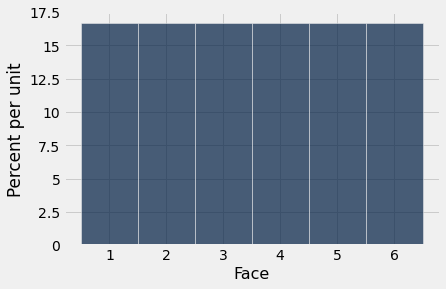
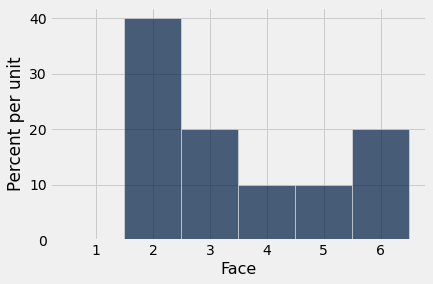
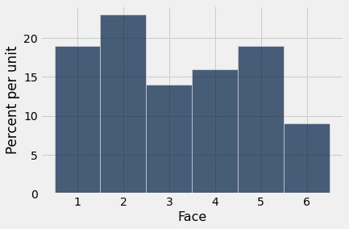
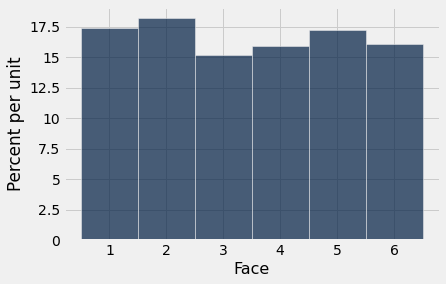

# 경험적 분포(empirical distribution)

데이터 과학(data science)에서 "경험적(empirical)"이라는 단어는 "관측된(observed)"이라는 뜻이다. 경험적 분포(empirical distribution)는 무작위 표본(random sample)의 데이터와 같이 관측된 데이터의 분포(distribution)이다.

이 절에서는 데이터를 생성하고 경험적 분포(empirical distribution)가 어떤 모습인지 살펴본다.

우리가 다룰 상황은 간단한 실험이다. 주사위를 여러 번 굴려서 어떤 면이 나오는지 기록하는 것이다. 테이블 `die`에는 주사위 각 면의 눈의 수가 들어 있다. 주사위가 공정하다고 가정하므로 모든 수가 정확히 한 번씩 나타난다.

```python
from datascience import *
path_data = '../../../assets/data/'
import matplotlib
matplotlib.use('Agg')
%matplotlib inline
import matplotlib.pyplot as plots
plots.style.use('fivethirtyeight')
import numpy as np
```

```python
die = Table().with_column('Face', np.arange(1, 7, 1))
die
```

<table border="1" class="dataframe">
    <thead>
        <tr>
            <th>Face</th>
        </tr>
    </thead>
    <tbody>
        <tr>
            <td>1   </td>
        </tr>
        <tr>
            <td>2   </td>
        </tr>
        <tr>
            <td>3   </td>
        </tr>
        <tr>
            <td>4   </td>
        </tr>
        <tr>
            <td>5   </td>
        </tr>
        <tr>
            <td>6   </td>
        </tr>
    </tbody>
</table>

## 확률 분포(probability distribution)

아래 히스토그램(histogram)은 모든 면이 1/6의 확률로 나온다는 사실을 시각화하는 데 도움이 된다. 이 히스토그램은 가능한 모든 면에 걸친 확률의 *분포*(distribution)를 보여 준다고 말한다. 모든 막대가 같은 백분율 확률을 나타내므로, 이 분포를 *1부터 6까지의 정수 위의 균등(uniform) 분포*라고 한다.

```python
die_bins = np.arange(0.5, 6.6, 1)
die.hist(bins = die_bins)
```



주사위 굴리기의 결과값처럼(연속된 값의 차이가 1) 연속된 값들이 같은 고정된 간격으로 떨어져 있는 변수(variable)는 *이산*(discrete) 변수라고 불리는 변수의 범주에 속한다. 위의 히스토그램(histogram)은 *이산* 히스토그램이라고 한다. 그 구간(bin)은 배열 `die_bins`로 지정되며, 각 막대가 해당 정수 값 위에 중심을 두도록 한다.

주사위는 1.3개나 5.2개의 눈을 보여 줄 수 없고 항상 정수 개의 눈을 보여 준다는 점을 기억하는 것이 중요하다. 그러나 우리의 시각화는 각 값의 확률(probability)을 막대의 넓이에 걸쳐 펼쳐 놓는다. 이 강좌의 현 단계에서는 이것이 다소 임의적으로 보일 수 있지만, 나중에 이산 히스토그램(discrete histogram) 위에 매끄러운 곡선을 겹쳐 그릴 때 중요해진다.

더 나아가기 전에 축에 표시된 숫자들이 타당한지 확인해 보자. 각 면의 확률(probability)은 1/6이며, 소수점 둘째 자리까지 반올림하면 16.67%이다. 각 구간(bin)의 너비는 1단위이다. 따라서 각 막대의 높이는 단위당 16.67%이다. 이는 그래프의 가로축과 세로축 눈금과 일치한다.

## 경험적 분포(empirical distribution)
위의 분포(distribution)는 각 면의 이론적 확률로 이루어져 있다. 이것을 *확률 분포*(probability distribution)라고 하며, 관측된 데이터에 기반하지 않는다. 주사위를 한 번도 굴리지 않고도 이를 연구하고 이해할 수 있다.

반면 *경험적 분포*(empirical distribution)는 관측된 데이터의 분포(distribution)이다. 경험적 분포는 *경험적 히스토그램*(empirical histogram)으로 시각화할 수 있다.

주사위 굴리기를 시뮬레이션(simulation)하여 데이터를 얻어 보자. 이는 1부터 6까지의 정수에서 복원 무작위 표본추출(random sampling with replacement)을 하여 수행할 수 있다. 이전에 이러한 시뮬레이션에 `np.random.choice`를 사용한 적이 있다. 하지만 이제 이를 위한 Table 메서드(method)를 소개한다. 이렇게 하면 익숙한 Table 메서드를 시각화에 사용하기가 더 쉬워진다.

이 Table 메서드(method)는 `sample`이다. 이 메서드는 테이블의 행들에서 복원 무작위 추출(random draw with replacement)을 한다. 인수는 표본 크기(sample size)이며, 선택된 행들로 이루어진 테이블을 반환한다. 선택적 인수 `with_replacement=False`는 표본을 비복원으로 추출하도록 지정한다. 그러나 주사위 굴리기에는 이것이 적용되지 않는다.

다음은 주사위를 10번 굴린 결과이다.

```python
die.sample(10)
```

<table border="1" class="dataframe">
    <thead>
        <tr>
            <th>Face</th>
        </tr>
    </thead>
    <tbody>
        <tr>
            <td>2   </td>
        </tr>
        <tr>
            <td>4   </td>
        </tr>
        <tr>
            <td>5   </td>
        </tr>
        <tr>
            <td>5   </td>
        </tr>
        <tr>
            <td>1   </td>
        </tr>
        <tr>
            <td>6   </td>
        </tr>
        <tr>
            <td>1   </td>
        </tr>
        <tr>
            <td>4   </td>
        </tr>
        <tr>
            <td>6   </td>
        </tr>
        <tr>
            <td>5   </td>
        </tr>
    </tbody>
</table>

같은 메서드(method)를 사용하여 원하는 만큼 주사위 굴리기를 시뮬레이션(simulation)한 다음, 그 결과의 경험적 히스토그램(empirical histogram)을 그릴 수 있다. 이 작업을 반복해서 할 것이므로, 표본 크기(sample size)를 인수로 받아 그 횟수만큼 주사위를 굴린 다음 관측된 결과의 히스토그램을 그리는 함수 `empirical_hist_die`를 정의한다.

```python
def empirical_hist_die(n):
    die.sample(n).hist(bins = die_bins)
```

## 경험적 히스토그램(empirical histogram)

다음은 10번 굴린 결과의 경험적 히스토그램(empirical histogram)이다. 위의 확률 히스토그램(probability histogram)과 그다지 비슷해 보이지 않는다. 셀을 여러 번 실행하여 어떻게 달라지는지 확인해 보자.

```python
empirical_hist_die(10)
```



표본 크기(sample size)가 커지면 경험적 히스토그램(empirical histogram)은 이론적 확률의 히스토그램과 점점 더 비슷해지기 시작한다.

```python
empirical_hist_die(100)
```



```python
empirical_hist_die(1000)
```



시뮬레이션(simulation)에서 굴리는 횟수를 늘릴수록 각 막대의 넓이는 확률 히스토그램(probability histogram)의 각 막대 넓이인 16.67%에 점점 더 가까워진다.

## 평균의 법칙(law of averages)

위에서 관찰한 것은 *평균의 법칙*(law of averages)이라고 불리는 일반적인 규칙의 한 사례이다.

우연 실험(chance experiment)을 독립적으로 동일한 조건에서 반복하면, 장기적으로 어떤 사건(event)이 일어나는 횟수의 비율은 그 사건의 이론적 확률(probability)에 점점 더 가까워진다.

예를 들어, 장기적으로 눈이 네 개인 면이 나오는 횟수의 비율은 1/6에 점점 더 가까워진다.

여기서 "독립적으로 동일한 조건에서"란 다른 모든 반복의 결과와 관계없이 모든 반복이 같은 방식으로 수행된다는 뜻이다.

이러한 조건에서 위의 법칙은, 우연 실험(chance experiment)을 매우 많이 반복하면 어떤 사건(event)이 일어나는 횟수의 비율이 그 사건의 이론적 확률(probability)에 가까울 가능성이 매우 높다는 것을 의미한다.
