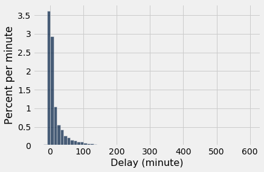
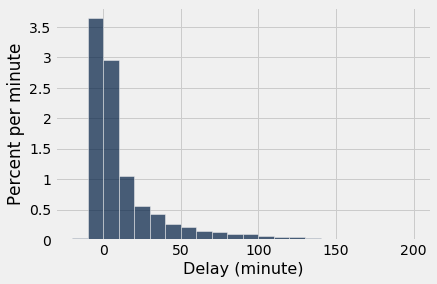
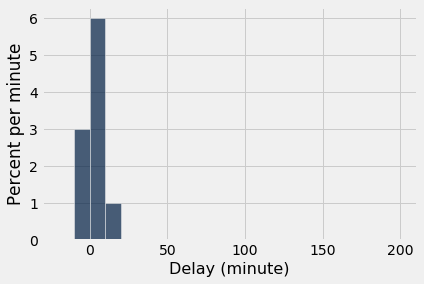
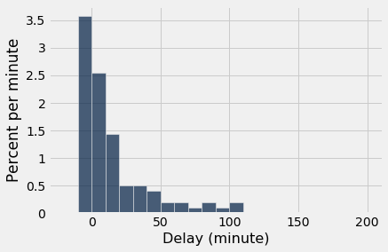
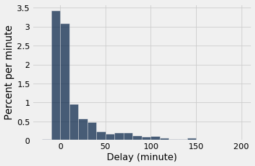

# 모집단(population)으로부터의 표본추출(sampling)

평균의 법칙(law of averages)은 큰 모집단(population)의 개체들로부터 무작위 표본(random sample)을 추출할 때에도 성립한다.

예로서 항공편 지연 시간의 모집단(population)을 살펴보겠다. 테이블 `united`에는 2015년 여름 샌프란시스코(San Francisco)에서 출발한 유나이티드 항공(United Airlines) 국내선 항공편의 데이터가 들어 있다. 이 데이터는 미국 교통부(United States Department of Transportation) 산하 [교통통계국(Bureau of Transportation Statistics)](http://www.transtats.bts.gov/Fields.asp?Table_ID=293)이 공개한 것이다.

행은 13,825개이며 각 행은 항공편 하나에 해당한다. 열은 운항 날짜, 항공편 번호, 목적지 공항 코드, 분 단위의 출발 지연 시간이다. 일부 지연 시간은 음수인데, 이는 해당 항공편이 일찍 출발했다는 뜻이다.

```python
from datascience import *
path_data = '../../../assets/data/'
import matplotlib
matplotlib.use('Agg')
%matplotlib inline
import matplotlib.pyplot as plots
plots.style.use('fivethirtyeight')
import numpy as np
```

```python
united = Table.read_table(path_data + 'united_summer2015.csv')
united
```

<table border="1" class="dataframe">
    <thead>
        <tr>
            <th>Date</th> <th>Flight Number</th> <th>Destination</th> <th>Delay</th>
        </tr>
    </thead>
    <tbody>
        <tr>
            <td>6/1/15</td> <td>73           </td> <td>HNL        </td> <td>257  </td>
        </tr>
        <tr>
            <td>6/1/15</td> <td>217          </td> <td>EWR        </td> <td>28   </td>
        </tr>
        <tr>
            <td>6/1/15</td> <td>237          </td> <td>STL        </td> <td>-3   </td>
        </tr>
        <tr>
            <td>6/1/15</td> <td>250          </td> <td>SAN        </td> <td>0    </td>
        </tr>
        <tr>
            <td>6/1/15</td> <td>267          </td> <td>PHL        </td> <td>64   </td>
        </tr>
        <tr>
            <td>6/1/15</td> <td>273          </td> <td>SEA        </td> <td>-6   </td>
        </tr>
        <tr>
            <td>6/1/15</td> <td>278          </td> <td>SEA        </td> <td>-8   </td>
        </tr>
        <tr>
            <td>6/1/15</td> <td>292          </td> <td>EWR        </td> <td>12   </td>
        </tr>
        <tr>
            <td>6/1/15</td> <td>300          </td> <td>HNL        </td> <td>20   </td>
        </tr>
        <tr>
            <td>6/1/15</td> <td>317          </td> <td>IND        </td> <td>-10  </td>
        </tr>
    </tbody>
</table>
<p>... (13815 rows omitted)</p>

한 항공편은 16분 일찍 출발했고, 한 항공편은 580분 늦게 출발했다. 아래 히스토그램(histogram)에서 볼 수 있듯이, 나머지 지연 시간은 거의 모두 -10분에서 200분 사이였다.

```python
united.column('Delay').min()
```

```
-16
```

```python
united.column('Delay').max()
```

```
580
```

```python
delay_bins = np.append(np.arange(-20, 301, 10), 600)
united.hist('Delay', bins = delay_bins, unit = 'minute')
```



이 절의 목적상, 데이터의 대부분을 확대해서 보고 지연 시간이 200분을 넘은 0.8%의 항공편은 무시해도 충분하다. 이러한 제한은 시각적 편의를 위한 것일 뿐이며, 테이블에는 여전히 모든 데이터가 남아 있다.

```python
united.where('Delay', are.above(200)).num_rows/united.num_rows
```

```
0.008390596745027125
```

```python
delay_bins = np.arange(-20, 201, 10)
united.hist('Delay', bins = delay_bins, unit = 'minute')
```



[0, 10) 막대의 높이는 분당 3%를 약간 밑도는데, 이는 항공편의 30% 약간 미만이 0분에서 10분 사이로 지연되었다는 뜻이다. 행의 수를 세어 보면 이를 확인할 수 있다.

```python
united.where('Delay', are.between(0, 10)).num_rows/united.num_rows
```

```
0.2935985533453888
```

## 표본(sample)의 경험적 분포(empirical distribution)

이제 13,825개의 항공편을 모집단(population)으로 생각하고, 여기서 복원 추출(sampling with replacement)로 무작위 표본(random sample)을 뽑아 보자. 코드를 함수로 묶어 두면 편리하다. 함수 `empirical_hist_delay`는 표본 크기(sample size)를 인수로 받아 결과의 경험적 히스토그램(empirical histogram)을 그린다.

```python
def empirical_hist_delay(n):
    united.sample(n).hist('Delay', bins = delay_bins, unit = 'minute')
```

주사위에서 보았듯이, 표본 크기(sample size)가 커질수록 표본의 경험적 히스토그램(empirical histogram)은 모집단(population)의 히스토그램과 더 비슷해진다. 이 히스토그램들을 위의 모집단 히스토그램과 비교해 보자.

```python
empirical_hist_delay(10)
```



```python
empirical_hist_delay(100)
```



가장 일관되게 눈에 띄는 차이는 모집단(population)에서 드물게 나타나는 값들에서 생긴다. 이 예에서 그러한 값들은 분포(distribution)의 오른쪽 꼬리에 있다. 그러나 표본 크기(sample size)가 커지면 그러한 값들조차도 표본에 대략 올바른 비율로 나타나기 시작한다.

```python
empirical_hist_delay(1000)
```



## 표본(sample)의 경험적 히스토그램(empirical histogram)의 수렴(convergence)
이 절에서 관찰한 내용은 다음과 같이 요약할 수 있다.

큰 무작위 표본(random sample)의 경우, 표본의 경험적 히스토그램(empirical histogram)은 높은 확률로 모집단(population)의 히스토그램과 비슷하다.

이는 통계적 추론(statistical inference)에서 큰 무작위 표본(random sample)을 사용하는 것을 정당화한다. 큰 무작위 표본은 그것이 추출된 모집단(population)과 비슷할 가능성이 높으므로, 표본의 값들로부터 계산한 양은 모집단의 대응하는 양에 가까울 가능성이 높다는 것이 그 아이디어이다.
