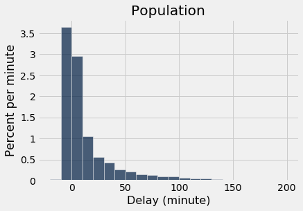
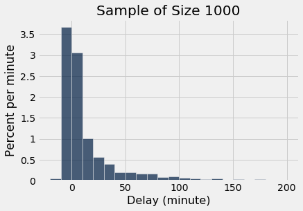
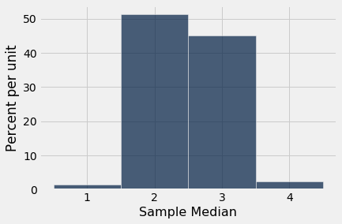

# 통계량(statistic)의 경험적 분포(empirical distribution)
평균의 법칙(law of averages)에 따르면, 큰 무작위 표본(random sample)의 경험적 분포(empirical distribution)는 높은 확률로 그 표본이 추출된 모집단(population)의 분포와 비슷할 것이다.

이러한 유사성은 두 히스토그램(histogram)에서 볼 수 있다. 큰 무작위 표본(random sample)의 경험적 히스토그램(empirical histogram)은 모집단(population)의 히스토그램과 비슷할 가능성이 높다.

다시 상기해 보면, 다음은 `united`에 있는 모든 항공편의 지연 시간 히스토그램(histogram)과, 이 항공편 중 1,000개를 무작위 표본(random sample)으로 뽑은 지연 시간의 경험적 히스토그램(empirical histogram)이다.

```python
from datascience import *
%matplotlib inline
path_data = '../../../assets/data/'
import matplotlib.pyplot as plots
plots.style.use('fivethirtyeight')
import numpy as np
```

```python
united = Table.read_table(path_data + 'united_summer2015.csv')
```

```python
delay_bins = np.arange(-20, 201, 10)
united.hist('Delay', bins = delay_bins, unit = 'minute')
plots.title('Population');
```



```python
sample_1000 = united.sample(1000)
sample_1000.hist('Delay', bins = delay_bins, unit = 'minute')
plots.title('Sample of Size 1000');
```



두 히스토그램(histogram)은 동일하지는 않지만 분명히 서로 비슷하다.

## 모수(parameter)
우리는 흔히 모집단(population)과 관련된 수치적 양에 관심을 가진다.
- 유권자 모집단에서 후보 A에게 투표할 사람의 비율은 몇 퍼센트인가?
- 페이스북(Facebook) 사용자 모집단에서 사용자들이 가진 페이스북 친구 수의 최댓값은 얼마인가?
- 유나이티드(United) 항공편 모집단에서 출발 지연 시간의 중앙값(median)은 얼마인가?

모집단(population)과 관련된 수치적 양을 *모수*(parameter)라고 한다. `united`에 있는 항공편 모집단에 대해서는 모수 "지연 시간의 중앙값(median)"의 값을 알고 있다.

```python
np.median(united.column('Delay'))
```

```
2.0
```

`NumPy` 함수 `median`은 배열의 중앙값(median), 즉 한가운데 지점을 반환한다. `united`의 모든 항공편 중 지연 시간의 중앙값은 2분이었다. 즉, 모집단(population)의 항공편 중 약 50%가 2분 이하로 지연되었다.

```python
united.where('Delay', are.below_or_equal_to(2)).num_rows / united.num_rows
```

```
0.5018444846292948
```

전체 항공편의 절반이 예정된 출발 시각보다 2분 이내로 늦게 출발했다. 아주 짧은 지연이다!

**참고.** 이 비율이 정확히 50%가 아닌 것은 "동점(ties)", 즉 지연 시간이 정확히 2분인 항공편들 때문이다. 그러한 항공편은 480개였다. 데이터 세트(data set)에서 동점은 매우 흔하며, 이 강좌에서는 이에 대해 신경 쓰지 않는다.

```python
united.where('Delay', are.equal_to(2)).num_rows
```

```
480
```

## 통계량(statistic)
많은 상황에서 우리는 알려지지 않은 모수(parameter)의 값을 알아내는 데 관심을 가진다. 이를 위해 모집단(population)에서 추출한 큰 무작위 표본(random sample)의 데이터에 의존한다.

*통계량*(statistic, 단수형임에 유의하라!)은 표본(sample)의 데이터를 사용하여 계산한 임의의 수이다. 따라서 표본 중앙값(sample median)은 통계량이다.

`sample_1000`에는 `united`에서 뽑은 1000개 항공편의 무작위 표본(random sample)이 들어 있다는 것을 기억하자. 표본 중앙값(sample median)의 관측값은 다음과 같다.

```python
np.median(sample_1000.column('Delay'))
```

```
2.0
```

우리의 표본(sample), 즉 1,000개 항공편으로 이루어진 하나의 집합은 통계량(statistic)의 관측값 하나를 주었다. 이는 추론(inference)의 중요한 문제를 제기한다.

**통계량(statistic)은 다르게 나올 수도 있었다.**
무작위 표본(random sample)에 기반한 통계량을 사용할 때 근본적으로 고려해야 할 점은 *표본이 다르게 나올 수도 있었고*, 따라서 통계량 역시 다르게 나올 수도 있었다는 것이다.

```python
np.median(united.sample(1000).column('Delay'))
```

```
3.0
```

위의 셀을 여러 번 실행하여 답이 어떻게 달라지는지 확인해 보자. 모집단 모수(population parameter)의 값과 같은 2인 경우가 많다. 하지만 때로는 다르다.

**통계량(statistic)은 얼마나 다르게 나올 수 있었을까?** 이 질문에 답하는 한 가지 방법은 통계량을 여러 번 시뮬레이션(simulation)하고 그 값들을 기록하는 것이다. 그 값들의 히스토그램(histogram)은 통계량의 분포(distribution)에 대해 알려 줄 것이다.

시뮬레이션(simulation)의 주요 단계를 다시 떠올려 보자.

## 통계량(statistic)의 시뮬레이션(simulation)
앞 장에서 시뮬레이션(simulation)을 처음 공부할 때 정한 단계에 따라 표본 중앙값(sample median)을 시뮬레이션하겠다. 표본 크기(sample size) 1000을 다른 어떤 표본 크기로 바꾸어도 되고, 표본 중앙값을 다른 어떤 통계량(statistic)으로 바꾸어도 된다.

**1단계: 어떤 통계량(statistic)을 시뮬레이션(simulation)할지 정한다.** 이는 이미 정했다. 항공편 지연 시간의 모집단(population)에서 추출한 크기 1000인 무작위 표본(random sample)의 중앙값(median)을 시뮬레이션할 것이다.

**2단계: 통계량(statistic)의 시뮬레이션된 값 하나를 반환하는 함수를 정의한다.** 크기 1000인 무작위 표본(random sample)을 추출하고 표본의 중앙값(median)을 계산한다. 위의 코드 셀에서 이미 이 작업을 했다. 여기서는 이를 함수로 감싸서 다시 작성한다.

```python
def random_sample_median():
    return np.median(united.sample(1000).column('Delay'))
```

**3단계: 시뮬레이션된 값을 몇 개 생성할지 정한다.** 5,000번 반복하자.

**4단계: `for` 루프를 사용하여 시뮬레이션된 값들의 배열을 생성한다.** 늘 그렇듯이 결과를 모을 빈 배열을 만드는 것부터 시작한다. 그런 다음 시뮬레이션된 값을 모두 생성하는 `for` 루프를 설정한다. 루프 본문에서는 표본 중앙값(sample median)의 시뮬레이션된 값 하나를 생성하여 결과를 모으는 배열에 추가한다.

이 시뮬레이션(simulation)은 실행하는 데 상당한 시간이 걸린다. 크기 1000인 표본(sample)을 추출하고 그 중앙값(median)을 계산하는 과정을 5000번 반복하기 때문이다. 표본추출과 반복을 아주 많이 하는 셈이다!

```python
medians = make_array()

for i in np.arange(5000):
    medians = np.append(medians, random_sample_median())
```

시뮬레이션(simulation)이 끝났다. 시뮬레이션된 5,000개의 표본 중앙값(sample median)이 모두 배열 `medians`에 모였다. 이제 결과를 시각화할 차례이다.

## 시각화(visualization)

다음은 테이블 `simulated_medians`에 표시된, 시뮬레이션된 무작위 표본 중앙값(sample median)들이다.

```python
simulated_medians = Table().with_column('Sample Median', medians)
simulated_medians
```

<table border="1" class="dataframe">
    <thead>
        <tr>
            <th>Sample Median</th>
        </tr>
    </thead>
    <tbody>
        <tr>
            <td>2            </td>
        </tr>
        <tr>
            <td>3            </td>
        </tr>
        <tr>
            <td>1            </td>
        </tr>
        <tr>
            <td>3            </td>
        </tr>
        <tr>
            <td>2            </td>
        </tr>
        <tr>
            <td>2.5          </td>
        </tr>
        <tr>
            <td>3            </td>
        </tr>
        <tr>
            <td>3            </td>
        </tr>
        <tr>
            <td>3            </td>
        </tr>
        <tr>
            <td>2            </td>
        </tr>
    </tbody>
</table>
<p>... (4990 rows omitted)</p>

시뮬레이션된 데이터를 히스토그램(histogram)으로 시각화할 수도 있다. 이 히스토그램을 *통계량의 경험적 히스토그램*(empirical histogram of the statistic)이라고 한다. 이는 통계량의 *경험적 분포*(empirical distribution)를 보여 준다. *경험적*이란 *관측된*이라는 뜻임을 기억하자.

```python
simulated_medians.hist(bins=np.arange(0.5, 5, 1))
```



표본 중앙값(sample median)이 모집단 중앙값인 2 근처일 가능성이 매우 높다는 것을 알 수 있다. 1000개의 항공편 지연 시간으로 이루어진 표본(sample)은 지연 시간의 모집단(population)과 비슷할 가능성이 높으므로, 그러한 표본들의 지연 시간 중앙값이 모집단의 지연 시간 중앙값에 가까운 것은 놀라운 일이 아니다.

이는 통계량(statistic)이 모수(parameter)의 좋은 추정값(estimate)을 제공할 수 있음을 보여 주는 한 예이다.

## 시뮬레이션(simulation)의 힘

크기 1000인 가능한 모든 무작위 표본(random sample)을 생성할 수 있다면, 통계량(statistic), 즉 표본 중앙값의 가능한 모든 값과 그 값들 각각의 확률(probability)을 알 수 있을 것이다. 그러면 모든 값과 확률을 통계량의 확률 히스토그램(probability histogram)으로 시각화할 수 있을 것이다.

그러나 이 경우를 포함한 많은 상황에서 가능한 모든 표본(sample)의 수는 컴퓨터의 처리 능력을 넘어설 만큼 크며, 확률(probability)을 순수하게 수학적으로 계산하는 것은 다루기 어려울 정도로 힘들 수 있다.

바로 여기서 경험적 히스토그램(empirical histogram)이 필요해진다.

평균의 법칙(law of averages)에 따라, 표본 크기(sample size)가 크고 무작위 표본추출(random sampling) 과정을 여러 번 반복하면 통계량(statistic)의 경험적 히스토그램(empirical histogram)은 통계량의 확률 히스토그램(probability histogram)과 비슷할 가능성이 높다는 것을 알고 있다.

이는 무작위 과정을 반복적으로 시뮬레이션(simulation)하는 것이 *확률을 수학적으로 알아내거나 가능한 모든 무작위 표본을 생성하지 않고도* 확률 분포(probability distribution)를 근사하는 방법이라는 뜻이다. 따라서 컴퓨터 시뮬레이션은 데이터 과학(data science)에서 강력한 도구가 된다. 컴퓨터 시뮬레이션은 다른 방법으로는 분석하기 복잡한 확률적 양(random quantity)의 성질을 데이터 과학자가 이해하는 데 도움을 줄 수 있다.
