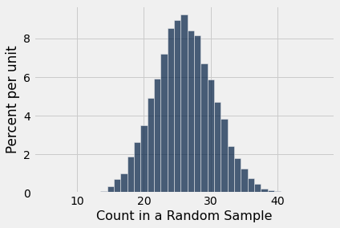
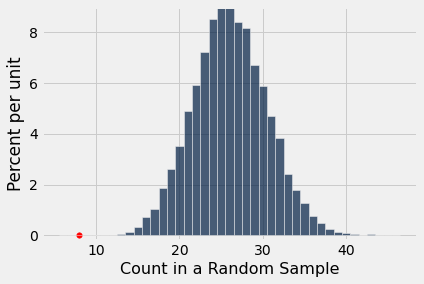

# 모형(model) 평가하기 #
데이터 과학에서 *모형*(model)이란 데이터에 관한 가정들의 집합이다. 모형에는 흔히 데이터를 생성하는 데 사용된 우연 과정(chance process)에 관한 가정이 포함된다.

때때로 데이터 과학자는 어떤 모형이 좋은지 아닌지를 결정해야 한다. 이 절에서는 그러한 결정을 내리는 예를 살펴본다.

```python
from datascience import *
%matplotlib inline
path_data = '../../../../assets/data/'
import matplotlib.pyplot as plots
plots.style.use('fivethirtyeight')
import numpy as np
```

## 배심원 선정 ##

데이터 과학은 우리 사회의 인종차별과 불평등을 드러내는 강력한 도구가 될 수 있다. 이 절에서는 데이터가 배심원 선정 과정에서의 인종적 편향(bias)에 대한 증거를 제공한 사건을 다룬다.

미국 수정헌법 제6조는 "모든 형사 소추에서 피고인은 범죄가 발생한 주(State)와 지역의 공정한 배심원단에 의한 신속한 공개 재판을 받을 권리를 가진다"라고 규정한다.

*공정한* 배심원단의 한 가지 특징은 해당 지역의 모집단(population)을 대표하는 배심원 후보단(jury panel)에서 선정되어야 한다는 것이다. 배심원 후보단이란 예비 배심원으로 선택된 사람들의 집단이다. 최종 재판 배심원단은 이들 가운데에서 의도적인 포함 또는 제외를 통해 선정되므로 어떤 구성이든 될 수 있다. 그러나 재판 배심원이 뽑히는 더 큰 후보단은 반드시 모집단을 대표해야 한다.

배심원 후보단이 실제로 한 지역의 모집단을 대표하는지에 대한 질문은 중요한 법적 함의를 가진다. 만약 모집단의 어떤 집단이 배심원 후보단에서 체계적으로 과소대표되었다면, 배심원단이 공정했는지, 따라서 피고인이 적법 절차를 보장받았는지에 대한 의문이 제기될 수 있다.

이것이 바로 1962년 앨라배마주 탈라디가 카운티(Talladega County)에서 유죄 판결을 받은 흑인 남성 로버트 스웨인(Robert Swain)의 연방대법원 사건에서 쟁점이 된 질문이었다. 그는 탈라디가 카운티에서 흑인이 배심원단에서 체계적으로 배제되었다는 이유로 미국 연방대법원까지 기소에 불복하여 상고하였다. 연방대법원은 그의 상고를 기각했고, 로버트 스웨인은 이후 종신형을 선고받았다.

그러나 아래의 분석은 데이터가 법원이 내린 결론과 일치하지 않음을 보여 준다. 오히려 데이터는 배심원 선정 과정에 편향(bias)이 있었음을 가리킨다. 형사 사법 제도의 이러한 편향은 당시 흑인에 대해 만연했던 편견과 불의를 반영한 것이었다.

먼저 수치의 세부 사항부터 살펴보자. 재판 당시 탈라디가 카운티에서는 21세 이상의 남성만 배심원으로 봉사할 자격이 있었다. 그 모집단(population)에서 남성의 26%가 흑인이었다. 배심 재판에서 흔히 그러하듯, 로버트 스웨인 재판의 배심원들은 배심원 자격이 있는 사람들의 모집단을 대표하도록 되어 있는 후보단에서 선정되었다. 그러나 100명으로 이루어진 후보단 가운데 흑인은 8명(즉 8%)에 불과했다.

로버트 스웨인은 상고의 일부로 이 불일치에 문제를 제기했다. 더 나아가 그는 지난 10년 동안 탈라디가 카운티의 모든 배심원 후보단에 흑인 후보가 아주 적은 비율로만 포함되어 있었다고 지적했다.

미국 연방대법원은 상고를 검토하고 "전반적인 비율 격차는 작았다"라고 결론지었다. 그러나 이 주장은 합리적이었을까? 만약 배심원 후보가 카운티의 자격 있는 모집단(population)에서 무작위로 선정되었다면 어느 정도의 우연에 의한 변동(chance variation)이 있을 것이다. 100명으로 구성된 모든 후보단에서 정확히 26명의 흑인 후보가 나오지는 않을 것이다. 하지만 8명만큼 적은 수를 예상할 수 있을까?

답은 '아니오'이다. 이를 입증한 다음, 관련된 여러 편향(bias) 가운데 몇 가지를 논의할 것이다.

## 무작위 선정 모형(model) ##

데이터를 바라보는 한 가지 관점, 다시 말해 하나의 모형(model)은 후보단이 무작위로 선정되었고 단지 우연에 의해 흑인 후보가 적게 포함되었다는 것이다.

후보단은 배심원 자격이 있는 모든 사람의 모집단(population)과 닮도록 되어 있었으므로, 무작위 선정 모형(model)을 평가하는 것은 중요하다. 이 모형이 면밀한 검토를 견뎌 내는지 살펴보자.

이 모형(model)은 우연 과정(chance process)의 세부 사항을 명시한다. 모형에 따르면 데이터는 26%가 흑인인 모집단(population)에서 뽑은 무작위 표본(random sample)과 같다. 다음과 같은 이유로 우리는 이 모형을 평가하기에 좋은 위치에 있다.

- 모형(model)에 근거하여 데이터를 시뮬레이션(simulation)할 수 있다. 즉 26%가 흑인인 모집단(population)에서 무작위로 뽑는 과정을 시뮬레이션할 수 있다.
- 시뮬레이션은 후보단이 무작위로 선정되었다***면*** 어떤 모습일지를 보여 줄 것이다.
- 그런 다음 시뮬레이션 결과를 실제 배심원 후보단의 구성과 비교할 수 있다.
- 시뮬레이션 결과가 재판 후보단의 구성과 일치하지 않는다면, 이는 무작위 선정 모형에 반하는 증거가 된다. 따라서 그것은 재판의 공정성에 반하는 증거가 될 것이다.

이 과정을 단계별로 진행해 보자.

## 통계량(statistic) ##
먼저 시뮬레이션할 통계량(statistic)을 선택해야 한다. 통계량은 모형(model)과 데이터에 관한 대안적 관점 사이에서 판단하는 데 도움이 되어야 한다. 모형은 후보단이 자격 있는 모집단(population)에서 무작위로 뽑혔다고 말한다. 대안적 관점은 로버트 스웨인 측의 주장으로, 후보단에 흑인 후보가 너무 적어서 무작위로 뽑혔다고 볼 수 없다는 것이다. 그렇다면 자연스러운 통계량은 표본(sample)에 포함된 흑인 후보의 수, 즉 *개수*(count)이다. 통계량의 값이 작으면 로버트 스웨인의 관점에 유리하다.

## 모형(model) 하에서 통계량(statistic) 시뮬레이션하기 ##
모형(model)이 참이라면 통계량(statistic)은 일반적으로 얼마나 클까? 이에 답하기 위해 무작위 선정이라는 가정 하에서 통계량을 시뮬레이션(simulation)하고 그 결과의 분포(distribution)를 살펴볼 것이다.

### 통계량(statistic)의 값 하나 시뮬레이션하기 ###

`sample_proportions`를 사용하여 통계량(statistic)의 값 하나를 시뮬레이션할 수 있다. 표본 크기(sample size)는 후보단의 크기인 100이다. 표본을 추출할 분포(distribution)는 배심원 자격이 있는 사람들의 모집단(population)에서의 분포이다. 그중 26%가 흑인이었으므로, 비율 [0.26, 0.74]로 지정된 분포에서 표본을 추출할 것이다.

```python
sample_size = 100
eligible_population = [0.26, 0.74]
```

`sample_proportions`의 출력 배열에서 범주들은 입력 배열과 같은 순서로 나열된다. 따라서 무작위 표본(random sample)에서 흑인 후보의 비율은 출력 배열의 `item(0)`이다. 아래 셀을 여러 번 실행하여 무작위로 선정된 후보단에서 흑인 배심원의 표본 비율이 어떻게 달라지는지 확인해 보라. 0.08만큼 낮은 값이 나오는가?

```python
sample_proportions(sample_size, eligible_population).item(0)
```

```
0.27
```

각 범주의 개수는 표본 크기(sample size)에 해당 비율을 곱한 값이다. 따라서 비율 대신 개수를 시뮬레이션하는 것도 마찬가지로 쉽다.

이를 수행하는 함수를 정의해 보자. 이 함수는 후보단을 무작위로 뽑고 흑인 후보의 수를 반환한다.

```python
def one_simulated_count():
    return sample_size * sample_proportions(sample_size, eligible_population).item(0)
```

### 통계량(statistic)의 값 여러 개 시뮬레이션하기 ###

이 분석의 초점은 개수의 변동성이다. 개수의 시뮬레이션(simulation) 값을 10,000개 생성하고 그 값들이 어떻게 변하는지 살펴보자. 늘 그렇듯이 `for` 루프를 사용하고 시뮬레이션된 모든 개수를 배열에 모아서 이를 수행할 것이다.

```python
counts = make_array()
repetitions = 10000
for i in np.arange(repetitions):
    counts = np.append(counts, one_simulated_count())
```

## 무작위 선정 모형(model) 하에서의 예측 ##
시뮬레이션(simulation) 결과를 해석하기 위해, 시뮬레이션된 개수의 경험적 히스토그램(empirical histogram)으로 결과를 시각화할 수 있다.

```python
Table().with_column(
    'Count in a Random Sample', counts
).hist(bins = np.arange(5.5, 46.6, 1))
```



이 히스토그램(histogram)은 무작위 선정 모형(model)이 우리의 통계량(statistic), 즉 표본(sample)에 포함된 흑인 후보의 수에 대해 무엇을 예측하는지 보여 준다.

시뮬레이션(simulation)된 각 개수를 생성하기 위해 26%가 흑인인 모집단(population)에서 무작위로 100번 뽑았다. 따라서 예상할 수 있듯이 시뮬레이션된 개수 대부분은 26 근처에 있다. 정확히 26은 아니며 어느 정도의 변동이 있다. 개수는 대략 15에서 40 사이의 범위에 있다.

## 예측과 데이터 비교하기 ##
재판을 위해 선정된 후보단에는 8명의 흑인 후보가 있었다. 아래에 시뮬레이션(simulation)된 개수의 히스토그램(histogram)을 다시 그리고, 값 8을 가로축 위에 빨간 점으로 표시했다. 이 점은 히스토그램의 왼쪽 꼬리 아주 먼 곳에 있다. 무작위 선정으로 시뮬레이션된 10,000개의 개수 가운데 8 이하로 나온 경우는 극히 드물다.

```python
Table().with_column(
    'Count in a Random Sample', counts
).hist(bins = np.arange(5.5, 46.6, 1))
plots.ylim(-0.002, 0.09)
plots.scatter(8, 0, color='red', s=30);
```



## 데이터 분석의 결론 ##

위의 그래프는 선정 과정에 존재하는 편향(bias)을 시각적으로 보여 준다. 이 그래프는 자격 있는 모집단(population)에서 크기 100인 후보단을 무작위로 선정한다면, 재판 후보단에서 관측된 8명만큼 적은 흑인 후보 수를 얻을 가능성은 매우 낮다는 것을 보여 준다.

이는 후보단 배심원의 무작위 선정 모형(model)이 후보단의 데이터와 일치하지 않는다는 증거이다. 후보단이 우연에 의해 생성되었을 *가능성*이 있기는 하지만, 우리의 시뮬레이션(simulation)은 그것이 극도로 일어나기 어렵다는 것을 보여 준다.

재판 후보단의 실제 모습은 자격 있는 모집단(population)에서 무작위로 선정했다는 모형(model)의 가정과 크게 어긋난다. 데이터와 모형이 일치하지 않으면 모형을 정당화하기 어렵다. 결국 데이터는 실제이다. 모형은 가정들의 집합일 뿐이다. 가정이 현실과 어긋날 때 우리는 그 가정을 의심해야 한다.

따라서 가장 합리적인 결론은 이 배심원 후보단에 대해 무작위 선정이라는 가정이 정당화되지 않는다는 것이다. 다시 말해, 가장 합리적인 결론은 배심원 후보단이 배심원 자격이 있는 사람들의 모집단(population)에서 무작위 표본추출(random sampling)로 선정되지 *않았다*는 것이다. 연방대법원의 견해에도 불구하고, 26%와 8%의 차이는 우연만으로 잘 설명될 만큼 작지 않다.

## 통계적 편향(statistical bias) ##

위의 분석은 로버트 스웨인의 재판이 불공정했다는 정량적 증거를 제공한다. 데이터는 그가 미국 헌법이 보장하는 공정한 배심원단을 거부당했다는 그의 입장을 뒷받침한다.

추가 데이터는 흑인 후보의 배제가 만연했음을 보여 준다. 1965년에 작성된 연방대법원 판결문에는 로버트 스웨인이 제출한 증거가 포함되어 있는데, 그에 따르면 "1953년 이후 배심원 명부함에서 뽑힌 … 배심원 후보단의 10~15%만이 [흑인]이었으며, 그 비율이 23%에 이른 경우는 단 한 번뿐이었다." 위 히스토그램(histogram)의 가로축에서 10%와 15%가 어디에 위치하는지 보라. 그러한 값 역시 자격 있는 모집단(population)에서 무작위로 선정할 경우 매우 일어나기 어렵다.

어떤 과정이 체계적으로 한 방향으로 치우친 오차를 만들어 낼 때, 예를 들어 흑인 후보의 비율이 항상 예상보다 낮을 때, 데이터 과학자는 그 과정이 *편향되었다*(biased)고 말한다. 이러한 편향을 정량화하는 것은 데이터 과학의 중요한 책무이다.

이 절에서 제시한 것과 같은 논증은 이제 법정에서 더 자주 제시된다. 1960년대에 연방대법원은 데이터를 살펴보았지만 "전반적인 비율 격차는 작았다"라는 잘못된 결론을 내렸다. "작다"의 의미를 판단하면서 대법원 다수에게 단순히 합리적으로 보이는 것에 의존한 것은 잘못이었다. 무엇이 합리적인지에 대한 견해는 순전히 주관적일 뿐만 아니라 만연한 인종적 편견의 영향에도 취약했다. 만약 이 사건의 논증에 이 절의 정량적 분석이 포함되었다면, 법원은 비율 격차가 작았다고 결론짓지 않았을지도 모른다.

## 인종적 편향(racial bias) ##
선정 과정의 통계적 편향(statistical bias)은 당시 법률 제도에 깊이 뿌리내린 인종적 편향(racial bias)에서 비롯되었다.

예를 들어, 연방대법원 판결문에 따르면 탈라디가 카운티의 배심원 후보단은 배심원 위원들이 "도시 주소록, 등록 명부, 클럽 및 교회 명단, 백인과 [비백인] 모두를 포함한 지역사회의 다른 사람들과의 대화, 그리고 개인적·사업적 지인"으로부터 얻은 이름들로 이루어진 배심원 명부에서 선정되었다. 이 과정은 명백히 흑인에게 불리하고 위원들의 사회적·직업적 인맥에 속한 사람들에게 유리하게 편향되어 있었다. 이처럼 흑인을 배심원 명부에서 체계적으로 배제한 결과, 배심원 후보단에 선정된 흑인은 매우 적었다.

흑인 후보가 있는 경우에도 그들은 대개 최종 배심원단에 들지 못했다. 로버트 스웨인의 배심원 후보단에 있던 8명의 흑인 남성 가운데 2명은 면제되었고, 6명은 *무이유부 기피*(peremptory challenge)라는 절차를 통해 검찰에 의해 배제되었다. 이 절차에서 양측 변호인은 이유를 제시하지 않고도 일정 수의 후보를 배제, 즉 *기피*(strike)할 수 있었다.

무이유부 기피(peremptory challenge)의 불공정성에 대한 반박은 로버트 스웨인 상고의 중요한 부분이었다. 그는 "검사들이 일관되고 체계적으로 기피권을 행사하여 [흑인 후보] 누구도 [배심원단] 자체에 참여하지 못하도록 막아 왔다"라고 지적했다. 법원은 탈라디가 카운티의 어떤 민사 또는 형사 사건에서도 흑인 배심원이 한 명도 없었다는 사실을 인정했다. 그럼에도 법원은 상고를 기각했다.

법률 제도의 인종적 편향(racial bias)은 사회의 편향에서 비롯되었다. 흑인에 대한 편견과 불의는 너무나 오랫동안 만연해 왔기 때문에 사회의 많은 부분에서 거의 정상적인 사고방식과 행동 방식이 되어 있었다. 사회의 구성원으로서 연방대법원 판사들도 이로부터 자유롭지 않았다. 법원의 다수는 자신들의 결정을 법에 대한 가장 적절하고 논리적인 해석으로 제시했다. 그러나 그렇지 않았다. 무이유부 기피에 관한 법원의 결정은 20년에 걸친 법적 투쟁 끝에 결국 번복되었다.

로버트 스웨인은 자신에게 불리하게 짜인 형사 사법 제도에 맞서 싸웠다. 여기서 우리는 그가 직면했고 수많은 다른 흑인들이 맞서 싸워 온 구조적 편향과 인종차별의 한 측면만을 드러낼 수 있었다. 많은 이들에게 그 싸움은 오늘날까지 계속되고 있다. 우리는 데이터 과학이 강력한 동맹이 될 수 있다고 믿는다.

## 더 읽을거리 ##

미국 연방대법원에서 로버트 스웨인(Robert Swain)의 변호를 맡은 사람은 그 법정에서 변론한 최초의 아프리카계 미국인 여성인 [콘스턴스 베이커 모틀리(Constance Baker Motley)](https://en.wikipedia.org/wiki/Constance_Baker_Motley)였다. 그녀는 연방대법원에서 10건의 사건을 변론했으며 단 한 건, 즉 1965년 로버트 스웨인 사건에서만 패소했다.

1967년 최초의 아프리카계 미국인 연방대법관이 된 [서굿 마셜(Thurgood Marshall)](https://en.wikipedia.org/wiki/Thurgood_Marshall)은 로버트 스웨인 사건에 대한 법원의 결정을 연구했으며, 오로지 인종에 근거한 무이유부 기피(peremptory challenge)를 폐지할 것을 강력히 촉구했다. 이는 1986년 연방대법원 사건인 [뱃슨 대 켄터키(Batson v. Kentucky)](https://supreme.justia.com/cases/federal/us/476/79/)에서 실현되었다.

그러나 마셜은 뱃슨 판결의 실효성에 대해 우려했다. 그는 일부 법률 팀이 표면상 인종 중립적인 방법을 찾아 흑인 배심원을 배제함으로써 이 판결을 우회할 것이라고 예상했다. 법원 다수 의견에 동의하는 그의 [보충 의견](https://supreme.justia.com/cases/federal/us/476/79/#tab-opinion-1956655)에서, 그는 한 걸음 더 나아가 무이유부 기피(peremptory challenge)를 완전히 금지할 것을 권고했다. 그의 결론은 다음과 같았다. "나는 인종 차별적인 무이유부 기피의 사용이 평등보호조항을 위반한다는 법원의 판시를 환영하며, 법원의 의견에 동참한다. 그러나 무이유부 기피를 전면 금지해야만 이러한 차별을 끝낼 수 있다." 아래의 몇몇 읽을거리에서 보게 되겠지만, 서굿 마셜의 우려는 선견지명이 있었다.

2013년 콘스턴스 베이커 모틀리는 "미국에 대한 그녀의 지속적인 공헌과 봉사를 기리어" 사후에 [의회 금메달](https://www.congress.gov/bill/113th-congress/house-bill/3097/text?r=5&s=1)을 수여받았다. 수여를 지지하며 하원 의원들은 다음과 같이 썼다. "콘스턴스 베이커 모틀리가 미국 연방대법원에서 유일하게 패소한 사건은 스웨인 대 앨라배마(Swain v. Alabama), 380 U.S. 202 (1965)였다. 이 사건에서 법원은 아프리카계 미국인 피고인이 관련된 사건에서 인종에 근거한 무이유부 기피를 금지하기를 거부했으며, 이 판결은 이후 뱃슨 대 켄터키(Batson v. Kentucky), 476 U.S. 79 (1986)에서 번복되었는데, 그 근거는 대부분 콘스턴스 베이커 모틀리가 스웨인 사건에서 주장했던 것이었다."

서굿 마셜과 콘스턴스 베이커 모틀리는 다른 인연도 있었다. 예를 들어, 컬럼비아 로스쿨(Columbia Law School) 학생 시절 베이커 모틀리는 마셜의 법률 서기로 일했다. 몇 년 후 그녀는 획기적인 민권 사건인 브라운 대 토피카 교육위원회(Brown v. Board of Education in Topeka)의 최초 소장을 작성했으며, 이 사건은 1954년 서굿 마셜이 승소했다.

[NAACP 법률 변호 및 교육 기금(NAACP Legal Defense and Educational Fund)](https://www.naacpldf.org/)은 로버트 [스웨인 사건](https://www.naacpldf.org/press-release/ldf-marks-anniversary-of-batson-decision-reaffirms-importance-of-impartial-jury-selection/)을 변론했고 이후 뱃슨 사건을 지원했다.

뱃슨 판결에도 불구하고 배심원 선정에서의 인종적 편향(racial bias)은 지속되고 있다. 법학자이자 버클리 로스쿨(Berkeley Law School) 동문인 [리처드 L. 해리스 주니어(Richard L. Harris Jr.)](https://www.thehistorymakers.org/biography/robert-lewis-harris)는 무이유부 기피(peremptory challenge)로 인해 영속되는 편향에 대한 [상세한 설명](https://scholarship.law.wm.edu/cgi/viewcontent.cgi?article=1944&context=wmlr)을 제공했다.

2020년 보고서 [Whitewashing the Jury Box](http://www.clrc.ca.gov/CRPC/Pub/Panelist_Materials/PM-20210325-Semel.pdf): How California Perpetuates the Discriminatory Exclusion of Black and Latinx Jurors(배심원석의 백인화: 캘리포니아는 어떻게 흑인 및 라틴계 배심원에 대한 차별적 배제를 영속시키는가)에서,
버클리 로스쿨 사형 클리닉(Berkeley Law Death Penalty Clinic)의 [엘리자베스 세멜(Elisabeth Semel) 교수](https://www.law.berkeley.edu/our-faculty/faculty-profiles/elisabeth-semel/)와 공동 저자들은 뱃슨 판결의 실효성에 대한 서굿 마셜의 우려가 캘리포니아 법원에서의 경험으로 어떻게 정당화되는지를 서술한다.

스웨인 대 앨라배마(Swain v. Alabama) 사건에 대한 미국 연방대법원 [판결문](https://supreme.justia.com/cases/federal/us/380/202/)은 읽기에 고통스러울 수 있다. 이 절에서 그 일부를 인용했기 때문에 여기에 포함하였다.
