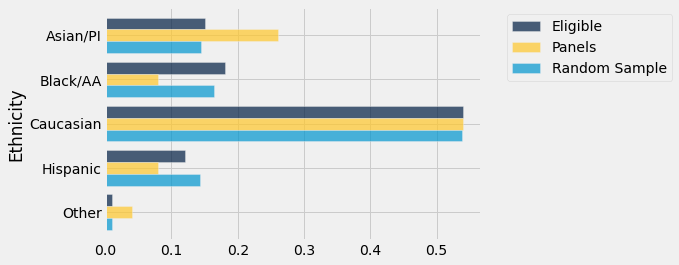
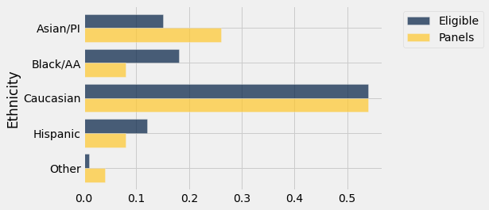
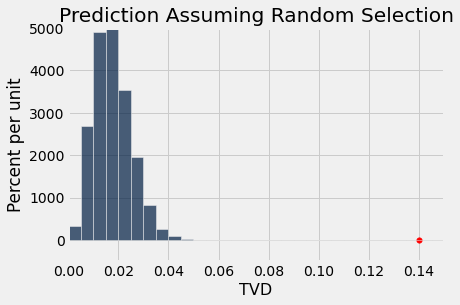

# 여러 범주

배심원 후보단이 배심원 자격이 있는 모집단(population)을 대표하는지는 여전히 중요한 문제이다. 이 절에서는 1960년대 로버트 스웨인(Robert Swain)의 사례보다 더 최근의 후보단을 대상으로 이 문제를 다룬다.

평가의 전반적인 과정은 이전과 같다. 그러나 이번에는 두 범주만이 아니라 여러 인종 및 민족 범주에 속한 후보들을 고려한다. 기술적인 관점에서 이는 시뮬레이션(simulation)할 새로운 통계량(statistic)을 고안해야 한다는 것을 의미한다. 그것을 시뮬레이션하여 결론에 도달한 후에는, 관찰된 불일치의 근본 원인 몇 가지를 살펴볼 것이다.

```python
from datascience import *
%matplotlib inline
path_data = '../../../../data/'
import matplotlib.pyplot as plots
plots.style.use('fivethirtyeight')
import numpy as np
```

## 앨러미다 카운티(Alameda County)의 배심원 선정

2010년 미국시민자유연맹(American Civil Liberties Union, ACLU) 북부 캘리포니아 지부는 캘리포니아주 앨러미다 카운티(Alameda County)의 배심원 선정에 관한 [보고서](https://www.aclunc.org/sites/default/files/racial_and_ethnic_disparities_in_alameda_county_jury_pools.pdf "ACLU_NC report")를 발표했다. 이 보고서는 앨러미다 카운티의 배심원 후보 가운데 특정 인종 및 민족 집단이 과소대표되어 있다고 결론짓고, 자격 있는 배심원을 후보단에 배정하는 과정에 대한 몇 가지 개혁안을 제안했다. 이 절에서는 ACLU가 제공한 데이터를 분석한다.

앞 절에서 보았듯이, 재판 배심원은 더 큰 배심원 후보단에서 선정된다. 법에 따라 배심원 후보단은 배심원 자격이 있는 사람들의 모집단(population)을 대표해야 한다. 캘리포니아에서 "대표한다(representative)"라는 말은 "무작위로 선정된다"로 명확하게 정의되어 있다. 캘리포니아 민사소송법 제197조는 "배심 업무를 위해 선정되는 모든 사람은 법원 관할 지역 모집단의 대표적 단면을 포함하는 하나 이상의 출처에서 무작위로 선정되어야 한다"라고 규정한다.

여기서 "배심 업무를 위해 선정된다"는 것은 배심원 후보단에 포함되도록 선정되는 것을 의미한다.

## 앨러미다 카운티 후보단의 구성

ACLU 북부 캘리포니아 지부가 수행한 연구의 초점은 앨러미다 카운티 배심원 후보단의 인종 및 민족 구성이었다. ACLU는 2009년과 2010년 앨러미다 카운티에서 열린 11건의 중범죄 재판의 배심원 후보단 구성에 관한 데이터를 수집했다. 이 후보단들에서 배심 업무를 위해 출석한 사람은 총 1453명이었다. ACLU는 이 예비 배심원 전원의 인구통계 데이터를 수집하고, 이를 카운티의 배심원 자격이 있는 모든 사람의 구성과 비교했다.

데이터는 아래에 ``jury``라는 표로 정리되어 있다. 각 범주에서 첫 번째 수치는 배심원 자격이 있는 모든 후보 가운데 해당 범주에 속하는 비율이다. 두 번째 수치는 배심원 선정 절차에 출석한 사람들 가운데 해당 범주에 속하는 사람의 비율이다.

각 범주의 이름은 ACLU 보고서에서 가져온 것으로, 보고서에는 "'기타(other)' 범주에는 하나의 주된 인종 정체성을 밝히지 않고 혼혈이라고 밝힌 사람과 인종이나 민족을 밝히지 않은 개인이 포함된다"라고 쓰여 있다. `Asian/PI`라는 이름은 "아시아인 또는 태평양 섬 주민(Asian or Pacific Islander)"을 의미한다. `Black/AA`라는 이름은 "흑인 또는 아프리카계 미국인(Black or African-American)"을 의미한다.

```python
jury = Table().with_columns(
    'Ethnicity', make_array('Asian/PI', 'Black/AA', 'Caucasian', 'Hispanic', 'Other'),
    'Eligible', make_array(0.15, 0.18, 0.54, 0.12, 0.01),
    'Panels', make_array(0.26, 0.08, 0.54, 0.08, 0.04)
)

jury
```

<table border="1" class="dataframe">
    <thead>
        <tr>
            <th>Ethnicity</th> <th>Eligible</th> <th>Panels</th>
        </tr>
    </thead>
    <tbody>
        <tr>
            <td>Asian/PI </td> <td>0.15    </td> <td>0.26  </td>
        </tr>
        <tr>
            <td>Black/AA </td> <td>0.18    </td> <td>0.08  </td>
        </tr>
        <tr>
            <td>Caucasian</td> <td>0.54    </td> <td>0.54  </td>
        </tr>
        <tr>
            <td>Hispanic </td> <td>0.12    </td> <td>0.08  </td>
        </tr>
        <tr>
            <td>Other    </td> <td>0.01    </td> <td>0.04  </td>
        </tr>
    </tbody>
</table>

이 연구의 배심원 후보단에서 일부 민족은 과대대표되어 있고 일부는 과소대표되어 있다. 특히 Black/AA와 Hispanic 범주의 후보는 과소대표되어 있다.

막대그래프(bar chart)는 차이를 시각화하는 데 도움이 된다.

```python
jury.barh('Ethnicity')
```


## 무작위로 선정된 후보단과의 비교
배심원 자격이 있는 사람들의 모집단(population)에서 1,453명의 무작위 표본(random sample)을 뽑는다면 어떻게 될까? 그들의 민족 분포(distribution)는 위의 후보단 분포와 비슷해 보일까?

`sample_proportions`를 사용하고 `jury` 표에 표본(sample)의 비율을 담은 열을 추가하여 이 질문에 답할 수 있다.

**기술적 참고 사항.** 예비 배심원의 무작위 표본(random sample)은 비복원추출(sampling without replacement)로 선정될 것이다. 그러나 표본의 크기가 모집단(population)의 크기에 비해 작을 때, 비복원추출은 복원추출(sampling with replacement)과 비슷하다. 즉 모집단의 비율이 한 번 뽑을 때마다 크게 변하지 않는다. 앨러미다 카운티에서 배심원 자격이 있는 사람들의 모집단은 100만 명이 넘으며, 이에 비하면 약 1500명이라는 표본 크기(sample size)는 꽤 작다. 따라서 복원추출을 사용할 것이다.

아래 셀에서는 배심원 자격이 있는 사람들의 분포(distribution)에서 무작위로 1453번 추출하고, 무작위 표본(random sample)의 분포를 자격 있는 배심원 및 데이터상 후보단의 분포와 함께 표시한다.

```python
eligible_population = jury.column('Eligible')
sample_distribution = sample_proportions(1453, eligible_population)
panels_and_sample = jury.with_column('Random Sample', sample_distribution)
panels_and_sample
```

<table border="1" class="dataframe">
    <thead>
        <tr>
            <th>Ethnicity</th> <th>Eligible</th> <th>Panels</th> <th>Random Sample</th>
        </tr>
    </thead>
    <tbody>
        <tr>
            <td>Asian/PI </td> <td>0.15    </td> <td>0.26  </td> <td>0.14384      </td>
        </tr>
        <tr>
            <td>Black/AA </td> <td>0.18    </td> <td>0.08  </td> <td>0.163799     </td>
        </tr>
        <tr>
            <td>Caucasian</td> <td>0.54    </td> <td>0.54  </td> <td>0.538197     </td>
        </tr>
        <tr>
            <td>Hispanic </td> <td>0.12    </td> <td>0.08  </td> <td>0.143152     </td>
        </tr>
        <tr>
            <td>Other    </td> <td>0.01    </td> <td>0.04  </td> <td>0.0110117    </td>
        </tr>
    </tbody>
</table>

무작위 표본(random sample)의 분포(distribution)는 후보단의 분포와 달리 자격 있는 모집단(population)의 분포에 상당히 가깝다. 늘 그렇듯이 시각화하는 것이 도움이 된다.

```python
panels_and_sample.barh('Ethnicity')
```



막대그래프(bar chart)는 무작위 표본(random sample)의 분포(distribution)가 자격 있는 모집단(population)과 비슷하지만 후보단의 분포는 그렇지 않음을 보여 준다.

이러한 관찰이 하나의 무작위 표본(random sample)에만 해당하는 것인지 더 일반적인 것인지 평가하기 위해, 무작위 선정 모형(model) 하에서 여러 후보단을 시뮬레이션(simulation)하고 시뮬레이션이 무엇을 예측하는지 볼 수 있다. 그러나 위와 같은 막대그래프를 수천 개나 살펴볼 수는 없다. 무작위 선정 모형이 데이터에 의해 지지되는지 아닌지를 평가하는 데 도움이 되는 통계량(statistic)이 필요하다.

## 새로운 통계량(statistic): 두 분포(distribution) 사이의 거리
두 수가 얼마나 다른지 측정하는 방법은 알고 있다. 두 수가 $x$와 $y$라면 그 사이의 거리는 $\vert x-y \vert$이다. 이제 두 분포(distribution) 사이의 거리를 정량화해야 한다. 예를 들어 아래의 파란색 분포와 금색 분포 사이의 거리를 측정해야 한다.

```python
jury.barh('Ethnicity')
```



이를 위해 두 분포(distribution) 사이의 *총변동거리*(total variation distance)라는 양을 계산할 것이다. 이 계산은 두 수 사이의 거리를 구하는 방법을 확장한 것이다.

총변동거리(total variation distance)를 계산하려면 먼저 각 범주에서 두 비율의 차이를 구한다.

```python
# Augment the table with a column of differences between proportions

jury_with_diffs = jury.with_column(
    'Difference', jury.column('Panels') - jury.column('Eligible')
)
jury_with_diffs
```

<table border="1" class="dataframe">
    <thead>
        <tr>
            <th>Ethnicity</th> <th>Eligible</th> <th>Panels</th> <th>Difference</th>
        </tr>
    </thead>
    <tbody>
        <tr>
            <td>Asian/PI </td> <td>0.15    </td> <td>0.26  </td> <td>0.11      </td>
        </tr>
        <tr>
            <td>Black/AA </td> <td>0.18    </td> <td>0.08  </td> <td>-0.1      </td>
        </tr>
        <tr>
            <td>Caucasian</td> <td>0.54    </td> <td>0.54  </td> <td>0         </td>
        </tr>
        <tr>
            <td>Hispanic </td> <td>0.12    </td> <td>0.08  </td> <td>-0.04     </td>
        </tr>
        <tr>
            <td>Other    </td> <td>0.01    </td> <td>0.04  </td> <td>0.03      </td>
        </tr>
    </tbody>
</table>

`Difference` 열을 보면 그 항목들의 합이 0임을 알 수 있다. 양수 항목의 합은 0.14로, 음수 항목의 합인 -0.14를 정확히 상쇄한다.

이는 막대그래프(bar chart)에서 금색 막대가 파란색 막대를 넘어서는 양이 파란색 막대가 금색 막대를 넘어서는 양과 정확히 같다는 사실에 대한 수치적 증거이다. ``Panels``와 ``Eligible`` 두 열 각각의 비율은 합이 1이므로, 두 열의 항목 사이에서 더하고 빼는 양의 합은 0이 되어야 한다.

상쇄를 피하기 위해 음의 부호를 없앤 다음 모든 항목을 더한다. 그러나 이렇게 하면 양수 항목 합계의 두 배(동등하게, 부호를 제거한 음수 항목 합계의 두 배)가 된다. 이 두 배는 필요하지 않으므로 합을 2로 나눈다.

```python
jury_with_diffs = jury_with_diffs.with_column(
    'Absolute Difference', np.abs(jury_with_diffs.column('Difference'))
)

jury_with_diffs
```

<table border="1" class="dataframe">
    <thead>
        <tr>
            <th>Ethnicity</th> <th>Eligible</th> <th>Panels</th> <th>Difference</th> <th>Absolute Difference</th>
        </tr>
    </thead>
    <tbody>
        <tr>
            <td>Asian/PI </td> <td>0.15    </td> <td>0.26  </td> <td>0.11      </td> <td>0.11               </td>
        </tr>
        <tr>
            <td>Black/AA </td> <td>0.18    </td> <td>0.08  </td> <td>-0.1      </td> <td>0.1                </td>
        </tr>
        <tr>
            <td>Caucasian</td> <td>0.54    </td> <td>0.54  </td> <td>0         </td> <td>0                  </td>
        </tr>
        <tr>
            <td>Hispanic </td> <td>0.12    </td> <td>0.08  </td> <td>-0.04     </td> <td>0.04               </td>
        </tr>
        <tr>
            <td>Other    </td> <td>0.01    </td> <td>0.04  </td> <td>0.03      </td> <td>0.03               </td>
        </tr>
    </tbody>
</table>

```python
jury_with_diffs.column('Absolute Difference').sum() / 2
```

```
0.14
```

이 양 0.14가 배심원 자격이 있는 모집단(population)의 민족 분포(distribution)와 후보단의 분포 사이의 *총변동거리*(total variation distance, TVD)이다.

일반적으로 두 분포(distribution) 사이의 총변동거리(total variation distance)는 두 분포가 얼마나 가까운지를 측정한다. TVD가 클수록 두 분포는 더 달라 보인다.

**기술적 참고 사항:** 양수 차이만 더해도 같은 결과를 얻을 수 있었을 것이다. 그러나 모든 절대 차이를 포함하는 우리의 방법을 사용하면 어떤 차이가 양수이고 어떤 차이가 그렇지 않은지 추적할 필요가 없다.

무작위 선정이라는 가정 하에서 시뮬레이션(simulation)할 통계량(statistic)으로 분포(distribution) 사이의 총변동거리(total variation distance)를 사용할 것이다. 거리의 값이 크면 무작위 선정에 반하는 증거가 된다.

## 모형(model) 하에서 통계량(statistic) 시뮬레이션하기
무작위 표본(random sample)에 따라 TVD가 어떻게 변하는지 보기 위해, 자격 있는 모집단(population)에서의 무작위 선정 모형(model) 하에서 TVD를 반복적으로 시뮬레이션(simulation)할 것이다.

계산을 체계적으로 정리해 보자. 총변동거리(total variation distance)를 반복해서 계산할 것이므로, 먼저 주어진 두 분포(distribution)에 대해 이를 계산하는 함수를 작성한다.

함수 `total_variation_distance`는 비교할 분포(distribution)를 담은 두 배열을 받아 그 사이의 TVD를 반환한다.

```python
def total_variation_distance(distribution_1, distribution_2):
    return sum(np.abs(distribution_1 - distribution_2)) / 2
```

이 함수는 시뮬레이션(simulation)을 반복할 때마다 통계량(statistic)을 계산하는 데 도움이 될 것이다. 그러나 먼저 이 함수로 위의 파란색(자격 있는 사람) 분포(distribution)와 금색(후보단) 분포 사이의 거리를 계산할 때 올바른 답을 주는지 확인해 보자. 이것들이 ACLU 연구의 분포이다.

```python
total_variation_distance(jury.column('Panels'), jury.column('Eligible'))
```

```
0.14
```

이는 함수를 사용하지 않고 직접 계산한 값과 일치한다.

아래 셀에서는 이 함수를 사용하여 배심원 자격이 있는 사람들의 분포(distribution)와 하나의 무작위 표본(random sample)의 분포 사이의 TVD를 계산한다. `eligible_population`은 자격 있는 배심원의 분포를 담은 배열이고, 표본 크기(sample size)는 1453임을 기억하라.

첫 번째 줄에서는 `sample_proportions`를 사용하여 자격 있는 모집단(population)에서 무작위 표본(random sample)을 생성한다. 다음 줄에서는 `total_variation_distance`를 사용하여 무작위 표본의 분포(distribution)와 자격 있는 모집단의 분포 사이의 TVD를 계산한다.

```python
sample_distribution = sample_proportions(1453, eligible_population)
total_variation_distance(sample_distribution, eligible_population)
```

```
0.018265657260839632
```

셀을 몇 번 실행해 보면, 거리가 후보단 분포(distribution)와 자격 있는 배심원 분포 사이의 거리인 0.14보다 상당히 작다는 것을 알 수 있다.

이제 무작위 선정 모형(model)을 평가하기 위한 시뮬레이션(simulation)을 실행할 준비가 되었다.

### 통계량(statistic)의 값 하나 시뮬레이션하기
모든 시뮬레이션(simulation)을 시작할 때와 같은 방식으로, 무작위 선정 가설(hypothesis) 하에서 총변동거리(total variation distance)의 시뮬레이션 값 하나를 반환하는 함수 `one_simulated_tvd`를 정의하자.

정의 본문의 코드는 위의 셀을 바탕으로 한다.

```python
# Simulate one simulated value of 
# the total variation distance between
# the distribution of a sample selected at random
# and the distribution of the eligible population

def one_simulated_tvd():
    sample_distribution = sample_proportions(1453, eligible_population)
    return total_variation_distance(sample_distribution, eligible_population)
```

### 통계량(statistic)의 값 여러 개 시뮬레이션하기
이제 `for` 루프를 사용하는 익숙한 과정을 적용하여 이러한 거리 5000개로 이루어진 배열을 만들 수 있다.

```python
tvds = make_array()
repetitions = 5000
for i in np.arange(repetitions):
    tvds = np.append(tvds, one_simulated_tvd())
```

## 무작위 선정 모형(model) 평가하기

다음은 시뮬레이션(simulation)된 거리의 경험적 히스토그램(empirical histogram)이다. 이 히스토그램은 자격 있는 후보 집단에서 1453명의 후보를 무작위로 뽑으면, 후보들의 분포(distribution)와 자격 있는 모집단(population)의 분포 사이의 거리가 약 0.05를 넘는 경우가 드물다는 것을 보여 준다.

그러나 연구에 나온 후보단은 자격 있는 모집단(population)과 그렇게 비슷하지 않았다. 후보단과 모집단 사이의 총변동거리(total variation distance)는 0.14였으며, 가로축 위의 빨간 점으로 표시되어 있다. 이 값은 히스토그램(histogram)의 꼬리보다 훨씬 바깥에 있으며, 무작위 표본(random sample)의 분포(distribution)와 자격 있는 모집단의 분포 사이의 전형적인 거리처럼 전혀 보이지 않는다.

```python
Table().with_column('TVD', tvds).hist(bins=np.arange(0, 0.2, 0.005))

# Plotting parameters; you can ignore this code
plots.title('Prediction Assuming Random Selection')
plots.xlim(0, 0.15)
plots.ylim(-5, 50)
plots.scatter(0.14, 0, color='red', s=30);
```



시뮬레이션(simulation)은 ACLU 연구에 나온 후보단의 구성이 무작위 선정 모형(model)과 일치하지 않음을 보여 준다. 우리의 분석은 후보단이 자격 있는 배심원에 대해 제공된 분포(distribution)를 대표하지 않았다는 ACLU의 결론을 뒷받침한다.

## 편향(bias)의 원인
대부분의 이러한 분석이 그렇듯이, 우리의 분석은 분포(distribution)가 *왜* 다른지 말해 주지 않는다. 그러나 그 이유를 이해하는 것은 중요하다. 배심원 후보단이 배심원 자격이 있는 사람들의 모집단(population)을 대표하지 않는다면, 적법 절차와 배심 재판의 공정성에 큰 영향을 미칠 수 있다.

ACLU 보고서는 불일치의 몇 가지 가능한 원인을 논의하고 몇 가지 해결책을 제안한다. 일부는 순전히 실무적인 것이지만 큰 영향을 미친다. 예를 들어, 파이썬(Python)에서의 무작위 표본추출(random sampling)은 품질이 높다고 당연하게 여길 수 있지만, 후보단 선정에는 다른 소프트웨어가 사용되었다. ACLU의 조사 결과 그 소프트웨어가 제대로 작동하지 않아 편향된 선정에 일조한 것으로 드러났다. 더 나은 소프트웨어를 사용하는 것이 명확한 해결책이다.

더 중요한 점은 앨러미다 카운티의 배심원 후보단이 배심원 자격이 있는 전체 모집단(population)에서 선정되지 않는다는 것이다. 앨러미다 카운티 고등법원(Superior Court of Alameda County)의 [웹사이트](http://www.alameda.courts.ca.gov/pages.aspx/faqs)에는 "법원의 목표는 카운티 모집단의 정확한 단면을 제공하는 것이다. 배심원의 이름은 유권자로 등록되어 있거나 차량관리국(Department of Motor Vehicles)이 발급한 운전면허증 또는 신분증을 가지고 있는 모든 사람 가운데에서 무작위로 선정된다"라고 쓰여 있다.

이 과정은 그러한 명단에 없는 배심원 자격자를 배제한다. 주에서 발급한 신분증을 가지고 있거나 유권자로 등록되어 있는지 여부는 소득과 연관성(association)이 있을 가능성이 높고, 따라서 흑인 및 히스패닉 공동체에 대한 역사적 편향(bias) 때문에 인종 및 민족과도 연관되어 있다. 이로 인해 해당 집단이 후보단에서 과소대표된다.

명단에 있는 사람들에게 배심원 소환을 알리려면 그들에게 연락이 닿아야 한다. 그러나 자원이 부족한 공동체의 사람들은 항상 고정된 주소를 가지고 있지는 않다. 오래된 주소 기록, 공공요금 납부자 명단과 같은 다른 명단과의 교차 확인 부족 등이 모두 편향된 선정의 원인이 될 수 있다.

연락이 닿았더라도 잠재적 후보는 여전히 출석할 수 있어야 한다. 배심 업무 첫날은 보상이 없으며, 이후에는 하루 \$15가 지급된다. 법에 따라 고용주는 배심 의무가 있는 직원에게 휴가를 주어야 하지만 보상을 제공할 의무는 없으며, 일부 고용주는 보상하지 않는다. 베이 에어리어(Bay Area)처럼 생활비가 비싼 지역에서는 이것이 후보가 배심원 소환에 응하지 않는 이유가 될 수 있다. 심각한 경제적 어려움이 있으면 배심원 의무를 면제받을 수 있지만, 면제를 요청하는 절차조차 일부 배심원에게는 접근하기 어려울 수 있다. 만 건너편 샌프란시스코(San Francisco)에서는 시 지도자들이 저소득 배심원에게 하루 \$100의 보상을 제공하는 [프로그램](https://sftreasurer.org/new-ca-bill-pilots-higher-compensation-low-income-jurors-san-francisco)을 시범 운영하여 이러한 형태의 편향(bias)을 줄이려 하고 있다.

## 데이터 품질
우리는 하나의 분포(distribution)가 다른 분포에서 뽑은 무작위 표본(random sample)처럼 보이는지 판단하는 데 도움이 되는 기법을 개발했다. 그러나 분석으로부터 정확히 무엇을 결론지을 수 있는지 더 잘 이해하려면 데이터 출처를 살펴보아야 한다. 좋은 데이터 과학에는 데이터가 어떻게 수집되었는지에 대한 신중한 검토가 포함된다.

**배심원 자격자.** 모든 사람이 배심원으로 봉사할 자격이 있는 것은 아니라는 점을 염두에 두어야 한다. 앨러미다 카운티 고등법원은 [웹사이트](http://www.alameda.courts.ca.gov/pages.aspx/jury-duty-overview)에서 "18세 이상이고, 미국 시민이며, 소환된 카운티 또는 지역의 주민이라면 배심원으로 소환될 수 있다. 영어를 이해할 수 있어야 하며, 신체적·정신적으로 봉사할 수 있어야 한다. 또한 지난 12개월 동안 어떤 종류의 배심원으로도 봉사한 적이 없어야 하며, 중범죄로 유죄 판결을 받은 적이 없어야 한다"라고 밝히고 있다.

인구조사(Census)는 인구통계 정보의 자연스러운 출처이지만, 이러한 모든 범주에 대한 데이터를 수집하지는 않는다. 따라서 ACLU는 배심원 자격자의 인구통계를 다른 방법으로 얻어야 했다.

ACLU가 사용한 것은 2002년 앨러미다 카운티의 한 재판을 위해 샌디에이고 주립대학교(San Diego State University)의 한 교수가 개발한 추정치였다. 이 추정치는 2000년 인구조사를 바탕으로 했으며, 배심원 자격에 필요한 기준도 고려했다.

따라서 자격 있는 모집단(population)에 대해 사용한 분포(distribution) 자체가 추정치이며 오차의 영향을 받는다는 점을 염두에 두어야 한다. 더욱이 ACLU가 지적했듯이, 캘리포니아의 인구 구성이 변화하고 있으므로 2000년 인구조사에 근거한 추정치를 2010년의 모집단에 사용하는 것은 정확하지 않을 수 있다.

따라서 배심원 자격자의 모집단(population)에 사용된 분포(distribution)는 정확하지 않을 수 있다.

**후보단.** 보고서만으로는 1453명의 후보가 정확히 어떻게 여러 민족 범주로 분류되었는지 명확하지 않다. 보고서는 "변호사들이 … 배심원 풀 데이터 수집에 협력했다"라고만 말한다.

누가 각 민족 범주로 분류되거나 스스로를 분류하는지에는 중요한 사회적·문화적·정치적 요인이 영향을 미친다. 또한 후보단에서 사용된 범주의 정의가 배심원 자격자 분포(distribution)의 추정에 사용된 정의와 같았는지도 명확하지 않다. 이는 비교되는 두 분포 사이의 대응 관계에 의문을 제기한다.

더욱이 후보에 관한 데이터는 출석한 사람들로부터 얻은 것이다. 앞서 논의했듯이 모든 후보가 출석하는 것은 아니다. 출석하지 않는 이유는 인종 및 민족과 연관되어 있으며, 자원이 부족한 공동체 출신 후보에게 불균형적으로 영향을 미친다.

배심원 소환에 응하는 것은 법적 의무이다. 그러나 ACLU가 지적했듯이, 연구 당시 앨러미다 카운티에는 소환되었으나 출석하지 않은 예비 배심원을 후속 조치하는 효과적인 절차가 없었다. ACLU는 "최소한 예비 배심원에게 두 번째 통지서를 발송하도록 하는 불출석 대응 프로그램"을 만들 것을 권고했다.

실제로 응답하지 않은 사람들에 대한 후속 조치는 편향(bias)을 줄일 것이다. 우리의 분석에서는 선정되었으나 출석하지 않은 후보들의 인구통계 정보를 채우는 데 필요한 데이터가 없다는 점을 인정해야 한다.

## 결론

위의 논의를 고려할 때, 우리의 분석으로부터 무엇을 결론지을 수 있는지 정확히 해 두는 것이 중요하다.

- 출석한 후보들에 대해 제공된 분포(distribution)는 자격 있는 모집단(population)의 추정 분포에서 뽑은 무작위 표본(random sample)처럼 보이지 않는다고 결론지을 수 있다.

우리의 논의는 ACLU 보고서의 논의와 마찬가지로, 두 분포(distribution) 사이에서 관찰된 차이 가운데 일부의 원인과 소환된 후보가 출석하지 않을 수 있는 이유를 제시한다. 거의 모든 이유는 사회의 역사적인 인종적 편향(racial bias)에 뿌리를 두고 있으며, 그 편향이 낳은 지속적인 부정적 결과의 예이다.
