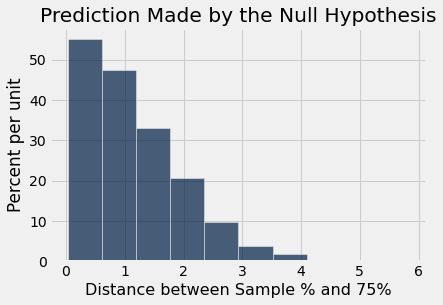
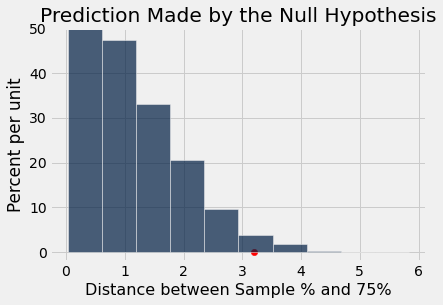

# 결정과 불확실성

배심원 선정에 관한 모형(model)을 평가하기 위해 우리가 개발한 통계적·계산적 방법론은 *통계적 가설 검정*(statistical tests of hypotheses)이라 불리는 일반적인 의사결정 체계에 속한다. 통계적 검정을 의사결정의 방법으로 사용하는 것은 여러 분야에서 표준적이며, 표준적인 용어 체계를 가지고 있다.

이 절에서는 통계적 검정(statistical test)에 사용되는 일반적인 단계의 순서와 함께 몇 가지 용어를 설명한다.

여기서 다룰 예는 생명과학 분야에서 가져온 것이지만, 이 과정의 통계적·계산적 단계가 법률 제도에서 얻은 데이터를 분석할 때의 해당 단계와 일치한다는 것을 알게 될 것이다. 다만 생물학 데이터는 인간과 불의가 아니라 식물에 관한 것이다. 따라서 아래 계산의 맥락과 해석은 훨씬 단순하다.

```python
from datascience import *
%matplotlib inline
path_data = '../../../assets/data/'
import matplotlib.pyplot as plots
plots.style.use('fivethirtyeight')
import numpy as np
```

[그레고어 멘델(Gregor Mendel)](https://en.wikipedia.org/wiki/Gregor_Mendel)(1822-1884)은 현대 유전학의 창시자로 널리 인정받는 오스트리아의 수도사이다. 멘델은 유전의 기본 법칙을 도출하기 위해 식물을 대상으로 신중하고 대규모의 실험을 수행했다.

그의 실험 중 다수는 여러 품종의 완두콩을 대상으로 한 것이었다. 그는 각 품종에 대한 가정들의 집합을 세웠는데, 이것이 그의 모형(model)이었다. 그런 다음 식물을 재배하고 데이터를 수집하여 모형의 타당성을 검정했다.

특정 품종의 완두콩에 대해 멘델은 다음과 같은 모형(model)을 제안했다.

## 멘델의 모형(model) ##
모든 식물에 대해, 다른 모든 식물의 꽃 색깔과 관계없이, 보라색 꽃이 필 확률은 75%이고 흰색 꽃이 필 확률은 25%이다.

자신의 모형(model)이 타당한지 확인하기 위해 멘델은 이 품종의 완두콩 929그루를 재배했다. 이 929그루 가운데 705그루가 보라색 꽃을 피웠다.

이 데이터를 사용하여 가설 검정(test of hypotheses)을 수행하고 멘델의 모형(model)이 좋아 보이는지 확인할 것이다.

## 1단계: 가설(hypothesis)

모든 통계적 검정(statistical test)은 세상을 바라보는 두 관점 가운데 하나를 선택하려고 한다. 구체적으로는 데이터가 어떻게 생성되었는지에 관한 두 관점 사이에서 선택하는 것이다. 이 두 관점을 *가설*(hypothesis)이라고 한다.

**귀무가설(null hypothesis).** 이것은 확률에 관해 명확하게 정의된 모형(model)이다. 귀무가설은 무작위성에 관해 명확하게 명시된 가정 하에서 데이터가 무작위로 생성되었다고 말한다. "귀무(null)"라는 단어는 데이터가 귀무가설이 예측하는 것과 다르게 보인다면 그 차이가 *오로지* 우연 때문이라는 생각을 강조한다.

실용적인 관점에서 **귀무가설(null hypothesis)은 그 하에서 데이터를 시뮬레이션(simulation)할 수 있는 가설이다.**

완두콩 꽃 색깔에 관한 멘델의 모형(model)의 예에서 귀무가설(null hypothesis)은 그의 모형의 가정이 옳다는 것이다. 즉 각 식물은 다른 모든 식물과 독립적으로 75%의 확률로 보라색 꽃을 피운다.

이 가설(hypothesis) 하에서 `sample_proportions`를 사용하여 무작위 표본(random sample)을 시뮬레이션할 수 있다.

**대립가설(alternative hypothesis).** 이것은 우연 이외의 어떤 이유 때문에 데이터가 귀무가설(null hypothesis)에 있는 모형(model)의 예측과 달라졌다고 말한다.

멘델의 식물 예에서 대립가설(alternative hypothesis)은 단순히 그의 모형(model)이 좋지 않다는 것이다.

대립가설(alternative hypothesis)은 모형(model)이 어떻게 또는 왜 좋지 않은지 말해 주지 않는다는 점을 명심하라. 단지 모형이 좋지 않다고 말할 뿐이다.

## 2단계: 검정 통계량(test statistic)

두 가설(hypothesis) 사이에서 결정하려면 결정을 내리는 데 사용할 수 있는 통계량(statistic)을 선택해야 한다. 이를 **검정 통계량**(test statistic)이라고 한다.

우리는 두 범주형 분포(categorical distribution), 즉 멘델의 모형(model)에 있는 분포와 무작위 표본(random sample)에서 얻을 분포를 비교할 것이다. 이 두 분포가 서로 가까운지 멀리 떨어져 있는지 알고 싶다. 따라서 자연스러운 검정 통계량(test statistic)은 앞 절에서 개발한 총변동거리(total variation distance, TVD)이다.

범주가 단 두 개뿐이면 TVD는 상당히 단순하고 해석하기 쉽다는 것이 밝혀진다. 예를 살펴보자. 멘델의 모형(model)은 "보라색, 흰색" 분포(distribution)가 [0.75, 0.25]라고 말한다. 표본(sample)의 분포가 [0.7, 0.3]으로 나왔다고 하자.

범주가 두 개뿐이기 때문에 TVD를 계산할 때 흥미로운 일이 일어난다. 먼저 다음에 주목하라.

$$
\vert 0.7 - 0.75 \vert = 0.05 = \vert 0.3 - 0.25 \vert
$$

따라서 TVD는 다음과 같다.

$$
\frac{1}{2}\Big( \vert 0.7 - 0.75 \vert + \vert 0.3 - 0.25 \vert \Big) = 0.05 
= \vert 0.7 - 0.75 \vert
$$

이는 보라색 꽃을 피우는 식물의 두 비율 사이의 거리일 뿐이다. 또한 흰색 꽃을 피우는 식물의 두 비율 사이의 거리이기도 하다.

여기서 다루지 않을 약간의 수학을 이용하면, 범주가 두 개뿐일 때는 항상 이것이 성립함을 보일 수 있다. 즉 TVD는 한 범주에서의 두 비율 사이의 거리와 같다.

따라서 보라색 식물의 표본(sample) 비율과 멘델의 모형(model)에서 해당 비율인 0.75 사이의 거리는 완벽하게 좋은 검정 통계량(test statistic)이 될 것이다.

백분율이 비율보다 해석하기 쉬우므로 대신 백분율을 사용할 것이다.

우리의 검정 통계량(test statistic)은 보라색 식물의 표본(sample) 백분율과 멘델의 모형(model)에서 해당 백분율인 75% 사이의 거리가 될 것이다.

$$
\Big\vert \text{sample percent of purple-flowering plants} - 75 \Big\vert
$$

이 검정 통계량(test statistic)은 두 분포(distribution) 사이의 *거리*이다. 이는 의미가 통하고 사용하기 쉽다. 표본(sample) 백분율이 75% 근처라면 모형(model)과 일치하지만, 75보다 훨씬 크거나 훨씬 작은 백분율은 모형이 좋지 않다고 생각하게 만들 것이다. 따라서 거리의 값이 작으면 귀무가설(null hypothesis) 쪽으로 기울게 된다. 통계량의 값이 크면 대립가설(alternative hypothesis) 쪽으로 기울게 된다.

다른 상황에서 검정 통계량(test statistic)을 선택하려면 대립가설(alternative hypothesis)을 살펴보라. 통계량(statistic)의 어떤 값이 대립가설을 귀무가설(null hypothesis)보다 더 나은 선택이라고 생각하게 만드는가?
- 답이 "큰 값"이라면 통계량(statistic)을 잘 선택한 것이다.
- 답이 "작은 값"인 경우도 마찬가지이다.
- 그러나 답이 "큰 값과 작은 값 모두"라면 통계량(statistic)을 다시 살펴보기를 권한다. 차이 대신 거리를 사용하면 답을 "큰 값"만으로 바꿀 수 있는지 확인해 보라.

### 검정 통계량(test statistic)의 관측값 ###
*검정 통계량의 관측값*(observed value of the test statistic)은 시뮬레이션(simulation)된 값이 아니라 연구 데이터에서 얻은 통계량의 값이다. 멘델의 식물 929그루 가운데 705그루가 보라색 꽃을 피웠다. 따라서 검정 통계량의 관측값은 다음과 같았다.

```python
observed_statistic = abs ( 100 * (705 / 929) - 75)
observed_statistic
```

```
0.8880516684607045
```

## 3단계: 귀무가설(null hypothesis) 하에서 검정 통계량(test statistic)의 분포(distribution)

가설 검정(test of hypotheses)의 주요 계산적 측면은 귀무가설(null hypothesis)에 있는 모형(model)이 무엇을 예측하는지 알아내는 것이다. 구체적으로는 *귀무가설이 참이라면 검정 통계량(test statistic)이 어떤 값을 가질 수 있는지* 알아내야 한다.

검정 통계량(test statistic)은 귀무가설(null hypothesis)에 있는 모형(model)의 가정에 근거하여 시뮬레이션(simulation)된다. 그 모형에는 우연이 포함되어 있으므로, 통계량을 여러 번 시뮬레이션하면 매번 다르게 나온다.

통계량(statistic)을 반복해서 시뮬레이션(simulation)하면 그 통계량이 가질 수 있는 값들과 어떤 값이 다른 값보다 더 가능성이 높은지에 대해 잘 파악할 수 있다. 다시 말해, 귀무가설(null hypothesis)에 있는 모형(model)이 예측하는 통계량의 확률 분포(probability distribution)에 대한 좋은 근사를 얻게 된다.

모든 분포(distribution)와 마찬가지로, 이전 예에서 했던 것처럼 이 분포를 히스토그램(histogram)으로 시각화하면 매우 유용하다. 여기서 전체 과정을 진행해 보자.

먼저 알고 있는 몇 가지 양을 이름에 할당한다.

```python
mendel_proportions = make_array(0.75, 0.25)
mendel_proportion_purple = mendel_proportions.item(0)
sample_size = 929
```

다음으로 검정 통계량(test statistic)의 시뮬레이션(simulation) 값 하나를 반환하는 함수를 정의한다. 그런 다음 `for` 루프를 사용하여 10,000개의 시뮬레이션 값을 배열에 모은다.

```python
def one_simulated_distance():
    sample_proportion_purple = sample_proportions(929, mendel_proportions).item(0)
    return 100 * abs(sample_proportion_purple - mendel_proportion_purple)
```

```python
repetitions = 10000
distances = make_array()
for i in np.arange(repetitions):
    distances = np.append(distances, one_simulated_distance())
```

이제 이 값들의 히스토그램(histogram)을 그릴 수 있다. 이것은 *귀무가설(null hypothesis)이 예측하는 검정 통계량(test statistic)의 분포*(distribution)를 나타내는 히스토그램이다.

```python
Table().with_column(
    'Distance between Sample % and 75%', distances
).hist()
plots.title('Prediction Made by the Null Hypothesis');
```



가로축을 보면 모형(model)이 예측하는 거리의 전형적인 값을 알 수 있다. 그 값들은 상당히 작다. 예를 들어 거리의 상당 부분이 0에서 1 사이에 있는데, 이는 상당 비율의 표본(sample)에서 보라색 꽃을 피우는 식물의 백분율이 75% $\pm$ 1% 범위에 있다는 뜻이다. 즉 표본 백분율이 74%에서 76% 사이에 있다.

또한 이 예측은 멘델이 재배한 식물에서 관측한 비율이 아니라 오직 멘델의 모형(model)만을 사용하여 이루어졌다는 점에 주목하라. 이제 예측과 멘델의 관측을 비교할 때이다.

## 4단계. 검정의 결론

귀무가설(null hypothesis)과 대립가설(alternative hypothesis) 사이의 선택은 2단계와 3단계에서 계산한 것, 즉 검정 통계량(test statistic)의 관측값과 귀무가설이 예측하는 그 분포(distribution)의 비교에 달려 있다.

둘이 서로 일치하지 않으면 데이터는 귀무가설(null hypothesis)을 지지하지 않는다. 다시 말해 대립가설(alternative hypothesis)이 데이터에 의해 더 잘 지지된다. 이때 검정이 귀무가설을 *기각한다*(reject)고 말한다.

둘이 서로 일치하면 관측된 검정 통계량(test statistic)은 귀무가설(null hypothesis)이 예측하는 것과 부합한다. 다시 말해 귀무가설이 데이터에 의해 더 잘 지지된다. 이때 데이터가 귀무가설과 *일치한다*(consistent with)고 말한다.

우리의 예에서 검정 통계량(test statistic)의 관측값은 위의 2단계에서 계산한 대로 약 0.89이다. 눈으로만 보고 히스토그램(histogram)의 가로축에서 0.89가 대략 어디에 있는지 찾아보라. 그 값이 멘델의 모형(model)이 예측하는 분포(distribution)의 한가운데에 분명히 있다는 것을 알 수 있다.

아래 셀은 관측값을 가로축에 표시하여 히스토그램(histogram)을 다시 그린다.

```python
Table().with_column(
    'Distance between Sample % and 75%', distances
).hist()
plots.ylim(-0.02, 0.5)
plots.title('Prediction Made by the Null Hypothesis')
plots.scatter(observed_statistic, 0, color='red', s=40);
```


관측된 통계량(statistic)은 귀무가설(null hypothesis)이 예측하는 전형적인 거리와 같다. 귀무가설은 멘델의 모형(model)이다. 따라서 우리의 검정은 데이터가 멘델의 모형과 일치한다고 결론짓는다.

우리의 데이터에 근거하면 멘델의 모형(model)은 좋아 보인다.

## "일치한다"의 의미

지금까지 모형(model)을 평가한 모든 예에서는 데이터가 모형의 예측과 일치하는지에 대해 의심의 여지가 없었다. 배심원 후보단에 관한 예에서처럼 모형이 예측한 것과 매우 멀리 떨어져 있거나, 멘델의 모형에 관한 예에서처럼 모형이 예측한 것과 비슷했다.

그러나 결과가 항상 그렇게 명확한 것은 아니다. 얼마나 멀어야 "멀다"고 할 수 있는가? "비슷하다"는 정확히 무엇을 의미해야 하는가? 이러한 질문에 보편적인 답은 없지만, 따를 수 있는 몇 가지 지침과 관례가 있다.

그러나 먼저, 관측된 검정 통계량(test statistic)이 귀무가설(null hypothesis) 하에서 예측된 분포(distribution)와 일치하는지는 주관적인 의견과 판단의 문제라는 점을 이해하는 것이 중요하다. 판단과 함께 검정 통계량의 값, 그리고 귀무가설 하에서 예측된 분포의 그래프를 제시하기를 권한다. 그러면 독자는 둘이 일치하는지에 대해 스스로 판단할 수 있다.

위의 예에서는 판단이 명확하다. 그러나 누군가가 관련된 다른 품종의 식물 929그루를 재배하고 멘델의 모형(model)이 그 품종의 식물에도 맞는지 알아보고자 한다고 하자. 관측된 거리가 아래에 표시된 것처럼 3.2로 나왔다면 무엇이라고 결론짓겠는가?

```python
different_observed_statistic = 3.2
Table().with_column(
    'Distance between Sample % and 75%', distances
).hist()
plots.ylim(-0.02, 0.5)
plots.title('Prediction Made by the Null Hypothesis')
plots.scatter(different_observed_statistic, 0, color='red', s=40);
```



새 품종의 식물에 근거한 관측은 히스토그램(histogram)의 예측과 일치하는가, 그렇지 않은가?

이제 답은 그렇게 명확하지 않다. 그것은 빨간 점이 예측값의 대부분으로부터 너무 멀리 떨어져 있어서 멘델의 모형(model)에 근거한 예측과 일치하지 않는다고 생각하는지에 달려 있다.

## 관례적 기준점과 p-값(p-value)
자신의 판단을 사용하고 싶지 않다면 따를 수 있는 관례가 있다. 이러한 관례는 꼬리 쪽으로 얼마나 멀리 떨어져야 관례적으로 "너무 멀다"고 간주하는지 알려 준다.

이 관례는 **관측된 통계량(statistic), 즉 빨간 점에서 시작하여 대립가설(alternative hypothesis) 쪽으로 기울게 만드는 방향을 바라볼 때의** 꼬리 넓이에 근거한다. 이 예에서는 오른쪽인데, 거리가 크면 모형(model)이 좋지 않다고 말하는 대립가설을 지지하기 때문이다.

꼬리의 넓이가 작으면 관측된 통계량(statistic)은 귀무가설(null hypothesis)이 가장 흔하게 예측하는 값들로부터 멀리 떨어져 있다.

히스토그램(histogram)에서 넓이는 백분율을 나타낸다는 것을 기억하라. 꼬리의 넓이를 구하려면 빨간 점이 있는 3.2 이상인 거리의 백분율을 구해야 한다. 배열 `distances`에는 멘델의 모형(model) 하에서 무작위 표본추출(random sampling)을 10,000번 반복하여 얻은 모든 평균이 들어 있고, `different_observed_statistic`은 3.2이다.

```python
np.count_nonzero(distances >= different_observed_statistic) / repetitions
```

```
0.0243
```

멘델의 모형(model) 하에서 시뮬레이션(simulation)된 거리의 약 2.4%가 3.2 이상이었다. 평균의 법칙(law of averages)에 따라, 멘델의 모형이 이 새로운 식물에 대해 옳다면 검정 통계량(test statistic)이 3.2 이상이 될 확률은 약 2.4%라고 결론지을 수 있다.

이것은 큰 확률로 보이지 않는다. 멘델의 모형(model)이 이 식물들에 대해 참이라면 상당히 일어나기 어려운 일이 일어난 것이다. 이러한 생각에서 관례가 생겨났다.

### p-값(p-value) ##

이 확률에는 인상적인 이름이 있다. 그것은 검정의 *관측 유의수준*(observed significance level)이라고 불린다. 이 이름은 길고 거창하기 때문에 흔히 검정의 *p-값*(p-value)이라고 부른다.

**정의:** 검정의 p-값(p-value)은 귀무가설(null hypothesis)에 있는 모형(model)에 근거하여, 검정 통계량(test statistic)이 표본(sample)에서의 관측값과 같거나 대립가설(alternative hypothesis)을 지지하는 방향으로 그보다 더 극단적일 확률이다.

p-값(p-value)이 작다는 것은 관측된 통계량(statistic) 너머의 꼬리가 작다는 뜻이며, 따라서 관측된 통계량이 귀무가설(null hypothesis)이 예측하는 것으로부터 멀리 떨어져 있다는 뜻이다. 이는 데이터가 귀무가설보다 대립가설(alternative hypothesis)을 더 지지한다는 것을 의미한다.

얼마나 작아야 "작다"고 할 수 있는가? 관례에 따르면 다음과 같다.

- p-값(p-value)이 5%보다 작으면 작다고 간주하며, 그 결과를 "통계적으로 유의하다(statistically significant)"고 한다.

- p-값이 그보다 더 작아서 1% 미만이면, 그 결과를 "고도로 통계적으로 유의하다(highly statistically significant)"고 한다.

이 관례에 따르면 우리의 p-값(p-value) 2.4%는 작다고 간주된다. 따라서 관례적인 결론은 귀무가설(null hypothesis)을 기각하고 멘델의 모형(model)이 새로운 식물에 대해서는 좋아 보이지 않는다고 말하는 것이다. 형식적으로 말하면, 이 검정의 결과는 통계적으로 유의하다(statistically significant).

이런 방식으로 결론을 내릴 때는 결과가 통계적으로 유의한지(statistically significant) 아닌지만 말하지 않기를 권한다. 독자가 스스로 판단할 수 있도록 결론과 함께 관측된 통계량(statistic)과 p-값(p-value)도 제시하라.

## 관례에 관한 역사적 메모

위에서 정의한 통계적 유의성(statistical significance)의 판정은 모든 응용 분야의 통계 분석에서 표준이 되었다. 어떤 관례가 이처럼 보편적으로 따라질 때, 그것이 어떻게 생겨났는지 살펴보는 것은 흥미롭다.

통계적 검정(statistical testing)의 방법, 즉 무작위 표본(random sample)의 데이터에 근거하여 가설(hypothesis) 사이에서 선택하는 방법은 20세기 초 로널드 피셔 경(Sir Ronald Fisher)이 개발했다. 로널드 경은 1925년 저서 *연구자를 위한 통계적 방법*(Statistical Methods for Research Workers)의 다음 문장에서 다소 의도치 않게 통계적 유의성의 관례를 정했을지도 모른다. 5% 수준에 대해 그는 "편차가 유의한 것으로 간주되어야 하는지 여부를 판단할 때 이 지점을 한계로 삼는 것이 편리하다"라고 썼다.

로널드 경에게 "편리했던" 것이 보편 상수의 지위를 얻은 기준점이 되었다. 로널드 경 자신이 이 값은 여러 값 가운데 자신이 개인적으로 선택한 것이라고 지적했음에도 불구하고 그렇게 되었다. 1926년의 한 논문에서 그는 다음과 같이 썼다. "20분의 1이 충분히 높은 가능성으로 보이지 않는다면, 원할 경우 50분의 1(2퍼센트 지점)이나 100분의 1(1퍼센트 지점)에 선을 그을 수 있다. 개인적으로 저자는 5퍼센트 지점에 낮은 유의성 기준을 두는 것을 선호한다 …"

피셔(Fisher)는 "낮다"는 것이 판단의 문제이며 유일한 정의가 없다는 것을 알고 있었다. 여러분도 이 점을 염두에 두기를 권한다. 데이터를 제시하고, 판단을 내리고, 왜 그렇게 판단했는지 설명하라.

관례적인 기준점을 사용하든 자신의 판단을 사용하든, 다음 사항을 명심하는 것이 중요하다.

- 독자가 p-값(p-value)이 작다고 생각하는지 아닌지 스스로 결정할 수 있도록, 항상 검정 통계량(test statistic)의 관측값과 p-값을 제시하라.
- 관례적으로 도출된 결과가 마음에 들지 않을 때만 관례를 거스르려 하지 마라.
- 검정 결과 데이터가 귀무가설(null hypothesis)의 우연 모형(chance model)을 지지하지 않는다고 결론짓더라도, 검정은 일반적으로 모형이 *왜* 맞지 않는지는 설명하지 않는다. 무작위 통제 실험(randomized controlled trial)을 수행하는 경우가 아니라면, 추가 분석 없이 인과적 결론을 내리지 마라. 무작위 통제 실험은 이후의 절에서 분석할 것이다.
