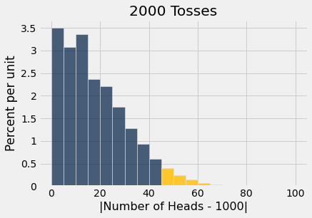

# 오류 확률(error probability)

두 가설(hypothesis) 가운데 어느 것이 데이터에 의해 더 잘 지지되는지 결정하는 과정에서, 마지막 단계는 데이터와 귀무가설(null hypothesis)이 일치하는지에 대한 판단을 포함한다. 이 단계는 대부분의 경우 좋은 결정으로 이어지지만, 때로는 우리를 잘못된 길로 이끌 수 있다. 그 이유는 우연에 의한 변동(chance variation)이다. 예를 들어 귀무가설이 참일 때에도, 우연에 의한 변동 때문에 표본(sample)이 귀무가설이 예측하는 것과 상당히 다르게 보일 수 있다.

```python
from datascience import *
%matplotlib inline
import matplotlib.pyplot as plots
plots.style.use('fivethirtyeight')
import numpy as np
```

## 잘못된 결론

귀무가설(null hypothesis)이 참이 아니라는 대립가설(alternative hypothesis)에 맞서 귀무가설을 검정한다면, 실제 상황과 검정 결과를 분류하는 방법은 네 가지가 있다.

|     | 검정이 귀무가설을 지지 | 검정이 대립가설을 지지 |
|----:|:-----------------------|:------------------------|
|**귀무가설이 참**| 올바른 결과 | 오류 |
|**대립가설이 참**| 오류 | 올바른 결과 |

이 표의 네 칸 가운데 두 칸에서 검정 결과가 틀린다. 한 가지 유형의 오류는 실제로는 귀무가설(null hypothesis)이 참인데 검정이 대립가설(alternative hypothesis)을 지지할 때 발생한다. 다른 유형의 오류는 실제로는 대립가설이 참인데 검정이 귀무가설을 지지할 때 발생한다.

귀무가설(null hypothesis)은 완전하게 명시된 우연 모형(chance model)이므로, 첫 번째 유형의 오류는 추정할 수 있는 확률을 가진다. 그 답은 본질적으로 p-값(p-value)에 사용하는 기준점이라는 것이 밝혀진다. 어떻게 그런지 살펴보자.

## 오류가 발생할 확률
동전이 공정한지 아닌지 검정하고 싶다고 하자. 그러면 가설(hypothesis)은 다음과 같다.

**귀무가설(null hypothesis):** 동전은 공정하다. 즉 결과는 *앞면, 뒷면*에서 복원추출로 무작위로 뽑은 것과 같다.

**대립가설(alternative hypothesis):** 동전은 공정하지 않다.

동전을 2000번 던진 결과에 근거하여 이 가설(hypothesis)을 검정한다고 하자. 공정한 동전이라면 2000번 가운데 1000번 앞면이 나올 것으로 기대할 수 있으므로, 사용할 만한 합리적인 검정 통계량(test statistic)은 다음과 같다.

$$
\text{test statistic} ~ = ~ \Big\vert ~ \text{number of heads} - 1000 ~ \Big\vert
$$

이 통계량(statistic)의 값이 작으면 귀무가설(null hypothesis)을 지지하고, 값이 크면 대립가설(alternative hypothesis)을 지지한다.

귀무가설(null hypothesis) 하에서 이 통계량(statistic)을 여러 번 시뮬레이션(simulation)하고 그 경험적 분포(empirical distribution)를 그렸다.

```python
fair_coin = [0.5, 0.5]

def one_simulated_statistic():
    number_of_heads = 2000 * sample_proportions(2000, fair_coin).item(0)
    return abs(number_of_heads - 1000)

repetitions = 50000

statistics = make_array()
for i in np.arange(50000):
    statistics = np.append(statistics, one_simulated_statistic())

results = Table().with_column('|Number of Heads - 1000|', statistics)
results.hist(bins = np.arange(0, 101, 5), left_end=45)
plots.title('2000 Tosses');
```



금색으로 칠해진 45의 오른쪽 넓이는 5%를 약간 밑돈다.

```python
np.count_nonzero(statistics >= 45) / repetitions
```

```
0.04654
```

검정 통계량(test statistic)의 값이 크면 대립가설(alternative hypothesis)을 지지한다. 따라서 p-값(p-value)에 대해 5% 기준점을 사용하고자 한다면, 결정 규칙은 검정 통계량이 45 이상으로 나올 경우 동전이 공정하지 않다고 결론짓는 것이 된다.

그러나 그림에서 보듯이, 공정한 동전도 45 이상의 검정 통계량(test statistic) 값을 만들어 낼 수 있다. 실제로 약 5%의 확률로 그런 일이 일어난다.

요약: *동전이 공정하고* 검정에서 공정한지 아닌지를 결정하기 위해 5% 기준점을 사용한다면, 검정이 동전이 공정하지 않다고 잘못 결론지을 확률은 약 5%이다.

## p-값(p-value)의 기준점은 오류 확률(error probability)이다
위의 예는 다음과 같은 일반적인 사실의 특수한 경우이다.

**p-값(p-value)에 대해 $p$% 기준점을 사용하는데 귀무가설(null hypothesis)이 실제로 참이라면, 검정이 대립가설(alternative hypothesis)이 참이라고 결론지을 확률은 약 $p$%이다.**

다음은 실제 상황과 검정 결과의 네 가지 가능한 조합을 다시 나타낸 표이다. 위쪽 행의 확률은 귀무가설(null hypothesis)이 참이라는 가정 하에서 계산된다. p-값(p-value)은 빨간색으로 표시된 오류의 확률이다.

|     | 검정이 귀무가설을 지지 | 검정이 대립가설을 지지 |
|----:|:-----------------------|:------------------------|
|**귀무가설이 참**| 올바른 결과 | <p style="color:red;"><b>오류</b></p> |
|**대립가설이 참**| 오류 | 올바른 결과 |

### 오류 통제하기 ###
따라서 1% 기준점은 5%보다 더 보수적이다. 1% 기준점을 사용하면 귀무가설(null hypothesis)이 실제로 참일 때 "대립가설"이라고 결론지을 확률이 더 작다. 이러한 이유로 의학적 처리(treatment)에 대한 무작위 통제 실험(randomized controlled trial)에서는 다음 두 가설(hypothesis) 사이에서 결정할 때 보통 1%를 기준점으로 사용한다.

**귀무가설(null hypothesis):** 처리는 효과가 없다. 처리군(treatment group)과 대조군(control group) 환자들의 결과 사이에서 관측된 차이는 무작위 배정(randomization)에 의한 것이다.

**대립가설(alternative hypothesis):** 처리는 효과가 있다.

그 목적은 처리가 실제로는 아무 효과가 없는데도 효과가 있다고 결론지을 확률을 통제하는 것이다. 이는 환자에게 쓸모없는 처리를 할 위험을 줄여 준다.

그렇더라도 기준점을 1%만큼 낮게 설정하고 처리가 아무 효과가 없다면, 처리가 효과가 있다고 결론지을 확률은 여전히 약 1%이다. 이는 우연에 의한 변동(chance variation) 때문이다. 무작위 표본(random sample)의 데이터가 결국 우리를 잘못된 길로 이끌 작은 확률이 존재한다. 무작위 표본추출(random sampling)의 장점은 그 확률을 구할 수 있다는 것이다.

## 데이터 스누핑(data snooping)과 p-해킹(p-hacking)
위의 논의는 다음을 의미한다. 서로 다른 100개의 연구 집단이 실제로는 효과가 없는 처리의 효과에 대해 각각 별도의 무작위 통제 실험(randomized controlled experiment)을 수행하고, 각 실험이 p-값(p-value)에 대해 1% 기준점을 사용한다면, 우연에 의한 변동으로 인해 실험 가운데 하나는 처리에 효과가 있다고 잘못 결론지을 것으로 예상된다.

불행히도 출판되는 것은 바로 그 실험일 수 있다. 이것이 실험이 *재현*(replicated)되는 것이 중요한 이유이다. 즉 다른 연구자들이 그 실험을 수행하고 비슷한 결과를 얻는지 확인할 수 있어야 한다.

연구자들이 같은 데이터를 사용하여 여러 가설(hypothesis)을 검정하는 일은 드물지 않다. 예를 들어, 어떤 약물의 효과에 관한 무작위 통제 실험(randomized controlled trial)에서 연구자들은 그 약물이 여러 다양한 질병에 효과가 있는지 검정할 수 있다.

이제 그 약물이 어떤 것에도 효과가 없다고 하자. 단지 우연에 의한 변동(chance variation)만으로 검정 가운데 작은 비율은 효과가 있다고 결론지을 수 있다. 따라서 가설 검정(test of hypotheses)을 사용하여 처리에 효과가 있다고 결론짓는 연구를 읽을 때는, 연구자들이 보고된 효과를 찾기 전에 얼마나 많은 다른 효과를 검정했는지 항상 물어보라.

연구자들이 "고도로 통계적으로 유의한(highly statistically significant)" 결과를 하나 찾기 전에 여러 다른 검정을 수행했다면, 그 결과를 신중하게 사용하라. 그 연구는 *데이터 스누핑*(data snooping)으로 훼손되었을 수 있는데, 이는 본질적으로 데이터를 고문하여 거짓 자백을 받아 내는 것을 의미한다. 이는 때때로 *p-해킹*(p-hacking)이라고도 불린다.

그러한 상황에서 보고된 결과를 검증하는 한 가지 방법은 실험을 재현하고 그 특정한 효과만을 검정하는 것이다. 다시 유의하게 나온다면 원래의 결론이 검증될 것이다.

## 기술적 참고 사항: 다른 종류의 오류
물론 또 다른 종류의 오류도 있다. 처리가 실제로는 효과가 있는데 효과가 없다고 결론짓는 것이다. 그 오류에 대한 논의는 이 강좌의 범위를 벗어난다. 다만 세상일이 쉽지 않다는 것은 알아 두라. 두 오류 가운데 하나를 줄이도록 검정을 설계하면 거의 항상 다른 하나가 늘어난다.
