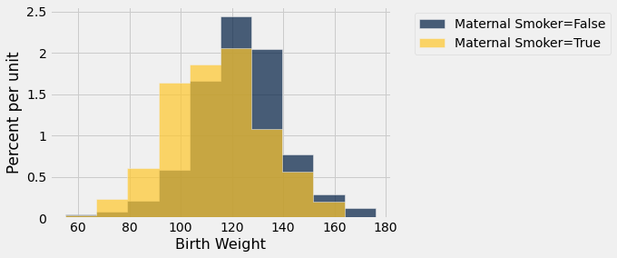
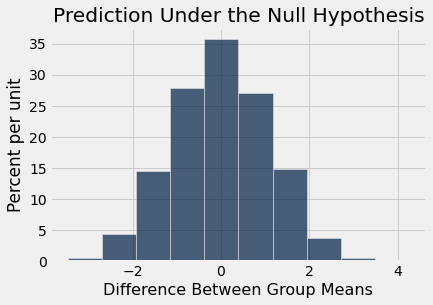
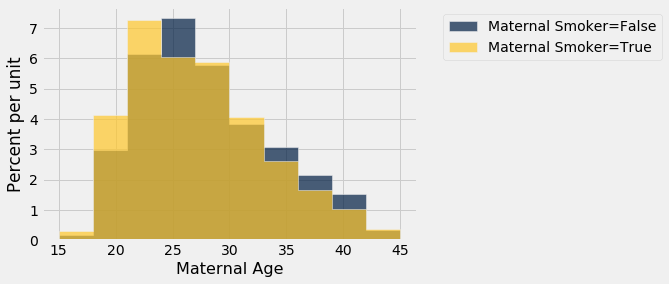
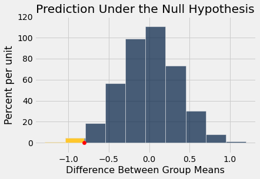

# A/B 검정(A/B testing)
현대 데이터 분석에서 두 개의 수치형 표본(sample)이 같은 기저 분포(underlying distribution)에서 나온 것인지를 판단하는 일을 *A/B 검정*(A/B testing)이라고 한다. 이 이름은 두 표본의 레이블인 A와 B를 가리킨다.

이 방법을 하나의 예를 통해 전개해 보자. 데이터는 한 대형 병원 체계에서 태어난 신생아의 표본(sample)에서 얻은 것이다. 실제 표본추출(sampling)은 여러 단계로 이루어졌지만, 여기서는 이를 단순 무작위 표본(simple random sample)인 것처럼 취급한다. 데버라 놀런(Deborah Nolan)과 테리 스피드(Terry Speed)의 [Stat Labs](https://www.stat.berkeley.edu/~statlabs/)에 이 데이터가 추출된 더 큰 데이터셋에 관한 자세한 내용이 나와 있다.

```python
from datascience import *
path_data = '../../../assets/data/'
import numpy as np

import matplotlib
matplotlib.use('Agg')
%matplotlib inline
import matplotlib.pyplot as plots
plots.style.use('fivethirtyeight')
```

## 흡연자와 비흡연자
테이블 `births`에는 1,174쌍의 산모와 아기에 대해 다음 변수들이 들어 있다. 아기의 출생 체중(온스 단위), 임신 일수, 산모의 만 나이, 산모의 키(인치 단위), 임신 중 체중(파운드 단위), 그리고 산모의 임신 중 흡연 여부이다.

```python
births = Table.read_table(path_data + 'baby.csv')
births
```

<table border="1" class="dataframe">
    <thead>
        <tr>
            <th>Birth Weight</th> <th>Gestational Days</th> <th>Maternal Age</th> <th>Maternal Height</th> <th>Maternal Pregnancy Weight</th> <th>Maternal Smoker</th>
        </tr>
    </thead>
    <tbody>
        <tr>
            <td>120         </td> <td>284             </td> <td>27          </td> <td>62             </td> <td>100                      </td> <td>False          </td>
        </tr>
        <tr>
            <td>113         </td> <td>282             </td> <td>33          </td> <td>64             </td> <td>135                      </td> <td>False          </td>
        </tr>
        <tr>
            <td>128         </td> <td>279             </td> <td>28          </td> <td>64             </td> <td>115                      </td> <td>True           </td>
        </tr>
        <tr>
            <td>108         </td> <td>282             </td> <td>23          </td> <td>67             </td> <td>125                      </td> <td>True           </td>
        </tr>
        <tr>
            <td>136         </td> <td>286             </td> <td>25          </td> <td>62             </td> <td>93                       </td> <td>False          </td>
        </tr>
        <tr>
            <td>138         </td> <td>244             </td> <td>33          </td> <td>62             </td> <td>178                      </td> <td>False          </td>
        </tr>
        <tr>
            <td>132         </td> <td>245             </td> <td>23          </td> <td>65             </td> <td>140                      </td> <td>False          </td>
        </tr>
        <tr>
            <td>120         </td> <td>289             </td> <td>25          </td> <td>62             </td> <td>125                      </td> <td>False          </td>
        </tr>
        <tr>
            <td>143         </td> <td>299             </td> <td>30          </td> <td>66             </td> <td>136                      </td> <td>True           </td>
        </tr>
        <tr>
            <td>140         </td> <td>351             </td> <td>27          </td> <td>68             </td> <td>120                      </td> <td>False          </td>
        </tr>
    </tbody>
</table>
<p>... (1164 rows omitted)</p>

이 연구의 목적 중 하나는 산모의 흡연이 출생 체중과 연관성(association)이 있는지를 알아보는 것이었다. 두 변수에 대해 무엇을 말할 수 있는지 살펴보자.

먼저 `Birth Weight`와 `Maternal Smoker`만 선택하자. 표본(sample)의 여성 중 비흡연자는 715명, 흡연자는 459명이다.

```python
smoking_and_birthweight = births.select('Maternal Smoker', 'Birth Weight')
```

```python
smoking_and_birthweight.group('Maternal Smoker')
```

<table border="1" class="dataframe">
    <thead>
        <tr>
            <th>Maternal Smoker</th> <th>count</th>
        </tr>
    </thead>
    <tbody>
        <tr>
            <td>False          </td> <td>715  </td>
        </tr>
        <tr>
            <td>True           </td> <td>459  </td>
        </tr>
    </tbody>
</table>

비흡연 산모의 아기들의 출생 체중 분포(distribution)를 흡연 산모의 아기들의 출생 체중 분포와 비교해 보자. 두 히스토그램(histogram)을 겹쳐 그리기 위해, 열 레이블이나 인덱스를 값으로 받는 선택적 인수 `group`과 함께 `hist`를 사용한다. 테이블의 행들이 먼저 이 열에 따라 그룹화되고, 그다음 각 그룹에 대해 히스토그램이 그려진다.

```python
smoking_and_birthweight.hist('Birth Weight', group = 'Maternal Smoker')
```



흡연한 산모에게서 태어난 아기들의 체중 분포(distribution)는 비흡연 산모에 해당하는 분포보다 약간 왼쪽에 놓여 있는 것으로 보인다. 흡연한 산모의 아기들의 체중이 비흡연자의 아기들의 체중보다 평균(average)적으로 더 낮은 것 같다. 

이로부터 이 차이가 단지 우연에 의한 변동(chance variation)을 반영하는 것인지, 아니면 더 큰 모집단(population)에서의 분포(distribution) 차이를 반영하는 것인지라는 질문이 생긴다. 모집단에서는 두 분포 사이에 차이가 없는데, 우연히 선택된 산모들 때문에 표본(sample)에서 차이가 보이는 것일 수도 있지 않을까?

## 가설(hypothesis)
이 질문에는 가설 검정(test of hypotheses)으로 답해 볼 수 있다. 우리가 검정할 확률 모형(chance model)은 모집단(population)에는 근본적인 차이가 없으며, 표본(sample)의 분포(distribution)가 다른 것은 단지 우연 때문이라고 말한다. 

형식적으로 이것이 귀무가설(null hypothesis)이다. 이 가설하에서 유용한 통계량(statistic)을 시뮬레이션(simulation)하는 방법을 알아내야 한다. 하지만 우선은 두 가지 자연스러운 가설(hypothesis)을 진술해 보자.

**귀무가설(null hypothesis):** 모집단(population)에서 아기의 출생 체중 분포(distribution)는 흡연하지 않는 산모와 흡연하는 산모에서 같다. 표본(sample)에서 나타난 차이는 우연에 의한 것이다.

**대립가설(alternative hypothesis):** 모집단(population)에서 흡연하는 산모의 아기들은 비흡연자의 아기들보다 평균(average)적으로 출생 체중이 더 낮다.

## 검정 통계량(test statistic)
대립가설(alternative hypothesis)은 두 집단의 평균(average) 출생 체중을 비교하며, 흡연하는 산모의 평균이 더 작다고 말한다. 따라서 두 집단 평균의 차이를 통계량(statistic)으로 사용하는 것이 합리적이다. 

뺄셈은 "흡연 집단의 평균(average) 체중 $-$ 비흡연 집단의 평균 체중"의 순서로 한다. 이 통계량(statistic)의 값이 작으면(즉, 절댓값이 큰 음수이면) 대립가설(alternative hypothesis)을 지지하게 된다. 

검정 통계량(test statistic)의 관측값은 약 $-9.27$온스이다.

```python
means_table = smoking_and_birthweight.group('Maternal Smoker', np.average)
means_table
```

<table border="1" class="dataframe">
    <thead>
        <tr>
            <th>Maternal Smoker</th> <th>Birth Weight average</th>
        </tr>
    </thead>
    <tbody>
        <tr>
            <td>False          </td> <td>123.085             </td>
        </tr>
        <tr>
            <td>True           </td> <td>113.819             </td>
        </tr>
    </tbody>
</table>

```python
means = means_table.column(1)
observed_difference = means.item(1) - means.item(0)
observed_difference
```

```
-9.266142572024918
```

아래의 시뮬레이션(simulation)에서 이러한 차이를 반복해서 계산할 것이므로, 이 일을 하는 함수를 정의하자. 이 함수는 두 개의 인수를 받는다.

- 데이터 테이블의 이름
- 그룹화에 사용할 불리언(Boolean) 변수가 들어 있는 열의 레이블

이 함수는 `True` 집단의 평균(mean)과 `False` 집단의 평균 사이의 차이를 반환한다.

두 인수를 지정하는 이유는 곧 알게 될 것이다. 지금은 함수가 제대로 된 값을 반환하는지만 확인하자.

```python
def difference_of_means(table, group_label):
    """Takes: name of table,
    column label that indicates the group to which the row belongs
    Returns: Difference of mean birth weights of the two groups"""
    reduced = table.select('Birth Weight', group_label)
    means_table = reduced.group(group_label, np.average)
    means = means_table.column(1)
    return means.item(1) - means.item(0)
```

함수가 제대로 작동하는지 확인하기 위해, 이 함수를 이용하여 표본(sample)에서 두 집단의 평균(mean) 출생 체중 사이의 관측된 차이를 계산해 보자.

```python
difference_of_means(births, 'Maternal Smoker')
```

```
-9.266142572024918
```

이는 앞에서 계산한 `observed_difference`의 값과 같다.

## 귀무가설(null hypothesis)하에서 통계량(statistic) 예측하기

귀무가설(null hypothesis)하에서 통계량(statistic)이 어떻게 변해야 하는지 보려면, 그 가설하에서 통계량을 시뮬레이션(simulation)하는 방법을 알아내야 한다. *무작위 순열*(random permutation)에 기반한 기발한 방법이 바로 그 일을 해 준다.

기저 모집단(population)에서 두 분포(distribution) 사이에 차이가 없다면, 어떤 출생 체중이 산모의 흡연에 관해 `True` 레이블을 갖는지 `False` 레이블을 갖는지는 평균(average)에 아무런 차이를 만들지 않아야 한다. 그렇다면 핵심 아이디어는 모든 레이블을 산모들 사이에서 무작위로 뒤섞는 것이다. 이를 *무작위 순열*이라고 한다. 

뒤섞기를 하면 `True` 레이블의 개수도, `False` 레이블의 개수도 변하지 않는다. 이는 시뮬레이션(simulation)으로 얻은 평균(mean)의 차이와 원래의 평균 차이를 비교 가능하게 하는 데 중요하다. 이 강의의 뒷부분에서 표본 크기(sample size)가 표본 평균의 변동성에 영향을 준다는 것을 보게 될 것이다.

두 새로운 집단의 평균(mean), 즉 산모가 무작위로 흡연자 레이블을 받은 아기들의 평균 체중과, 나머지 모든 산모가 무작위로 비흡연자 레이블을 받은 아기들의 평균 체중의 차이를 구한다. 이것이 귀무가설(null hypothesis)하에서 시뮬레이션된 검정 통계량(test statistic)의 값이다.

이를 어떻게 하는지 살펴보자. 언제나 데이터에서 시작하는 것이 좋다. 테이블은 필요한 열만 남도록 줄여 두었다.

```python
smoking_and_birthweight
```

<table border="1" class="dataframe">
    <thead>
        <tr>
            <th>Maternal Smoker</th> <th>Birth Weight</th>
        </tr>
    </thead>
    <tbody>
        <tr>
            <td>False          </td> <td>120         </td>
        </tr>
        <tr>
            <td>False          </td> <td>113         </td>
        </tr>
        <tr>
            <td>True           </td> <td>128         </td>
        </tr>
        <tr>
            <td>True           </td> <td>108         </td>
        </tr>
        <tr>
            <td>False          </td> <td>136         </td>
        </tr>
        <tr>
            <td>False          </td> <td>138         </td>
        </tr>
        <tr>
            <td>False          </td> <td>132         </td>
        </tr>
        <tr>
            <td>False          </td> <td>120         </td>
        </tr>
        <tr>
            <td>True           </td> <td>143         </td>
        </tr>
        <tr>
            <td>False          </td> <td>140         </td>
        </tr>
    </tbody>
</table>
<p>... (1164 rows omitted)</p>

테이블에는 1,174개의 행이 있다. 모든 레이블을 뒤섞기 위해, 1,174개의 행을 비복원(without replacement)으로 뽑는 무작위 표본(random sample)을 추출한다. 그러면 표본은 테이블의 모든 행을 무작위 순서로 포함하게 된다. 

Table 메서드 `sample`을 선택적 인수 `with_replacement=False`와 함께 사용하면 된다. 기본적으로 `sample`은 테이블의 행 수만큼 뽑기 때문에 표본 크기(sample size)를 지정할 필요가 없다.

```python
shuffled_labels = smoking_and_birthweight.sample(with_replacement = False).column(0)
original_and_shuffled = smoking_and_birthweight.with_column('Shuffled Label', shuffled_labels)
```

```python
original_and_shuffled
```

<table border="1" class="dataframe">
    <thead>
        <tr>
            <th>Maternal Smoker</th> <th>Birth Weight</th> <th>Shuffled Label</th>
        </tr>
    </thead>
    <tbody>
        <tr>
            <td>False          </td> <td>120         </td> <td>True          </td>
        </tr>
        <tr>
            <td>False          </td> <td>113         </td> <td>False         </td>
        </tr>
        <tr>
            <td>True           </td> <td>128         </td> <td>False         </td>
        </tr>
        <tr>
            <td>True           </td> <td>108         </td> <td>True          </td>
        </tr>
        <tr>
            <td>False          </td> <td>136         </td> <td>False         </td>
        </tr>
        <tr>
            <td>False          </td> <td>138         </td> <td>False         </td>
        </tr>
        <tr>
            <td>False          </td> <td>132         </td> <td>True          </td>
        </tr>
        <tr>
            <td>False          </td> <td>120         </td> <td>False         </td>
        </tr>
        <tr>
            <td>True           </td> <td>143         </td> <td>True          </td>
        </tr>
        <tr>
            <td>False          </td> <td>140         </td> <td>False         </td>
        </tr>
    </tbody>
</table>
<p>... (1164 rows omitted)</p>

이제 각 아기의 산모는 `Shuffled Label` 열에 무작위로 정해진 흡연자/비흡연자 레이블을 갖고, 원래의 레이블은 `Maternal Smoker`에 있다. 귀무가설(null hypothesis)이 참이라면, 레이블의 모든 무작위 재배열은 똑같이 일어날 가능성이 있어야 한다.

무작위로 레이블이 붙은 두 집단에서 평균(average) 체중이 얼마나 다른지 살펴보자.

```python
shuffled_only = original_and_shuffled.select('Birth Weight','Shuffled Label')
shuffled_group_means = shuffled_only.group('Shuffled Label', np.average)
shuffled_group_means
```

<table border="1" class="dataframe">
    <thead>
        <tr>
            <th>Shuffled Label</th> <th>Birth Weight average</th>
        </tr>
    </thead>
    <tbody>
        <tr>
            <td>False         </td> <td>119.277             </td>
        </tr>
        <tr>
            <td>True          </td> <td>119.752             </td>
        </tr>
    </tbody>
</table>

무작위로 선택된 두 집단의 평균(average)은 원래 두 집단의 평균보다 훨씬 더 가깝다. 함수 `difference_of_means`를 사용하여 두 차이를 구할 수 있다.

```python
difference_of_means(original_and_shuffled, 'Shuffled Label')
```

```
0.4747109100050153
```

```python
difference_of_means(original_and_shuffled, 'Maternal Smoker')
```

```
-9.266142572024918
```

그런데 다르게 뒤섞었다면 집단 평균(average) 사이의 차이가 더 커졌을 수도 있지 않을까? 변동성을 가늠하려면 이 차이를 여러 번 시뮬레이션(simulation)해야 한다. 

늘 그렇듯이, 귀무가설(null hypothesis)하에서 검정 통계량(test statistic)의 값 하나를 시뮬레이션하는 함수를 정의하는 것으로 시작한다. 이는 위에서 작성한 코드를 모으기만 하면 되는 일이다. 

이 함수의 이름은 `one_simulated_difference_of_means`이다. 이 함수는 인수를 받지 않으며, 모든 레이블을 무작위로 뒤섞어 만든 두 집단의 평균(mean) 출생 체중 사이의 차이를 반환한다.

```python
def one_simulated_difference_of_means():
    """Returns: Difference between mean birthweights
    of babies of smokers and non-smokers after shuffling labels"""
    
    # array of shuffled labels
    shuffled_labels = births.sample(with_replacement=False).column('Maternal Smoker')
    
    # table of birth weights and shuffled labels
    shuffled_table = births.select('Birth Weight').with_column(
        'Shuffled Label', shuffled_labels)
    
    return difference_of_means(shuffled_table, 'Shuffled Label')
```

아래 셀을 몇 번 실행하여 출력이 어떻게 바뀌는지 확인해 보자.

```python
one_simulated_difference_of_means()
```

```
-0.058299434770034964
```

## 순열 검정(permutation test)
데이터의 무작위 순열(random permutation)에 기반한 검정을 *순열 검정*(permutation test)이라고 한다. 이 예에서 우리는 순열 검정을 수행하고 있다. 아래 셀에서는 검정 통계량(test statistic), 즉 무작위로 구성된 두 집단의 평균(average) 출생 체중 사이의 차이를 여러 번 시뮬레이션(simulation)하고 그 차이들을 배열에 모은다.

```python
differences = make_array()

repetitions = 5000
for i in np.arange(repetitions):
    new_difference = one_simulated_difference_of_means()
    differences = np.append(differences, new_difference)
```

배열 `differences`에는 검정 통계량(test statistic)의 시뮬레이션된 값 5,000개가 들어 있다. 이는 레이블이 무작위로 배정되었을 때 흡연 집단의 평균(mean) 체중과 비흡연 집단의 평균 체중 사이의 차이이다. 

## 검정의 결론
아래 히스토그램(histogram)은 이 5,000개 값의 분포(distribution)를 보여 준다. 이것은 귀무가설(null hypothesis)하에서 시뮬레이션된 검정 통계량(test statistic)의 경험적 분포(empirical distribution)이다. 이는 귀무가설에 기반한, 검정 통계량에 대한 예측이다.

```python
Table().with_column('Difference Between Group Means', differences).hist()
print('Observed Difference:', observed_difference)
plots.title('Prediction Under the Null Hypothesis');
```

```
Observed Difference: -9.266142572024918
```



분포(distribution)의 중심이 대략 0 근처에 있다는 점에 주목하자. 귀무가설(null hypothesis)하에서는 두 집단의 평균(average)이 대략 같아야 하므로 이는 이치에 맞는다. 따라서 집단 평균 사이의 차이는 0 근처여야 한다.

원래 표본(sample)에서 관측된 차이는 약 $-9.27$온스로, 히스토그램(histogram)의 가로축 눈금에 나타나지조차 않는다. 통계량(statistic)의 관측값과 귀무가설(null hypothesis)하에서 예측된 통계량의 양상은 서로 일치하지 않는다. 

검정의 결론은 데이터가 귀무가설(null hypothesis)보다 대립가설(alternative hypothesis)을 지지한다는 것이다. 즉, 흡연하는 산모에게서 태어난 아기들의 평균(average) 출생 체중이 비흡연자에게서 태어난 아기들의 평균 출생 체중보다 작다는 가설(hypothesis)을 뒷받침한다.

경험적 p-값(empirical p-value)을 계산하려면, 통계량(statistic)의 값이 작을수록 대립가설(alternative hypothesis)을 지지한다는 점을 기억하자.

```python
empirical_p = np.count_nonzero(differences <= observed_difference) / repetitions
empirical_p
```

```
0.0
```

경험적 p-값(empirical p-value)은 0이다. 이는 5,000개의 순열 표본(permuted sample) 중 어느 것도 -9.27 이하의 차이를 내지 않았다는 뜻이다. 이것은 근사일 뿐이다. 그 범위의 차이를 얻을 정확한 확률은 0이 아니다. 그러나 시뮬레이션(simulation)에 따르면 그 확률은 무시할 수 있을 만큼 작으며, 따라서 귀무가설(null hypothesis)을 기각할 수 있다.

## 또 다른 순열 검정(permutation test)
같은 방법을 사용하여 흡연자와 비흡연자의 다른 속성, 예를 들어 나이를 비교할 수 있다. 두 집단의 나이에 대한 히스토그램(histogram)을 보면, 표본(sample)에서 흡연한 산모들이 더 젊은 경향이 있었음을 알 수 있다.

```python
smoking_and_age = births.select('Maternal Smoker', 'Maternal Age')
smoking_and_age.hist('Maternal Age', group = 'Maternal Smoker')
```



평균(average) 나이 사이의 관측된 차이는 약 $-0.8$년이다.

출생 체중을 비교했던 코드를 고쳐서, 이번에는 흡연자와 비흡연자의 나이를 비교하도록 하자.

```python
def difference_of_means(table, group_label):
    """Takes: name of table,
    column label that indicates the group to which the row belongs
    Returns: Difference of mean ages of the two groups"""
    reduced = table.select('Maternal Age', group_label)
    means_table = reduced.group(group_label, np.average)
    means = means_table.column(1)
    return means.item(1) - means.item(0)
```

```python
observed_age_difference = difference_of_means(births, 'Maternal Smoker')
observed_age_difference
```

```
-0.8076725017901509
```

차이는 흡연자의 평균(mean) 나이에서 비흡연자의 평균 나이를 빼서 계산한다는 것을 기억하자. 음의 부호는 흡연자가 평균적으로 더 젊다는 것을 보여 준다.

이 차이는 우연에 의한 것인가, 아니면 모집단(population)의 근본적인 차이를 반영하는 것인가?

앞에서와 마찬가지로, 이 질문에 답하기 위해 순열 검정(permutation test)을 사용할 수 있다. 두 집단의 기저 나이 분포(distribution)가 같다면, 순열 표본(permuted sample)에 기반한 차이의 경험적 분포(empirical distribution)는 통계량(statistic)이 우연에 의해 어떻게 변해야 하는지를 예측해 줄 것이다.

여느 시뮬레이션(simulation)과 같은 과정을 따른다. 먼저 평균(mean) 사이의 차이를 시뮬레이션한 값 하나를 반환하는 함수를 작성하고, 그다음 `for` 루프를 작성하여 그런 값을 많이 시뮬레이션하고 배열에 모은다.

```python
def one_simulated_difference_of_means():
    """Returns: Difference between mean ages
    of smokers and non-smokers after shuffling labels"""
    
    # array of shuffled labels
    shuffled_labels = births.sample(with_replacement=False).column('Maternal Smoker')
    
    # table of ages and shuffled labels
    shuffled_table = births.select('Maternal Age').with_column(
        'Shuffled Label', shuffled_labels)
    
    return difference_of_means(shuffled_table, 'Shuffled Label')
```

```python
age_differences = make_array()

repetitions = 5000
for i in np.arange(repetitions):
    new_difference = one_simulated_difference_of_means()
    age_differences = np.append(age_differences, new_difference)
```

관측된 차이는 귀무가설(null hypothesis)하에서 시뮬레이션된 차이들의 경험적 분포(empirical distribution)의 꼬리 부분에 있다.

```python
Table().with_column(
    'Difference Between Group Means', age_differences).hist(
    right_end = observed_age_difference)
# Plotting parameters; you can ignore the code below
plots.ylim(-0.1, 1.2)
plots.scatter(observed_age_difference, 0, color='red', s=40, zorder=3)
plots.title('Prediction Under the Null Hypothesis')
print('Observed Difference:', observed_age_difference)
```

```
Observed Difference: -0.8076725017901509
```



이번에도 시뮬레이션된 차이들의 경험적 분포(empirical distribution)는 중심이 대략 0 근처에 있다. 이는 시뮬레이션(simulation)이 두 집단의 분포 사이에 차이가 없다는 귀무가설(null hypothesis)하에서 이루어졌기 때문이다.

이 검정의 경험적 p-값(empirical p-value)은 시뮬레이션된 차이 중 관측된 차이 이하인 것들의 비율이다. 차이의 값이 작을수록 흡연자가 평균(average)적으로 더 젊다는 대립가설(alternative hypothesis)을 지지하기 때문이다.

```python
empirical_p = np.count_nonzero(age_differences <= observed_age_difference) / 5000
empirical_p
```

```
0.0108
```

경험적 p-값(empirical p-value)은 약 1%이므로 결과는 통계적으로 유의한(statistically significant) 것이다. 이 검정은 흡연자가 평균(average)적으로 더 젊었다는 가설(hypothesis)을 뒷받침한다.
