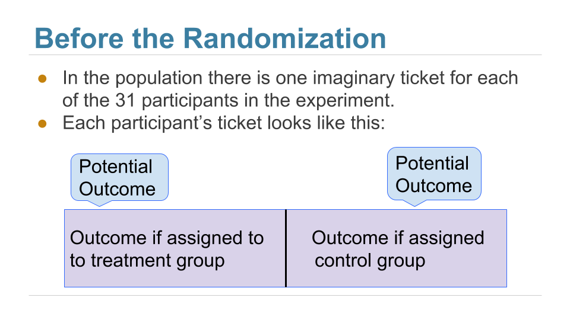
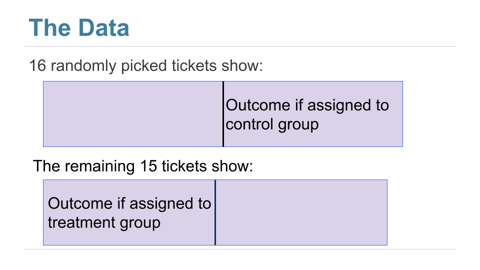
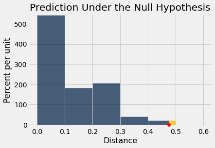

# 인과관계(causality)

```python
from datascience import *
%matplotlib inline
path_data = '../../../assets/data/'
import matplotlib.pyplot as plots
plots.style.use('fivethirtyeight')
import numpy as np
```

두 표본(sample)을 비교하는 우리의 방법은 무작위 통제 실험(randomized controlled experiment)의 분석에서 강력하게 활용된다. 이러한 실험에서는 처리군(treatment group)과 대조군(control group)이 무작위로 배정되므로, 두 집단의 결과 차이를 처리에 아무런 효과가 없을 때 순전히 우연에 의해 일어날 일과 비교할 수 있다. 관측된 차이가 순전히 우연에 의한 것으로 예측되는 것보다 더 뚜렷하다면, *인과관계*(causation)의 증거를 갖게 된다. 개인들이 처리군과 대조군에 치우침 없이 배정되었기 때문에, 두 집단의 결과 차이를 처리의 효과로 돌릴 수 있다.

무작위 통제 실험(randomized controlled experiment)의 분석에서 핵심은 우연이 정확히 어떻게 개입하는지를 이해하는 것이다. 이를 이해하면 명확한 귀무가설(null hypothesis)과 대립가설(alternative hypothesis)을 세우는 데 도움이 된다. 그렇게 하고 나면, 앞 절들의 방법을 그대로 사용하여 분석을 마무리할 수 있다.

예를 통해 이를 어떻게 하는지 살펴보자.

## 만성 요통의 치료: 무작위 통제 실험(randomized controlled trial)
성인의 요통은 매우 오래 지속되고 치료하기 어려울 수 있다. 흔히 쓰이는 치료법은 코르티코스테로이드(corticosteroid)에서 침술에 이르기까지 다양하다. 한 [무작위 통제 실험(randomized controlled trial, RCT)](https://www.ncbi.nlm.nih.gov/pubmed/11376175)은 보툴리눔 독소 A(Botulinum Toxin A, BTA)를 치료제로 사용하는 효과를 조사하였다. 보툴리눔 독소는 보툴리누스 중독증(botulism)을 일으키는 신경독성 단백질이다. [위키백과(Wikipedia)](https://en.wikipedia.org/wiki/Botulinum_toxin)에 따르면 보툴리눔은 "알려진 독소 중 급성 치사성이 가장 높은 독소"이다. 보툴리눔 독소에는 일곱 가지 유형이 있다. 보툴리눔 독소 A는 사람에게 질병을 일으킬 수 있는 유형 중 하나이지만, 근육과 관련된 여러 질병을 치료하는 데 의학적으로 사용되기도 한다. 2001년 포스터(Foster), 클랩(Clapp), 재버리(Jabbari)가 분석한 무작위 통제 실험은 이것을 요통 치료제로서 조사하였다.

요통 환자 31명이 처리군(treatment group)과 대조군(control group)에 무작위로 배정되었으며, 처리군에 15명, 대조군에 16명이 배정되었다. 대조군에는 일반 식염수가 투여되었고, 시험은 이중맹검(double-blind)으로 진행되어 의사도 환자도 누가 어느 집단에 속하는지 알지 못했다.

연구 시작 후 8주가 지났을 때, (연구자들이 사용한 엄밀한 정의에 따르면) 처리군(treatment group) 15명 중 9명, 대조군(control group) 16명 중 2명이 통증 완화를 경험하였다. 이 데이터는 테이블 `bta`에 들어 있으며, 처리에 분명한 이점이 있음을 보여 주는 것처럼 보인다.

```python
bta = Table.read_table(path_data + 'bta.csv')
bta.show()
```

<table border="1" class="dataframe">
    <thead>
        <tr>
            <th>Group</th> <th>Result</th>
        </tr>
    </thead>
    <tbody>
        <tr>
            <td>Control  </td> <td>1     </td>
        </tr>
        <tr>
            <td>Control  </td> <td>1     </td>
        </tr>
        <tr>
            <td>Control  </td> <td>0     </td>
        </tr>
        <tr>
            <td>Control  </td> <td>0     </td>
        </tr>
        <tr>
            <td>Control  </td> <td>0     </td>
        </tr>
        <tr>
            <td>Control  </td> <td>0     </td>
        </tr>
        <tr>
            <td>Control  </td> <td>0     </td>
        </tr>
        <tr>
            <td>Control  </td> <td>0     </td>
        </tr>
        <tr>
            <td>Control  </td> <td>0     </td>
        </tr>
        <tr>
            <td>Control  </td> <td>0     </td>
        </tr>
        <tr>
            <td>Control  </td> <td>0     </td>
        </tr>
        <tr>
            <td>Control  </td> <td>0     </td>
        </tr>
        <tr>
            <td>Control  </td> <td>0     </td>
        </tr>
        <tr>
            <td>Control  </td> <td>0     </td>
        </tr>
        <tr>
            <td>Control  </td> <td>0     </td>
        </tr>
        <tr>
            <td>Control  </td> <td>0     </td>
        </tr>
        <tr>
            <td>Treatment</td> <td>1     </td>
        </tr>
        <tr>
            <td>Treatment</td> <td>1     </td>
        </tr>
        <tr>
            <td>Treatment</td> <td>1     </td>
        </tr>
        <tr>
            <td>Treatment</td> <td>1     </td>
        </tr>
        <tr>
            <td>Treatment</td> <td>1     </td>
        </tr>
        <tr>
            <td>Treatment</td> <td>1     </td>
        </tr>
        <tr>
            <td>Treatment</td> <td>1     </td>
        </tr>
        <tr>
            <td>Treatment</td> <td>1     </td>
        </tr>
        <tr>
            <td>Treatment</td> <td>1     </td>
        </tr>
        <tr>
            <td>Treatment</td> <td>0     </td>
        </tr>
        <tr>
            <td>Treatment</td> <td>0     </td>
        </tr>
        <tr>
            <td>Treatment</td> <td>0     </td>
        </tr>
        <tr>
            <td>Treatment</td> <td>0     </td>
        </tr>
        <tr>
            <td>Treatment</td> <td>0     </td>
        </tr>
        <tr>
            <td>Treatment</td> <td>0     </td>
        </tr>
    </tbody>
</table>

각 집단에서 몇 명의 환자가 회복했는지 살펴보자. 개수를 세는 것은 0과 1을 더하는 것과 같다는 점을 기억하자. 대조군(control group)에서 1들의 합은 통증 완화를 경험한 대조군 환자의 수이다.

```python
bta.group('Group', sum)
```

<table border="1" class="dataframe">
    <thead>
        <tr>
            <th>Group</th> <th>Result sum</th>
        </tr>
    </thead>
    <tbody>
        <tr>
            <td>Control  </td> <td>2         </td>
        </tr>
        <tr>
            <td>Treatment</td> <td>9         </td>
        </tr>
    </tbody>
</table>

개수를 세는 것이 0과 1의 *합*과 같으므로, 통증 완화를 경험한 환자의 *비율*은 0과 1의 *평균*(average)이다. 이는 합을 각 집단의 전체 환자 수로 나눈 값이다.

```python
bta.group('Group', np.average)
```

<table border="1" class="dataframe">
    <thead>
        <tr>
            <th>Group</th> <th>Result average</th>
        </tr>
    </thead>
    <tbody>
        <tr>
            <td>Control  </td> <td>0.125         </td>
        </tr>
        <tr>
            <td>Treatment</td> <td>0.6           </td>
        </tr>
    </tbody>
</table>

처리군(treatment group)에서는 환자의 60%가 통증 완화를 경험한 반면, 대조군(control group)에서는 12.5%에 불과했다. 부작용을 겪은 환자는 한 명도 없었다. 

따라서 보툴리눔 독소 A가 식염수보다 더 나은 효과를 냈다는 징후가 있다. 그러나 이 결론은 아직 확실하다고 할 수 없다. 환자들은 두 집단에 무작위로 배정되었으므로, 어쩌면 이 차이는 단지 우연에 의한 것일 수도 있지 않을까?

이것이 무슨 뜻인지 이해하려면, 연구에 참여한 31명의 환자 중 일부는 처리의 도움 없이도 원래 다른 환자들보다 더 잘 회복할 수 있었을 가능성을 고려해야 한다. 만약 그런 환자들 중 유난히 큰 비율이 순전히 우연으로 처리군(treatment group)에 배정되었다면 어떻게 될까? 그렇다면 처리가 대조군(control group)의 식염수보다 나은 효과가 전혀 없었더라도, 처리군의 결과가 대조군의 결과보다 더 좋아 보일 수 있다. 

이 가능성을 고려하기 위해, 확률 모형(chance model)을 신중하게 세우는 것부터 시작하자.

## 잠재적 결과(potential outcomes)
환자들이 두 집단에 무작위로 배정되기 전에, 우리는 본능적으로 각 환자에 대해 두 가지 가능한 결과를 떠올린다. 하나는 그 환자가 처리군(treatment group)에 배정되었을 때 얻게 될 결과이고, 다른 하나는 같은 환자가 대조군(control group)에 배정되었을 때 얻게 될 결과이다. 이를 그 환자의 두 *잠재적 결과*(potential outcomes)라고 한다.

따라서 31개의 잠재적 처리 결과와 31개의 잠재적 대조 결과가 있다. 문제는 각각 31개의 결과로 이루어진 이 두 집합의 분포(distribution)에 관한 것이다. 두 분포는 같은가, 아니면 다른가?

아직은 이 질문에 답할 수 없다. 각 집단의 31개 값을 모두 볼 수는 없기 때문이다. 우리가 볼 수 있는 것은 무작위로 선택된 16개의 잠재적 대조 결과와, *나머지* 15명 환자의 처리 결과뿐이다. 

이 상황을 시각화하는 좋은 방법이 있다. 각 환자는 양면으로 된 티켓을 하나씩 가지고 있다.



무작위 배정 후에는 무작위로 선택된 티켓들의 오른쪽 절반과, 나머지 티켓들의 왼쪽 절반을 보게 된다.



테이블 `observed_outcomes`는 모든 환자의 잠재적 결과(potential outcomes)에 관한 정보를 모아 놓은 것으로, 각 "티켓"에서 관측되지 않은 절반은 비워 두었다. (이는 같은 정보를 담고 있는 `bta` 테이블을 바라보는 또 다른 방식일 뿐이다.)

```python
observed_outcomes = Table.read_table(path_data + "observed_outcomes.csv")
observed_outcomes.show()
```

<table border="1" class="dataframe">
    <thead>
        <tr>
            <th>Group</th> <th>Outcome if assigned treatment</th> <th>Outcome if assigned control</th>
        </tr>
    </thead>
    <tbody>
        <tr>
            <td>Control  </td> <td>Unknown                      </td> <td>1                          </td>
        </tr>
        <tr>
            <td>Control  </td> <td>Unknown                      </td> <td>1                          </td>
        </tr>
        <tr>
            <td>Control  </td> <td>Unknown                      </td> <td>0                          </td>
        </tr>
        <tr>
            <td>Control  </td> <td>Unknown                      </td> <td>0                          </td>
        </tr>
        <tr>
            <td>Control  </td> <td>Unknown                      </td> <td>0                          </td>
        </tr>
        <tr>
            <td>Control  </td> <td>Unknown                      </td> <td>0                          </td>
        </tr>
        <tr>
            <td>Control  </td> <td>Unknown                      </td> <td>0                          </td>
        </tr>
        <tr>
            <td>Control  </td> <td>Unknown                      </td> <td>0                          </td>
        </tr>
        <tr>
            <td>Control  </td> <td>Unknown                      </td> <td>0                          </td>
        </tr>
        <tr>
            <td>Control  </td> <td>Unknown                      </td> <td>0                          </td>
        </tr>
        <tr>
            <td>Control  </td> <td>Unknown                      </td> <td>0                          </td>
        </tr>
        <tr>
            <td>Control  </td> <td>Unknown                      </td> <td>0                          </td>
        </tr>
        <tr>
            <td>Control  </td> <td>Unknown                      </td> <td>0                          </td>
        </tr>
        <tr>
            <td>Control  </td> <td>Unknown                      </td> <td>0                          </td>
        </tr>
        <tr>
            <td>Control  </td> <td>Unknown                      </td> <td>0                          </td>
        </tr>
        <tr>
            <td>Control  </td> <td>Unknown                      </td> <td>0                          </td>
        </tr>
        <tr>
            <td>Treatment</td> <td>1                            </td> <td>Unknown                    </td>
        </tr>
        <tr>
            <td>Treatment</td> <td>1                            </td> <td>Unknown                    </td>
        </tr>
        <tr>
            <td>Treatment</td> <td>1                            </td> <td>Unknown                    </td>
        </tr>
        <tr>
            <td>Treatment</td> <td>1                            </td> <td>Unknown                    </td>
        </tr>
        <tr>
            <td>Treatment</td> <td>1                            </td> <td>Unknown                    </td>
        </tr>
        <tr>
            <td>Treatment</td> <td>1                            </td> <td>Unknown                    </td>
        </tr>
        <tr>
            <td>Treatment</td> <td>1                            </td> <td>Unknown                    </td>
        </tr>
        <tr>
            <td>Treatment</td> <td>1                            </td> <td>Unknown                    </td>
        </tr>
        <tr>
            <td>Treatment</td> <td>1                            </td> <td>Unknown                    </td>
        </tr>
        <tr>
            <td>Treatment</td> <td>0                            </td> <td>Unknown                    </td>
        </tr>
        <tr>
            <td>Treatment</td> <td>0                            </td> <td>Unknown                    </td>
        </tr>
        <tr>
            <td>Treatment</td> <td>0                            </td> <td>Unknown                    </td>
        </tr>
        <tr>
            <td>Treatment</td> <td>0                            </td> <td>Unknown                    </td>
        </tr>
        <tr>
            <td>Treatment</td> <td>0                            </td> <td>Unknown                    </td>
        </tr>
        <tr>
            <td>Treatment</td> <td>0                            </td> <td>Unknown                    </td>
        </tr>
    </tbody>
</table>

## 가설(hypothesis)
문제는 처리가 어떤 효과를 내는가 하는 것이다. 테이블 `observed_outcomes`의 관점에서 말하면, 문제는 (알려지지 않은 값을 포함한) 1열의 31개 "처리" 값의 분포(distribution)가 (역시 알려지지 않은 값을 포함한) 2열의 31개 "대조" 값의 분포와 다른가 하는 것이다.

**귀무가설(null hypothesis):** 31개의 잠재적 "처리" 결과 전체의 분포(distribution)는 31개의 잠재적 "대조" 결과 전체의 분포와 같다. 보툴리눔 독소 A는 식염수와 다른 효과를 전혀 내지 않으며, 두 표본(sample)의 차이는 단지 우연에 의한 것이다.

**대립가설(alternative hypothesis):** 31개의 잠재적 "처리" 결과의 분포(distribution)는 31개의 대조 결과의 분포와 다르다. 처리는 대조와 다른 효과를 낸다.

대립가설(alternative hypothesis)이 처리가 도움이 된다고 명시하는 것이 아니라, 단지 대조와 다르다고만 말한다는 점에 주목하자. 이는 결과가 어느 쪽으로 나올지 미리 판단하지 않기 때문에 의학 연구에서 표준적인 방식이다. 하지만 처리가 대조보다 더 나은지를 검정해도 좋다. 그에 맞게 검정 통계량(test statistic)을 조정하기만 하면 된다.

두 집단을 합쳐 31개의 관측된 결과가 있다. 귀무가설(null hypothesis)이 참이라면, 이 31개의 결과 중 어느 것에 "처리" 레이블이 붙고 어느 것에 "대조" 레이블이 붙는지는 상관이 없을 것이다. 31개 값 중 16개로 이루어진 임의의 무작위 부분집합을 "대조"라고 부르고 나머지 15개를 "처리"라고 불러도 된다.

이를 시뮬레이션(simulation)할 수 있다. 31개 값의 무작위 순열(random permutation)을 만든 뒤 16개와 15개의 두 집단으로 나누고, 두 집단의 분포(distribution)가 얼마나 다른지 보면 된다. 데이터가 0과 1로 이루어져 있으므로, 두 비율이 얼마나 다른지만 보면 된다. 

이는 앞 절에서 A/B 검정(A/B testing)을 할 때 한 일과 정확히 같다. 이제 표본(sample) A는 대조군(control group)이고 표본 B는 처리군(treatment group)이다. 아래에서 모든 단계를 자세히 보여 주면서 검정을 수행할 것이다. 이 단계들이 A/B 검정에서 수행한 단계들과 같다는 것을 확인해 보자.

## 검정 통계량(test statistic)
두 집단의 비율이 서로 크게 다르다면, 두 기저 분포(distribution)가 다르다는 대립가설(alternative hypothesis) 쪽으로 기울게 될 것이다. 따라서 검정 통계량(test statistic)은 두 집단 비율 사이의 거리, 즉 두 비율의 차이의 절댓값으로 한다.

검정 통계량(test statistic)의 값이 클수록 귀무가설(null hypothesis)보다 대립가설(alternative hypothesis)을 지지하게 된다.

두 집단의 비율이 0.6과 0.125였으므로, 검정 통계량(test statistic)의 관측값은 $\Big\vert 0.6 - 0.125 \Big\vert = 0.475$이다.

```python
bta.group('Group', np.average)
```

<table border="1" class="dataframe">
    <thead>
        <tr>
            <th>Group</th> <th>Result average</th>
        </tr>
    </thead>
    <tbody>
        <tr>
            <td>Control  </td> <td>0.125         </td>
        </tr>
        <tr>
            <td>Treatment</td> <td>0.6           </td>
        </tr>
    </tbody>
</table>

```python
observed_proportions = bta.group('Group', np.average).column(1)
observed_distance = abs(observed_proportions.item(0) - observed_proportions.item(1))
observed_distance
```

```
0.475
```

앞에서 했던 것처럼, 다음 두 인수를 받는 함수를 정의한다.

- 데이터 테이블의 이름
- 집단 레이블이 들어 있는 열의 레이블

이 함수는 두 집단 비율 사이의 거리를 반환한다.

```python
def distance(table, group_label):
    reduced = table.select('Result', group_label)
    proportions = reduced.group(group_label, np.average).column(1)
    return abs(proportions.item(1) - proportions.item(0))
```

```python
distance(bta, 'Group')
```

```
0.475
```

## 귀무가설(null hypothesis)하에서 통계량(statistic) 예측하기
귀무가설(null hypothesis)이 참일 때 검정 통계량(test statistic)이 어떻게 나와야 하는지 보기 위해, 귀무가설하에서 결과를 시뮬레이션(simulation)할 수 있다.

### 통계량(statistic)의 값 하나 생성하기
시뮬레이션(simulation)은 앞 절에서 사용한 것과 정확히 같은 과정을 따른다. 먼저 모든 집단 레이블의 무작위 순열(random permutation)을 만든 다음, 뒤섞인 레이블을 0/1 결과에 붙인다.

```python
shuffled_labels = bta.sample(with_replacement=False).column(0)
```

```python
bta_with_shuffled_labels = bta.with_column('Shuffled Label', shuffled_labels)
bta_with_shuffled_labels.show()
```

<table border="1" class="dataframe">
    <thead>
        <tr>
            <th>Group</th> <th>Result</th> <th>Shuffled Label</th>
        </tr>
    </thead>
    <tbody>
        <tr>
            <td>Control  </td> <td>1     </td> <td>Treatment     </td>
        </tr>
        <tr>
            <td>Control  </td> <td>1     </td> <td>Control       </td>
        </tr>
        <tr>
            <td>Control  </td> <td>0     </td> <td>Treatment     </td>
        </tr>
        <tr>
            <td>Control  </td> <td>0     </td> <td>Control       </td>
        </tr>
        <tr>
            <td>Control  </td> <td>0     </td> <td>Control       </td>
        </tr>
        <tr>
            <td>Control  </td> <td>0     </td> <td>Treatment     </td>
        </tr>
        <tr>
            <td>Control  </td> <td>0     </td> <td>Treatment     </td>
        </tr>
        <tr>
            <td>Control  </td> <td>0     </td> <td>Control       </td>
        </tr>
        <tr>
            <td>Control  </td> <td>0     </td> <td>Treatment     </td>
        </tr>
        <tr>
            <td>Control  </td> <td>0     </td> <td>Control       </td>
        </tr>
        <tr>
            <td>Control  </td> <td>0     </td> <td>Control       </td>
        </tr>
        <tr>
            <td>Control  </td> <td>0     </td> <td>Control       </td>
        </tr>
        <tr>
            <td>Control  </td> <td>0     </td> <td>Control       </td>
        </tr>
        <tr>
            <td>Control  </td> <td>0     </td> <td>Control       </td>
        </tr>
        <tr>
            <td>Control  </td> <td>0     </td> <td>Control       </td>
        </tr>
        <tr>
            <td>Control  </td> <td>0     </td> <td>Treatment     </td>
        </tr>
        <tr>
            <td>Treatment</td> <td>1     </td> <td>Control       </td>
        </tr>
        <tr>
            <td>Treatment</td> <td>1     </td> <td>Control       </td>
        </tr>
        <tr>
            <td>Treatment</td> <td>1     </td> <td>Treatment     </td>
        </tr>
        <tr>
            <td>Treatment</td> <td>1     </td> <td>Control       </td>
        </tr>
        <tr>
            <td>Treatment</td> <td>1     </td> <td>Treatment     </td>
        </tr>
        <tr>
            <td>Treatment</td> <td>1     </td> <td>Treatment     </td>
        </tr>
        <tr>
            <td>Treatment</td> <td>1     </td> <td>Control       </td>
        </tr>
        <tr>
            <td>Treatment</td> <td>1     </td> <td>Treatment     </td>
        </tr>
        <tr>
            <td>Treatment</td> <td>1     </td> <td>Treatment     </td>
        </tr>
        <tr>
            <td>Treatment</td> <td>0     </td> <td>Control       </td>
        </tr>
        <tr>
            <td>Treatment</td> <td>0     </td> <td>Treatment     </td>
        </tr>
        <tr>
            <td>Treatment</td> <td>0     </td> <td>Treatment     </td>
        </tr>
        <tr>
            <td>Treatment</td> <td>0     </td> <td>Control       </td>
        </tr>
        <tr>
            <td>Treatment</td> <td>0     </td> <td>Treatment     </td>
        </tr>
        <tr>
            <td>Treatment</td> <td>0     </td> <td>Treatment     </td>
        </tr>
    </tbody>
</table>

이제 집단 레이블을 뒤섞은 후 두 비율 사이의 거리를 구할 수 있다.

```python
distance(bta_with_shuffled_labels, 'Shuffled Label')
```

```
0.08750000000000002
```

이는 원래 두 비율 사이의 거리와 상당히 다르다.

```python
distance(bta_with_shuffled_labels, 'Group')
```

```
0.475
```

### 순열 검정(permutation test)
레이블을 다시 뒤섞으면 새로운 거리는 얼마나 달라질까? 이에 답하기 위해, 같은 기저 분포(distribution)에서 무작위로 뽑았다는 가설(hypothesis)하에서 거리의 값 하나를 시뮬레이션하는 함수를 정의한다. 그런 다음 이렇게 시뮬레이션된 값 20,000개를 배열에 모은다.

앞에서 살펴본 순열 검정(permutation test)의 예에서 한 것과 정확히 같은 일을 하고 있음을 알 수 있다.

```python
def one_simulated_distance():
    shuffled_labels = bta.sample(with_replacement = False
                                                    ).column('Group')
    shuffled_table = bta.select('Result').with_column(
        'Shuffled Label', shuffled_labels)
    return distance(shuffled_table, 'Shuffled Label')
```

```python
distances = make_array()

repetitions = 20000
for i in np.arange(repetitions):
    new_distance = one_simulated_distance()
    distances = np.append(distances, new_distance)
```

## 검정의 결론
배열 `distances`에는 귀무가설(null hypothesis)하에서 시뮬레이션된 검정 통계량(test statistic)의 값 20,000개가 들어 있다. 다음은 이 값들의 경험적 히스토그램(empirical histogram)과 통계량의 관측값이다. 검정의 p-값(p-value)을 구할 때는 거리의 값이 클수록 대립가설(alternative hypothesis)을 지지한다는 점을 기억하자.

```python
Table().with_column('Distance', distances).hist(
    bins = np.arange(0, 0.7, 0.1), left_end = observed_distance)
# Plotting parameters; you can ignore the code below
plots.ylim(-0.1, 5.5)
plots.scatter(observed_distance, 0, color='red', s=40, zorder=3)
plots.title('Prediction Under the Null Hypothesis')
print('Observed Distance', observed_distance)
```

```
Observed Distance 0.475
```



경험적 p-값(empirical p-value)을 수치로 구하려면, 시뮬레이션된 통계량(statistic) 중 관측된 통계량 이상인 것들의 비율을 구해야 한다.

```python
empirical_p = np.count_nonzero(distances >= observed_distance) / repetitions
empirical_p
```

```
0.00875
```

이는 작은 p-값(p-value)이다. 관측된 통계량(statistic)은 귀무가설(null hypothesis)하에서 생성된 검정 통계량(test statistic)의 경험적 히스토그램(empirical histogram)의 꼬리 부분에 있다.

이 결과는 통계적으로 유의하다(statistically significant). 검정은 귀무가설(null hypothesis)보다 대립가설(alternative hypothesis)을 지지한다. 이 증거는 처리가 어떤 효과를 내고 있다는 가설(hypothesis)을 뒷받침한다.

이 연구는 p-값(p-value)을 0.009, 즉 0.9%로 보고하는데, 이는 우리가 얻은 경험적 값과 크게 다르지 않다.

## 인과관계(causality)
시험이 무작위화되었으므로, 이 검정은 처리가 차이를 *일으킨다*는 증거가 된다. 환자들을 두 집단에 무작위로 배정했기 때문에 인과관계(causality)에 관한 결론에 영향을 줄 수 있는 교란 변수(confounding variable)가 없음이 보장된다.

처리가 무작위로 배정되지 않았더라도, 우리의 검정은 여전히 31명의 환자에게서 처리와 요통 결과 사이의 *연관성*(association)을 가리킬 것이다. 하지만 주의하자. 무작위화가 없다면 이 연관성이 처리가 요통 결과의 변화를 일으켰다는 것을 의미하지는 않는다. 예를 들어 환자들이 처리를 받을지 스스로 선택했다면, 통증이 더 심한 환자들이 처리를 선택할 가능성이 더 높고, *또한* 약물 없이도 통증이 어느 정도 줄어들 가능성이 더 높았을 수 있다. 그렇다면 기존의 통증은 분석에서 *교란 요인*(confounding factor)이 된다.

## 메타분석(meta-analysis)

이 무작위 통제 실험(RCT)은 보툴리눔 독소 A 처리가 환자들에게 도움이 되었다는 증거를 제공하기는 하지만, 31명의 환자를 대상으로 한 연구만으로는 의학적 치료의 효과를 확립하기에 충분하지 않다. 이는 단지 표본 크기(sample size)가 작기 때문만은 아니다. 이 절의 결과는 연구에 참여한 31명의 환자에게는 타당하지만, 우리가 진정으로 관심을 갖는 것은 *가능한 모든 환자*로 이루어진 모집단(population)이다.

2011년에 한 연구진이 이 치료에 관한 연구들의 [메타분석(meta-analysis)](https://www.ncbi.nlm.nih.gov/pubmed/21249702)을 수행하였다. 즉, 요통에 대한 이러한 치료를 다룬 이용 가능한 모든 연구를 찾아내고, 취합한 결과를 요약하였다. 

여러 연구가 있었지만, 과학적으로 타당한 방식으로 포함될 수 있는 연구는 많지 않았다. "비무작위화, 불완전하거나 출판되지 않은 데이터로 인해 19개 연구의 증거를 제외하였다." 무작위 통제 실험(randomized controlled trial)은 세 개만 남았으며, 그중 하나가 이 절에서 살펴본 연구이다. 메타분석(meta-analysis)은 모든 연구 중 이 연구에 가장 높은 평가를 주었다(LBP는 요통(low-back pain)을 뜻한다). "LBP에 대한 BoNT의 효용을 조사한 연구 세 개를 확인하였으나, 그중 편향(bias)의 위험이 낮고 비특이적 LBP 환자를 평가한 연구는 하나(N = 31)뿐이었다." 

이 모든 것을 종합하여 메타분석(meta-analysis)은 다음과 같이 결론지었다. "BoNT 주사가 식염수 주사보다 통증, 기능, 또는 둘 다를 더 잘 개선했다는 질 낮은 증거가 있고, 침술이나 스테로이드 주사보다 더 나았다는 매우 질 낮은 증거가 있다. ... 추가 연구는 효과의 추정치와 그에 대한 우리의 신뢰에 중요한 영향을 미칠 가능성이 매우 높다. 향후 시험에서는 환자 모집단, 치료 프로토콜 및 비교 집단을 표준화하고, 더 많은 참가자를 모집하며, 장기적 결과, 비용-편익 분석 및 연구 결과의 임상적 관련성을 포함해야 한다."

의학적 치료가 유익한 효과를 가진다는 것을 확립하려면 많은 신중한 작업이 필요하다. 무작위 통제 실험(randomized controlled trial)을 분석하는 방법을 아는 것은 이 작업의 매우 중요한 부분이다. 이제 그 방법을 알게 되었으니, 여러분은 의학을 비롯한 여러 분야에서 인과관계(cause-and-effect relation)를 확립하는 데 기여할 수 있는 좋은 위치에 있다.
