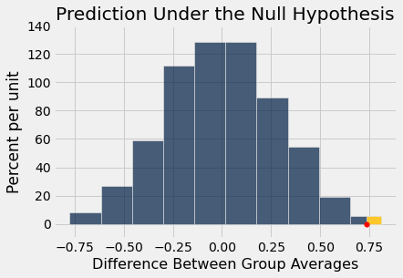

# 디플레이트게이트(Deflategate)
2015년 1월 18일, 인디애나폴리스 콜츠(Indianapolis Colts)와 뉴잉글랜드 패트리어츠(New England Patriots)는 두 팀 중 어느 팀이 슈퍼볼(Super Bowl)에 진출할지를 결정하는 아메리칸 풋볼 콘퍼런스(American Football Conference, AFC) 챔피언십 경기를 치렀다. 경기 후, 패트리어츠의 공이 규정에서 요구하는 만큼 바람이 채워져 있지 않아 더 물렁했다는 의혹이 제기되었다. 물렁한 공은 잡기가 더 쉬울 수 있으므로 이는 유리하게 작용할 수 있다.

몇 주 동안 미식축구계는 비난, 부인, 추측, 의혹으로 들끓었다. 언론은 1970년대의 정치 스캔들인 워터게이트(Watergate)에 빗대어 이 사건을 디플레이트게이트(Deflategate)라고 불렀다. 내셔널 풋볼 리그(National Football League, NFL)는 독립적인 분석을 의뢰하였다. 이 예에서는 데이터에 대해 우리 나름의 분석을 수행한다.

압력은 흔히 제곱인치당 파운드(pounds per square inch, psi) 단위로 측정한다. NFL 규칙은 경기용 공의 압력이 12.5 psi에서 13.5 psi 사이가 되도록 바람을 채워야 한다고 규정한다. 각 팀은 12개의 공으로 경기를 한다. 각 팀은 자기 팀 공의 압력을 유지할 책임이 있지만, 공의 검사는 경기 심판들이 한다. AFC 경기가 시작되기 전, 패트리어츠의 공은 모두 약 12.5 psi였다. 콜츠의 공은 대부분 약 13.0 psi였다. 그러나 이러한 경기 전 데이터는 기록되지 않았다.

2쿼터 중에 콜츠는 패트리어츠의 공을 가로챘다. 그들은 사이드라인에서 그 공의 압력을 측정하였고, 기준치인 12.5 psi보다 낮다는 것을 확인하였다. 그들은 즉시 심판들에게 이를 알렸다. 

하프타임에 모든 경기용 공이 검사를 위해 수거되었다. 두 심판, 클리트 블레이크먼(Clete Blakeman)과 다이롤 프리올로(Dyrol Prioleau)가 각 공의 압력을 측정하였다. 

데이터는 다음과 같다. 각 행은 공 하나에 해당한다. 압력은 psi 단위로 측정되었다. 콜츠가 가로챈 패트리어츠의 공은 하프타임에 검사되지 않았다. 콜츠의 공도 대부분 검사되지 않았는데, 심판들의 시간이 부족하여 후반전 시작을 위해 공을 돌려주어야 했기 때문이다.

```python
from datascience import *
%matplotlib inline
path_data = '../../../assets/data/'
import matplotlib.pyplot as plots
plots.style.use('fivethirtyeight')
import numpy as np
```

```python
football = Table.read_table(path_data + 'deflategate.csv')
football.show()
```

<table border="1" class="dataframe">
    <thead>
        <tr>
            <th>Team</th> <th>Blakeman</th> <th>Prioleau</th>
        </tr>
    </thead>
    <tbody>
        <tr>
            <td>Patriots</td> <td>11.5    </td> <td>11.8    </td>
        </tr>
        <tr>
            <td>Patriots</td> <td>10.85   </td> <td>11.2    </td>
        </tr>
        <tr>
            <td>Patriots</td> <td>11.15   </td> <td>11.5    </td>
        </tr>
        <tr>
            <td>Patriots</td> <td>10.7    </td> <td>11      </td>
        </tr>
        <tr>
            <td>Patriots</td> <td>11.1    </td> <td>11.45   </td>
        </tr>
        <tr>
            <td>Patriots</td> <td>11.6    </td> <td>11.95   </td>
        </tr>
        <tr>
            <td>Patriots</td> <td>11.85   </td> <td>12.3    </td>
        </tr>
        <tr>
            <td>Patriots</td> <td>11.1    </td> <td>11.55   </td>
        </tr>
        <tr>
            <td>Patriots</td> <td>10.95   </td> <td>11.35   </td>
        </tr>
        <tr>
            <td>Patriots</td> <td>10.5    </td> <td>10.9    </td>
        </tr>
        <tr>
            <td>Patriots</td> <td>10.9    </td> <td>11.35   </td>
        </tr>
        <tr>
            <td>Colts   </td> <td>12.7    </td> <td>12.35   </td>
        </tr>
        <tr>
            <td>Colts   </td> <td>12.75   </td> <td>12.3    </td>
        </tr>
        <tr>
            <td>Colts   </td> <td>12.5    </td> <td>12.95   </td>
        </tr>
        <tr>
            <td>Colts   </td> <td>12.55   </td> <td>12.15   </td>
        </tr>
    </tbody>
</table>

검사된 15개의 공 각각에 대해 두 심판은 서로 다른 결과를 얻었다. 같은 대상을 반복 측정하면 결과가 달라지는 일은 드물지 않으며, 특히 서로 다른 사람이 측정할 때 그렇다. 따라서 각 공에는 그 공에 대해 이루어진 두 측정값의 평균(average)을 부여한다.

```python
football = football.with_column(
    'Combined', (football.column(1)+football.column(2))/2
    ).drop(1, 2)
football.show()
```

<table border="1" class="dataframe">
    <thead>
        <tr>
            <th>Team</th> <th>Combined</th>
        </tr>
    </thead>
    <tbody>
        <tr>
            <td>Patriots</td> <td>11.65   </td>
        </tr>
        <tr>
            <td>Patriots</td> <td>11.025  </td>
        </tr>
        <tr>
            <td>Patriots</td> <td>11.325  </td>
        </tr>
        <tr>
            <td>Patriots</td> <td>10.85   </td>
        </tr>
        <tr>
            <td>Patriots</td> <td>11.275  </td>
        </tr>
        <tr>
            <td>Patriots</td> <td>11.775  </td>
        </tr>
        <tr>
            <td>Patriots</td> <td>12.075  </td>
        </tr>
        <tr>
            <td>Patriots</td> <td>11.325  </td>
        </tr>
        <tr>
            <td>Patriots</td> <td>11.15   </td>
        </tr>
        <tr>
            <td>Patriots</td> <td>10.7    </td>
        </tr>
        <tr>
            <td>Patriots</td> <td>11.125  </td>
        </tr>
        <tr>
            <td>Colts   </td> <td>12.525  </td>
        </tr>
        <tr>
            <td>Colts   </td> <td>12.525  </td>
        </tr>
        <tr>
            <td>Colts   </td> <td>12.725  </td>
        </tr>
        <tr>
            <td>Colts   </td> <td>12.35   </td>
        </tr>
    </tbody>
</table>

한눈에 보아도 패트리어츠의 공이 콜츠의 공보다 압력이 낮았던 것으로 보인다. 경기가 진행되는 동안 어느 정도 바람이 빠지는 것은 정상이므로, 독립 분석가들은 경기 시작 시점부터의 압력 감소량을 계산하기로 하였다. 패트리어츠의 공은 모두 약 12.5 psi에서, 콜츠의 공은 약 13.0 psi에서 시작했다는 것을 떠올리자. 따라서 패트리어츠 공의 압력 감소량은 12.5에서 하프타임의 압력을 뺀 값으로, 콜츠 공의 압력 감소량은 13.0에서 하프타임의 압력을 뺀 값으로 계산하였다.

먼저 시작 값의 배열을 만들어 각 공의 압력 감소량을 계산할 수 있다. 이를 위해 12.5인 값 11개로 이루어진 배열과 13인 값 4개로 이루어진 또 다른 배열이 필요하다. 개수를 인수로 받아 그 개수만큼의 원소가 모두 1인 배열을 반환하는 넘파이(NumPy) 함수 `np.ones`를 사용한다.

```python
np.ones(11)
```

```
array([1., 1., 1., 1., 1., 1., 1., 1., 1., 1., 1.])
```

```python
patriots_start = 12.5 * np.ones(11)
colts_start = 13 * np.ones(4)
start = np.append(patriots_start, colts_start)
start
```

```
array([12.5, 12.5, 12.5, 12.5, 12.5, 12.5, 12.5, 12.5, 12.5, 12.5, 12.5,
       13. , 13. , 13. , 13. ])
```

각 공의 압력 감소량은 시작 압력과 결합된 압력 측정값 사이의 차이이다.

```python
drop = start - football.column('Combined')
football = football.with_column('Pressure Drop', drop)
football.show()
```

<table border="1" class="dataframe">
    <thead>
        <tr>
            <th>Team</th> <th>Combined</th> <th>Pressure Drop</th>
        </tr>
    </thead>
    <tbody>
        <tr>
            <td>Patriots</td> <td>11.65   </td> <td>0.85         </td>
        </tr>
        <tr>
            <td>Patriots</td> <td>11.025  </td> <td>1.475        </td>
        </tr>
        <tr>
            <td>Patriots</td> <td>11.325  </td> <td>1.175        </td>
        </tr>
        <tr>
            <td>Patriots</td> <td>10.85   </td> <td>1.65         </td>
        </tr>
        <tr>
            <td>Patriots</td> <td>11.275  </td> <td>1.225        </td>
        </tr>
        <tr>
            <td>Patriots</td> <td>11.775  </td> <td>0.725        </td>
        </tr>
        <tr>
            <td>Patriots</td> <td>12.075  </td> <td>0.425        </td>
        </tr>
        <tr>
            <td>Patriots</td> <td>11.325  </td> <td>1.175        </td>
        </tr>
        <tr>
            <td>Patriots</td> <td>11.15   </td> <td>1.35         </td>
        </tr>
        <tr>
            <td>Patriots</td> <td>10.7    </td> <td>1.8          </td>
        </tr>
        <tr>
            <td>Patriots</td> <td>11.125  </td> <td>1.375        </td>
        </tr>
        <tr>
            <td>Colts   </td> <td>12.525  </td> <td>0.475        </td>
        </tr>
        <tr>
            <td>Colts   </td> <td>12.525  </td> <td>0.475        </td>
        </tr>
        <tr>
            <td>Colts   </td> <td>12.725  </td> <td>0.275        </td>
        </tr>
        <tr>
            <td>Colts   </td> <td>12.35   </td> <td>0.65         </td>
        </tr>
    </tbody>
</table>

패트리어츠의 감소량이 콜츠의 감소량보다 컸던 것으로 보인다. 두 집단 각각의 평균(average) 감소량을 살펴보자. 결합된 측정값은 더 이상 필요하지 않다.

```python
football = football.drop('Combined')
football.group('Team', np.average)
```

<table border="1" class="dataframe">
    <thead>
        <tr>
            <th>Team</th> <th>Pressure Drop average</th>
        </tr>
    </thead>
    <tbody>
        <tr>
            <td>Colts   </td> <td>0.46875              </td>
        </tr>
        <tr>
            <td>Patriots</td> <td>1.20227              </td>
        </tr>
    </tbody>
</table>

패트리어츠의 평균(average) 감소량은 약 1.2 psi였고, 콜츠는 약 0.47 psi였다. 

이제 문제는 왜 패트리어츠의 공이 콜츠의 공보다 평균(average)적으로 더 큰 압력 감소를 보였는가 하는 것이다. 이는 우연에 의한 것일 수 있을까?

## 가설(hypothesis)
여기서 우연은 어떻게 개입하는가? 무작위로 선택된 것은 아무것도 없었다. 그러나 패트리어츠의 감소량 11개가 전체 15개의 감소량 중에서 11개를 뽑은 무작위 표본(random sample)처럼 보이고, 콜츠의 감소량은 나머지 4개라고 가정함으로써 확률 모형(chance model)을 만들 수 있다. 이것은 데이터를 시뮬레이션(simulation)할 수 있는, 완전히 명시된 확률 모형이다. 따라서 이것이 **귀무가설**(null hypothesis)이다.

대립가설(alternative hypothesis)로는 패트리어츠의 감소량이 평균(average)적으로 너무 커서 전체 감소량에서 뽑은 무작위 표본(random sample)과 닮았다고 볼 수 없다는 입장을 취할 수 있다. 

## 검정 통계량(test statistic)
자연스러운 통계량(statistic)은 두 평균(average) 감소량의 차이이며, 이를 "패트리어츠의 평균 감소량 - 콜츠의 평균 감소량"으로 계산한다. 이 통계량의 값이 클수록 대립가설(alternative hypothesis)을 지지하게 된다.

```python
observed_means = football.group('Team', np.average).column(1)

observed_difference = observed_means.item(1) - observed_means.item(0)
observed_difference
```

```
0.733522727272728
```

이 양의 차이는 패트리어츠 공의 평균(average) 압력 감소량이 콜츠의 평균 압력 감소량보다 컸다는 사실을 반영한다.

앞 절에서 했던 것처럼, 두 집단의 평균(mean) 감소량 사이의 차이를 계산하는 함수를 작성한다. 함수 `difference_of_means`는 두 인수를 받는다.

- 데이터 테이블의 이름
- 두 집단 레이블이 들어 있는 열의 레이블

이 함수는 두 집단의 평균(mean) 감소량 사이의 차이를 반환한다. 앞에서와 같이 차이는 패트리어츠의 감소량에서 콜츠의 감소량을 빼서 계산한다.

```python
def difference_of_means(table, group_label):
    reduced = table.select('Pressure Drop', group_label)
    means_table = reduced.group(group_label, np.average)
    means = means_table.column(1)
    return means.item(1) - means.item(0)
```

```python
difference_of_means(football, 'Team')
```

```
0.733522727272728
```

이는 앞에서 `observed_difference`로 구한 값과 같다.

## 귀무가설(null hypothesis)하에서 통계량(statistic) 예측하기
귀무가설(null hypothesis)이 참이라면, 어느 공에 패트리어츠 레이블이 붙고 어느 공에 콜츠 레이블이 붙는지는 상관이 없어야 한다. 두 감소량 집합의 분포(distribution)는 같을 것이다. 팀 레이블을 무작위로 뒤섞어 이를 시뮬레이션(simulation)할 수 있다.

```python
shuffled_labels = football.sample(with_replacement=False).column(0)
original_and_shuffled = football.with_column('Shuffled Label', shuffled_labels)
original_and_shuffled.show()
```

<table border="1" class="dataframe">
    <thead>
        <tr>
            <th>Team</th> <th>Pressure Drop</th> <th>Shuffled Label</th>
        </tr>
    </thead>
    <tbody>
        <tr>
            <td>Patriots</td> <td>0.85         </td> <td>Patriots      </td>
        </tr>
        <tr>
            <td>Patriots</td> <td>1.475        </td> <td>Colts         </td>
        </tr>
        <tr>
            <td>Patriots</td> <td>1.175        </td> <td>Colts         </td>
        </tr>
        <tr>
            <td>Patriots</td> <td>1.65         </td> <td>Colts         </td>
        </tr>
        <tr>
            <td>Patriots</td> <td>1.225        </td> <td>Patriots      </td>
        </tr>
        <tr>
            <td>Patriots</td> <td>0.725        </td> <td>Patriots      </td>
        </tr>
        <tr>
            <td>Patriots</td> <td>0.425        </td> <td>Patriots      </td>
        </tr>
        <tr>
            <td>Patriots</td> <td>1.175        </td> <td>Patriots      </td>
        </tr>
        <tr>
            <td>Patriots</td> <td>1.35         </td> <td>Patriots      </td>
        </tr>
        <tr>
            <td>Patriots</td> <td>1.8          </td> <td>Patriots      </td>
        </tr>
        <tr>
            <td>Patriots</td> <td>1.375        </td> <td>Colts         </td>
        </tr>
        <tr>
            <td>Colts   </td> <td>0.475        </td> <td>Patriots      </td>
        </tr>
        <tr>
            <td>Colts   </td> <td>0.475        </td> <td>Patriots      </td>
        </tr>
        <tr>
            <td>Colts   </td> <td>0.275        </td> <td>Patriots      </td>
        </tr>
        <tr>
            <td>Colts   </td> <td>0.65         </td> <td>Patriots      </td>
        </tr>
    </tbody>
</table>

집단 평균(average)들은 서로 어떻게 비교되는가?

```python
difference_of_means(original_and_shuffled, 'Shuffled Label')
```

```
-0.5619318181818183
```

```python
difference_of_means(original_and_shuffled, 'Team')
```

```
0.733522727272728
```

팀 레이블을 공에 무작위로 배정했을 때 두 팀의 평균(average) 감소량은 실제 경기에서 사용된 두 집단의 경우보다 더 가깝다.

## 순열 검정(permutation test)
이제 익숙해진 단계로 넘어갈 차례이다. 귀무가설(null hypothesis)하에서 검정 통계량(test statistic)을 반복해서 시뮬레이션(simulation)한다. 

이는 공들의 순열(permutation)을 반복해서 만들고 무작위로 나뉜 집합을 두 팀에 배정하는 방식으로 이루어진다.

늘 그렇듯이, 공의 팀 레이블에 무작위 순열(random permutation)을 적용한 후 패트리어츠와 콜츠로 레이블이 붙은 집단들의 평균(mean) 압력 감소량 사이의 차이를 시뮬레이션한 값 하나를 반환하는 함수 `one_simulated_difference`를 작성하는 것으로 시작한다.

```python
def one_simulated_difference():
    shuffled_labels = football.sample(with_replacement = False
                                                    ).column('Team')
    shuffled_table = football.select('Pressure Drop').with_column(
        'Shuffled Label', shuffled_labels)
    return difference_of_means(shuffled_table, 'Shuffled Label')
```

이제 `for` 루프와 이 함수를 사용하여, 귀무가설(null hypothesis)하에서 시뮬레이션된 검정 통계량(test statistic)의 값 10,000개를 담은 배열 `differences`를 만들 수 있다.

```python
differences = make_array()

repetitions = 10000
for i in np.arange(repetitions):
    new_difference = one_simulated_difference()
    differences = np.append(differences, new_difference)
```

## 검정의 결론
경험적 p-값(empirical p-value)을 계산하려면 대립가설(alternative hypothesis)을 상기하는 것이 중요하다. 대립가설은 패트리어츠의 감소량이 너무 커서 우연에 의한 변동(chance variation)만의 결과로 볼 수 없다는 것이다.

패트리어츠의 감소량이 클수록 대립가설(alternative hypothesis)을 지지한다. 따라서 p-값(p-value)은 (귀무가설(null hypothesis)하에서 계산한) 검정 통계량(test statistic)이 관측값 0.733522727272728 이상이 될 확률이다.

아래 그림은 이 계산을 시각화한 것이다. 그림은 귀무가설(null hypothesis)하에서 검정 통계량(test statistic)의 경험적 분포(empirical distribution)로 이루어져 있으며, 관측된 통계량은 가로축에 빨간색으로 표시되어 있고 p-값(p-value)에 해당하는 영역은 금색으로 칠해져 있다.

```python
Table().with_column(
    'Difference Between Group Averages', differences).hist(
    left_end = observed_difference
)
plots.ylim(-0.1, 1.4)
plots.scatter(observed_difference, 0, color='red', s=30, zorder=3)
plots.title('Prediction Under the Null Hypothesis')
print('Observed Difference:', observed_difference)
```

```
Observed Difference: 0.733522727272728
```



눈으로 보기에 p-값(p-value)은 꽤 작아 보인다. 계산으로 이를 확인할 수 있다.

```python
empirical_p = np.count_nonzero(differences >= observed_difference) / 10000
empirical_p
```

```
0.0026
```

이 검정의 이전 예들에서와 마찬가지로, 분포(distribution)의 대부분은 0 근처에 중심을 두고 있다. 귀무가설(null hypothesis)하에서 패트리어츠의 감소량은 전체 15개 감소량에서 뽑은 무작위 표본(random sample)이며, 따라서 콜츠의 감소량도 마찬가지이다. 그러므로 두 감소량 집합은 평균(average)적으로 거의 같아야 하고, 따라서 그 차이는 0 근처여야 한다.

그러나 검정 통계량(test statistic)의 관측값은 분포(distribution)의 중심부에서 상당히 멀리 떨어져 있다. "작다"의 기준을 어떤 합리적인 값으로 정하더라도 경험적 p-값(empirical p-value)은 작다. 따라서 우리는 무작위성이라는 귀무가설(null hypothesis)을 기각하게 되며, 패트리어츠의 감소량은 너무 커서 우연에 의한 변동(chance variation)만을 반영한다고 볼 수 없다고 결론짓는다.

독립 조사팀은 물리 법칙을 고려하여 여러 가지 방법으로 데이터를 분석하였다. 최종 보고서는 다음과 같이 밝혔다. 

> "사용된 압력계에 관한 여러 가능한 가정에 따라 다르지만, 패트리어츠 공의 초기 압력을 12.5 psi, 콜츠 공의 초기 압력을 13.0으로 가정할 때, 패트리어츠 경기용 공의 평균 압력 감소량은 콜츠 공의 평균 압력 감소량보다 0.45~1.02 psi 더 컸다."
> 
> -- *2015년 1월 18일 AFC 챔피언십 경기에 관하여 NFL이 의뢰한 조사 보고서*

우리의 분석은 평균(average) 압력 감소량이 약 0.73 psi임을 보여 주는데, 이는 구간 "0.45~1.02 psi"의 중앙에 가까우므로 공식 분석과 일치한다.

우리의 가설 검정(test of hypotheses)은 차이가 우연에 의한 것이 아닌 *이유*를 밝혀 주지는 않는다는 점을 기억하자. 인과관계(causality)를 확립하는 일은 대개 가설 검정을 수행하는 것보다 더 복잡하다.

그러나 미식축구계에서 가장 중요한 질문은 인과관계(causation)에 관한 것이었다. 즉, 패트리어츠 공의 과도한 압력 감소가 고의적이었는가 하는 질문이었다. 조사관들이 내린 답이 궁금하다면 [전체 보고서](https://nfllabor.files.wordpress.com/2015/05/investigative-and-expert-reports-re-footballs-used-during-afc-championsh.pdf)를 참고하자.
