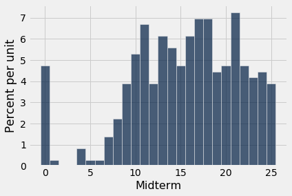

# 백분위수(percentile)
수치형 데이터는 오름차순이나 내림차순으로 정렬할 수 있다. 따라서 수치형 데이터 집합의 값들에는 *순위*(rank order)가 있다. 백분위수(percentile)란 특정 순위에 있는 값이다.

예를 들어, 어떤 시험에서 당신의 점수가 95번째 백분위수(percentile)에 해당한다면, 흔히 당신보다 높은 점수는 전체의 5%에 불과하다고 해석한다. 중앙값(median)은 50번째 백분위수이며, 데이터 집합의 값 중 50%가 중앙값보다 크다고 흔히 가정한다.

그러나 모든 순위와 모든 목록에 적용되는 정확한 백분위수(percentile)의 정의를 내리려면 약간의 주의가 필요하다. 그 이유를 알아보기 위해 한 반의 모든 학생이 시험에서 75점을 받은 극단적인 예를 생각해 보자. 이 경우 75는 중앙값(median)의 자연스러운 후보이지만, 점수의 50%가 75보다 크다는 것은 사실이 아니다. 또한 75는 95번째 백분위수나 25번째 백분위수, 혹은 다른 어떤 백분위수의 후보로도 똑같이 자연스럽다. 백분위수를 정의할 때는 동점(tie), 즉 같은 데이터 값들을 고려해야 한다.

또한 관련된 인덱스가 명확하지 않을 때 목록에서 정확히 어디까지 올라가야 하는지도 주의해야 한다. 예를 들어, 10개의 값으로 이루어진 모음의 87번째 백분위수(percentile)는 무엇이어야 할까? 정렬된 모음의 8번째 값일까, 9번째 값일까, 아니면 그 사이의 어딘가일까?

이 절에서는 모든 순위와 모든 목록에 일관되게 적용되는 정의를 제시할 것이다.

```python
from datascience import *
%matplotlib inline
path_data = '../../../assets/data/'
import matplotlib.pyplot as plt
plt.style.use('fivethirtyeight')
import numpy as np
```

## 수치 예제
모든 백분위수(percentile)에 대한 일반적인 정의를 제시하기 전에, 값들의 모음에서 80번째 백분위수를, 모음의 값 중에서 전체 값의 80% 이상보다 크거나 같은 가장 작은 값으로 정의하겠다.

예를 들어, 가장 큰 다섯 대륙 – 아프리카, 남극, 아시아, 북아메리카, 남아메리카 – 의 면적을 백만 제곱마일 단위로 반올림한 값을 생각해 보자.

```python
sizes = make_array(12, 17, 6, 9, 7)
```

80번째 백분위수(percentile)는 `sizes` 원소의 80%, 즉 다섯 원소 중 5분의 4 이상보다 크거나 같은 가장 작은 값이다. 그 값은 12이다.

```python
np.sort(sizes)
```

```
array([ 6,  7,  9, 12, 17])
```

80번째 백분위수(percentile)는 목록에 있는 값, 즉 12이다. 값의 80%가 이 값보다 작거나 같으며, 이것이 성립하는 목록의 값 중 가장 작은 값임을 확인할 수 있다.

마찬가지로, 70번째 백분위수(percentile)는 모음의 값 중에서 `sizes` 원소의 70% 이상보다 크거나 같은 가장 작은 값이다. 5개 원소의 70%는 "3.5개 원소"이므로, 70번째 백분위수는 목록의 4번째 원소이다. 그 값은 12로, 이 데이터에서는 80번째 백분위수와 같다.

## `percentile` 함수
`percentile` 함수는 두 개의 인수, 즉 0과 100 사이의 순위와 배열을 받는다. 이 함수는 배열의 해당 백분위수(percentile)를 반환한다.

```python
percentile(70, sizes)
```

```
12
```

### 일반적인 정의 ###

$p$를 0과 100 사이의 수라고 하자. 어떤 모음의 $p$번째 백분위수(percentile)는 모음의 값 중에서 전체 값의 p% 이상보다 크거나 같은 가장 작은 값이다.

이 정의에 따르면 어떤 값들의 모음에 대해서도 0과 100 사이의 모든 백분위수(percentile)를 계산할 수 있으며, 그 값은 항상 모음의 원소이다. 

실제 계산 측면에서, 모음에 $n$개의 원소가 있다고 하자. $p$번째 백분위수(percentile)를 찾으려면 다음과 같이 한다.
- 모음을 오름차순으로 정렬한다.
- n의 p%를 구한다: $(p/100) \times n$. 이를 $k$라고 하자.
- $k$가 정수이면, 정렬된 모음의 $k$번째 원소를 택한다.
- $k$가 정수가 아니면, 다음 정수로 올림한 뒤 정렬된 모음에서 그 위치의 원소를 택한다.

### 예제 ###
`scores_and_sections` 테이블에는 359명의 학생으로 이루어진 한 반의 각 학생에 대해 하나의 행이 있다. 열은 학생의 토론 분반과 중간고사 점수이다.

```python
scores_and_sections = Table.read_table(path_data + 'scores_by_section.csv')
scores_and_sections
```

<table border="1" class="dataframe">
    <thead>
        <tr>
            <th>Section</th> <th>Midterm</th>
        </tr>
    </thead>
    <tbody>
        <tr>
            <td>1      </td> <td>22     </td>
        </tr>
        <tr>
            <td>2      </td> <td>12     </td>
        </tr>
        <tr>
            <td>2      </td> <td>23     </td>
        </tr>
        <tr>
            <td>2      </td> <td>14     </td>
        </tr>
        <tr>
            <td>1      </td> <td>20     </td>
        </tr>
        <tr>
            <td>3      </td> <td>25     </td>
        </tr>
        <tr>
            <td>4      </td> <td>19     </td>
        </tr>
        <tr>
            <td>1      </td> <td>24     </td>
        </tr>
        <tr>
            <td>5      </td> <td>8      </td>
        </tr>
        <tr>
            <td>6      </td> <td>14     </td>
        </tr>
    </tbody>
</table>
<p>... (349 rows omitted)</p>

```python
scores_and_sections.select('Midterm').hist(bins=np.arange(-0.5, 25.6, 1))
```



점수의 85번째 백분위수(percentile)는 얼마였을까? `percentile` 함수를 사용하기 위해 중간고사 점수를 담은 배열 `scores`를 만들고 85번째 백분위수를 구해 보자.

```python
scores = scores_and_sections.column(1)
```

```python
percentile(85, scores)
```

```
22
```

`percentile` 함수에 따르면 85번째 백분위수(percentile)는 22였다. 이것이 우리의 새로운 정의와 일치하는지 확인하기 위해 정의를 직접 적용해 보자.

먼저 점수를 오름차순으로 정렬한다.

```python
sorted_scores = np.sort(scores_and_sections.column(1))
```

배열에는 359개의 점수가 있다. 따라서 다음으로 359의 85%를 구하면 305.15이다.

```python
0.85 * 359
```

```
305.15
```

이 값은 정수가 아니다. 우리의 정의에 따르면 85번째 백분위수(percentile)는 `sorted_scores`의 306번째 원소이며, 이는 파이썬(Python)의 인덱싱 규칙에 따라 배열의 305번 항목이다.

```python
# The 306th element of the sorted array

sorted_scores.item(305)
```

```
22
```

이는 `percentile`을 사용하여 얻은 답과 같다. 앞으로는 그냥 `percentile`을 사용할 것이다.

## 사분위수(quartile)
수치형 모음의 *제1사분위수*(first quartile)는 25번째 백분위수(percentile)이다. 이 용어는 *첫 번째 4분의 1*(the first quarter)에서 유래한다. 제2사분위수는 중앙값(median)이고, 제3사분위수는 75번째 백분위수이다.

우리의 `scores` 데이터에서 이 값들은 다음과 같다.

```python
percentile(25, scores)
```

```
11
```

```python
percentile(50, scores)
```

```
16
```

```python
percentile(75, scores)
```

```
20
```

점수의 분포(distribution)는 때때로 제1사분위수(first quartile)와 제3사분위수 사이의 구간인 "가운데 50%" 구간으로 요약된다.
