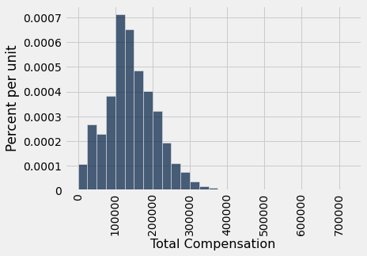
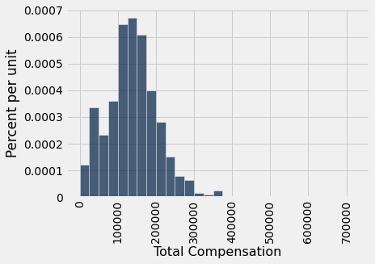
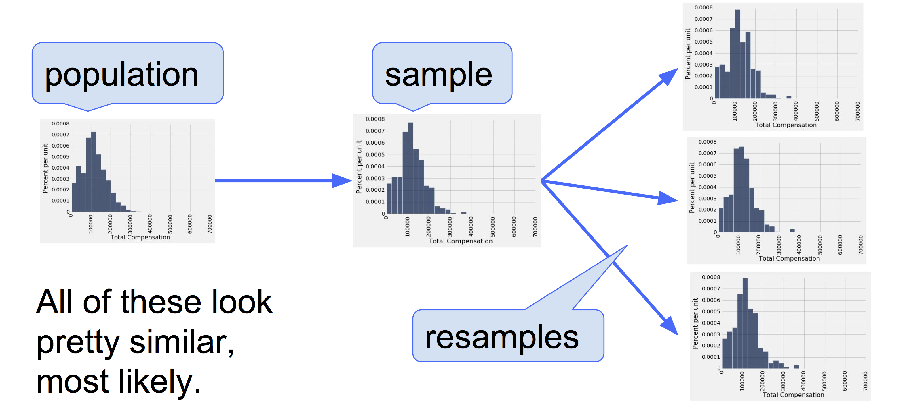
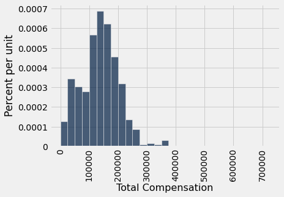
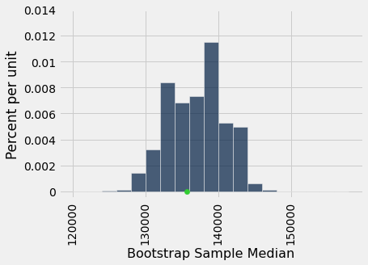
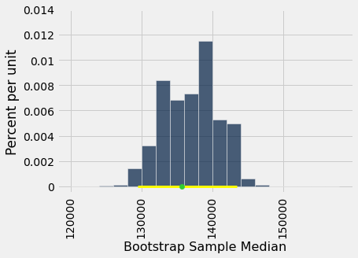
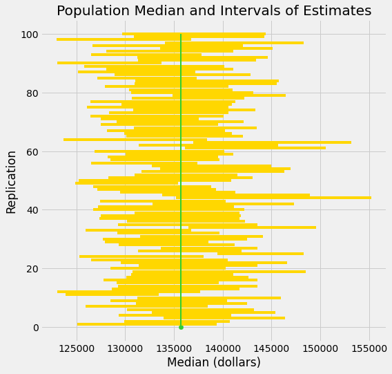

# 부트스트랩(bootstrap)
한 데이터 과학자가 무작위 표본(random sample)의 데이터를 사용하여 알려지지 않은 모수(parameter)를 추정하려 한다. 그녀는 표본을 사용하여 통계량(statistic)의 값을 계산하고, 이를 자신의 추정값(estimate)으로 사용할 것이다. 

통계량(statistic)의 관측값을 계산하고 나면, 그녀는 그 값을 추정값(estimate)으로 제시하고 가벼운 마음으로 제 갈 길을 갈 수도 있다. 그러나 그녀는 데이터 과학자이다. 그녀는 자신의 무작위 표본(random sample)이 가능한 수많은 무작위 표본 중 하나일 뿐이며, 따라서 자신의 추정값도 그럴듯한 수많은 추정값 중 하나일 뿐이라는 것을 알고 있다. 

그 추정값들은 얼마나 달라질 수 있을까? 이 질문에 답하려면 모집단(population)에서 또 다른 표본(sample)을 뽑아 새로운 표본을 바탕으로 새로운 추정값을 계산해야 할 것처럼 보인다. 그러나 그녀에게는 모집단으로 돌아가 다른 표본을 뽑을 자원이 없다.

데이터 과학자는 꼼짝없이 막힌 것처럼 보인다.

다행히도 *부트스트랩*(bootstrap)이라는 기발한 아이디어가 그녀를 도울 수 있다. 모집단(population)으로부터 새로운 표본(sample)을 생성하는 것은 불가능하므로, 부트스트랩은 *재표본추출*(resampling)이라는 방법으로 새로운 무작위 표본을 생성한다. 즉, 새로운 표본들은 *원래 표본으로부터* 무작위로 추출된다.

```python
from datascience import *
%matplotlib inline
path_data = '../../../assets/data/'
import matplotlib.pyplot as plots
plots.style.use('fivethirtyeight')
import numpy as np
```

이 절에서는 부트스트랩(bootstrap)이 어떻게, 그리고 왜 작동하는지 살펴볼 것이다. 이 장의 나머지 부분에서는 부트스트랩을 추론(inference)에 사용할 것이다.

## 샌프란시스코(San Francisco)시 직원 보수(compensation)
[SF OpenData](https://data.sfgov.org)는 샌프란시스코(San Francisco)시와 카운티가 일부 데이터를 공개하는 웹사이트이다. 데이터 세트 중 하나에는 시 소속 직원들의 보수 데이터가 들어 있다. 여기에는 시립 병원의 의료 전문가, 경찰관, 소방관, 교통 종사자, 선출직 공무원 및 그 밖의 모든 시 소속 직원이 포함된다. 

2019년 한 해 동안의 보수 데이터는 `sf2019` 테이블에 있다.

```python
sf2019 = Table.read_table(path_data + 'san_francisco_2019.csv')
```

```python
sf2019.show(3)
```

<table border="1" class="dataframe">
    <thead>
        <tr>
            <th>Organization Group</th> <th>Department</th> <th>Job Family</th> <th>Job</th> <th>Salary</th> <th>Overtime</th> <th>Benefits</th> <th>Total Compensation</th>
        </tr>
    </thead>
    <tbody>
        <tr>
            <td>Public Protection </td> <td>Adult Probation</td> <td>Information Systems</td> <td>IS Trainer-Journey        </td> <td>91332 </td> <td>0       </td> <td>40059   </td> <td>131391            </td>
        </tr>
        <tr>
            <td>Public Protection </td> <td>Adult Probation</td> <td>Information Systems</td> <td>IS Engineer-Assistant     </td> <td>123241</td> <td>0       </td> <td>49279   </td> <td>172520            </td>
        </tr>
        <tr>
            <td>Public Protection </td> <td>Adult Probation</td> <td>Information Systems</td> <td>IS Business Analyst-Senior</td> <td>115715</td> <td>0       </td> <td>46752   </td> <td>162468            </td>
        </tr>
    </tbody>
</table>
<p>... (44522 rows omitted)</p>

44,500명이 넘는 직원 각각에 대해 하나의 행이 있다. 시 소속 부서와 직원 보수 패키지의 여러 구성 요소에 대한 세부 정보를 담은 열이 많이 있다. 다음은 2019년 샌프란시스코 시장이었던 런던 브리드(London Breed)에 해당하는 행이다.

```python
sf2019.where('Job', 'Mayor')
```

<table border="1" class="dataframe">
    <thead>
        <tr>
            <th>Organization Group</th> <th>Department</th> <th>Job Family</th> <th>Job</th> <th>Salary</th> <th>Overtime</th> <th>Benefits</th> <th>Total Compensation</th>
        </tr>
    </thead>
    <tbody>
        <tr>
            <td>General Administration & Finance</td> <td>Mayor     </td> <td>Administrative & Mgmt (Unrep)</td> <td>Mayor</td> <td>342974</td> <td>0       </td> <td>98012   </td> <td>440987            </td>
        </tr>
    </tbody>
</table>

우리는 마지막 열인 `Total Compensation`을 살펴볼 것이다. 이는 직원의 급여에 퇴직 연금 및 복리후생 제도에 대한 시의 부담금을 더한 금액이다.

한 해 동안의 보수 패키지는 채용 날짜, 직원이 시 내부에서 직무를 옮기는지 여부 등에 따라 달라지므로 이해하기 어려울 때가 있다. 예를 들어, `Total Compensation` 열의 가장 낮은 값들은 조금 이상해 보인다.

```python
sf2019.sort('Total Compensation')
```

<table border="1" class="dataframe">
    <thead>
        <tr>
            <th>Organization Group</th> <th>Department</th> <th>Job Family</th> <th>Job</th> <th>Salary</th> <th>Overtime</th> <th>Benefits</th> <th>Total Compensation</th>
        </tr>
    </thead>
    <tbody>
        <tr>
            <td>Public Protection                      </td> <td>Adult Probation   </td> <td>Probation & Parole           </td> <td>Deputy Probation Officer      </td> <td>0     </td> <td>0       </td> <td>0       </td> <td>0                 </td>
        </tr>
        <tr>
            <td>Public Protection                      </td> <td>Fire Department   </td> <td>Clerical, Secretarial & Steno</td> <td>Senior Clerk Typist           </td> <td>0     </td> <td>0       </td> <td>0       </td> <td>0                 </td>
        </tr>
        <tr>
            <td>Public Protection                      </td> <td>Juvenile Court    </td> <td>Correction & Detention       </td> <td>Counselor, Juvenile Hall PERS </td> <td>0     </td> <td>0       </td> <td>0       </td> <td>0                 </td>
        </tr>
        <tr>
            <td>Public Protection                      </td> <td>Police            </td> <td>Clerical, Secretarial & Steno</td> <td>Clerk Typist                  </td> <td>0     </td> <td>0       </td> <td>0       </td> <td>0                 </td>
        </tr>
        <tr>
            <td>Public Protection                      </td> <td>Sheriff           </td> <td>Correction & Detention       </td> <td>Deputy Sheriff                </td> <td>0     </td> <td>0       </td> <td>0       </td> <td>0                 </td>
        </tr>
        <tr>
            <td>Public Works, Transportation & Commerce</td> <td>Airport Commission</td> <td>Sub-Professional Engineering </td> <td>StdntDsgn Train2/Arch/Eng/Plng</td> <td>0     </td> <td>0       </td> <td>0       </td> <td>0                 </td>
        </tr>
        <tr>
            <td>Public Works, Transportation & Commerce</td> <td>Airport Commission</td> <td>Clerical, Secretarial & Steno</td> <td>Executive Secretary 1         </td> <td>0     </td> <td>0       </td> <td>0       </td> <td>0                 </td>
        </tr>
        <tr>
            <td>Public Works, Transportation & Commerce</td> <td>Airport Commission</td> <td>Payroll, Billing & Accounting</td> <td>Senior Account Clerk          </td> <td>0     </td> <td>0       </td> <td>0       </td> <td>0                 </td>
        </tr>
        <tr>
            <td>Public Works, Transportation & Commerce</td> <td>Airport Commission</td> <td>Housekeeping & Laundry       </td> <td>Custodian                     </td> <td>0     </td> <td>0       </td> <td>0       </td> <td>0                 </td>
        </tr>
        <tr>
            <td>Public Works, Transportation & Commerce</td> <td>Airport Commission</td> <td>Housekeeping & Laundry       </td> <td>Custodian                     </td> <td>0     </td> <td>0       </td> <td>0       </td> <td>0                 </td>
        </tr>
    </tbody>
</table>
<p>... (44515 rows omitted)</p>

해석을 명확하게 하기 위해, 1년 내내 대략 하프타임(half-time) 이상의 일자리에 해당하는 근무를 한 사람들에게 초점을 맞추겠다. 시간당 약 15달러의 최저임금으로 52주 동안 주당 20시간을 일하면 급여는 15,000달러가 넘는다.

```python
sf2019 = sf2019.where('Salary', are.above(15000))
```

```python
sf2019.num_rows
```

```
37103
```

## 모집단(population)과 모수(parameter)
37,000개를 조금 넘는 행으로 이루어진 이 테이블을 우리의 모집단(population)으로 삼자. 다음은 이 테이블에 있는 직원들의 총보수에 대한 히스토그램(histogram)이다.

```python
sf_bins = np.arange(0, 726000, 25000)
sf2019.select('Total Compensation').hist(bins=sf_bins)
```



대부분의 값은 300,000달러 미만이지만, 몇몇 값은 그보다 훨씬 높다. 예를 들어, 최고투자책임자(Chief Investment Officer)의 총보수는 700,000달러가 넘었다. 이 때문에 가로축이 눈에 보이는 막대들보다 오른쪽으로 꽤 멀리 뻗어 있다.

```python
sf2019.sort('Total Compensation', descending=True).show(2)
```

<table border="1" class="dataframe">
    <thead>
        <tr>
            <th>Organization Group</th> <th>Department</th> <th>Job Family</th> <th>Job</th> <th>Salary</th> <th>Overtime</th> <th>Benefits</th> <th>Total Compensation</th>
        </tr>
    </thead>
    <tbody>
        <tr>
            <td>General Administration & Finance</td> <td>Retirement Services</td> <td>Administrative & Mgmt (Unrep)</td> <td>Chief Investment Officer</td> <td>577633</td> <td>0       </td> <td>146398  </td> <td>724031            </td>
        </tr>
        <tr>
            <td>General Administration & Finance</td> <td>Retirement Services</td> <td>Unassigned                   </td> <td>Managing Director       </td> <td>483072</td> <td>0       </td> <td>134879  </td> <td>617951            </td>
        </tr>
    </tbody>
</table>
<p>... (37101 rows omitted)</p>

우리가 관심을 가지는 모수(parameter)가 총보수의 중앙값(median)이라고 하자.

우리는 모집단(population)의 모든 데이터를 가지고 있는 호사를 누리고 있으므로, 모수(parameter)를 그냥 계산할 수 있다.

```python
pop_median = percentile(50, sf2019.column('Total Compensation'))
pop_median
```

```
135747.0
```

전체 직원의 총보수 중앙값(median)은 135,747달러였다. 

실용적인 관점에서 보면, 이 모수(parameter)의 값을 이미 알고 있으므로 이를 추정하기 위해 표본(sample)을 뽑을 이유가 없다. 그러나 이 절에서는 그 값을 모르는 척하고, 무작위 표본(random sample)에 기반하여 얼마나 잘 추정할 수 있는지 살펴볼 것이다. 

이후의 절들에서는 현실로 돌아와 모수(parameter)가 알려지지 않은 상황에서 작업할 것이다. 지금 당장은 우리가 모든 것을 알고 있다.

## 무작위 표본(random sample)과 추정값(estimate)
직원 500명을 비복원(without replacement)으로 무작위 추출하여 표본(sample)을 만들고, 표본으로 뽑힌 직원들의 총보수 중앙값(median)을 모수(parameter)의 추정값(estimate)으로 사용하자.

```python
our_sample = sf2019.sample(500, with_replacement=False)
our_sample.select('Total Compensation').hist(bins=sf_bins)
```



```python
est_median = percentile(50, our_sample.column('Total Compensation'))
est_median
```

```
136835.0
```

표본 크기(sample size)가 크다. 평균의 법칙(law of averages)에 따라 표본의 분포(distribution)는 모집단(population)의 분포와 닮는다. 따라서 표본 중앙값(median)은 모집단 중앙값과 상당히 비슷하지만, 물론 정확히 같지는 않다.

이제 우리는 모수(parameter)의 추정값(estimate) 하나를 가지고 있다. 그러나 표본(sample)이 다르게 나왔다면 추정값도 다른 값을 가졌을 것이다. 우리는 추정값이 표본마다 얼마나 달라질 수 있는지를 정량화하고 싶다. 이러한 변동성의 척도는 모수를 얼마나 정확하게 추정할 수 있는지 측정하는 데 도움이 될 것이다.

표본(sample)이 다르게 나왔다면 추정값(estimate)이 얼마나 달라졌을지 알아보기 위해, 모집단(population)에서 표본을 하나 더 뽑을 수도 있다. 그러나 그것은 반칙이다. 우리는 모집단 데이터 전체를 손에 쥐고 있지 않은 실제 상황을 흉내 내려 하고 있기 때문이다.

어떻게든 *모집단(population)으로부터 다시 표본을 추출하지 않고* 또 다른 무작위 표본(random sample)을 얻어야 한다.

## 부트스트랩(bootstrap): 표본으로부터의 재표본추출(resampling)

우리가 가진 것은 모집단(population)으로부터 추출한 큰 무작위 표본(random sample)이다. 알다시피 큰 무작위 표본은 그것이 추출된 모집단과 닮았을 가능성이 높다. 이러한 관찰 덕분에 데이터 과학자들은 *자기 신발끈(bootstrap)을 잡아당겨 스스로를 들어 올릴* 수 있다. 즉, 표본추출(sampling) 절차를 *표본으로부터 표본을 추출하는 것*으로 재현할 수 있다. 

다음은 모집단(population)과 닮은 또 다른 무작위 표본(random sample)을 생성하기 위한 *부트스트랩 방법*(bootstrap method)의 단계이다.

- **원래 표본을 마치 모집단인 것처럼 취급한다.**
- **표본으로부터 원래 표본 크기와 같은 횟수만큼 복원(with replacement) 무작위 추출을 한다**. 

원래 표본 크기(sample size)와 같은 횟수만큼 재표본추출(resampling)하는 것이 중요하다. 그 이유는 추정값(estimate)의 변동성이 표본의 크기에 따라 달라지기 때문이다. 원래 표본은 직원 500명으로 이루어져 있었으므로, 표본 중앙값(median)은 500개의 값에 기반한 것이었다. 표본이 얼마나 달라질 수 있었는지 알아보려면, 크기가 500인 다른 표본들의 중앙값과 비교해야 한다.

크기가 500인 표본에서 *비복원*(without replacement)으로 500번 무작위 추출하면 똑같은 표본(sample)을 다시 얻을 뿐이다. *복원*(with replacement)으로 추출하면 어떤 직원은 두 번 이상 뽑히고 어떤 직원은 전혀 뽑히지 않을 수 있으므로, 새로운 표본이 원래 표본과 달라질 가능성이 생긴다.

## 부트스트랩(bootstrap)이 작동하는 이유

왜 이것이 좋은 아이디어일까? 평균의 법칙(law of averages)에 따라 원래 표본(sample)의 분포(distribution)는 모집단(population)과 닮았을 가능성이 높고, 모든 "재표본(resample)"의 분포는 원래 표본과 닮았을 가능성이 높다. 따라서 모든 재표본의 분포 역시 모집단과 닮았을 가능성이 높다. 



```python
from IPython.display import Image
Image("../../images/bootstrap_pic.png")
```


## 재표본추출된(resampled) 중앙값(median)
`sample` 메서드는 기본적으로 테이블에서 행을 복원 추출(sampling with replacement)하며, 표본 크기(sample size)를 지정하지 않고 사용하면 기본적으로 표본 크기가 테이블의 행 수와 같아진다는 것을 기억하자. 이는 부트스트랩(bootstrap)에 안성맞춤이다! 다음은 원래 표본에서 추출한 새로운 표본 하나와 그에 대응하는 표본 중앙값(median)이다.

```python
resample_1 = our_sample.sample()
```

```python
resample_1.select('Total Compensation').hist(bins=sf_bins)
```



```python
resampled_median_1 = percentile(50, resample_1.column('Total Compensation'))
resampled_median_1
```

```
141793.0
```

이 값은 모집단(population) 중앙값(median)의 추정값(estimate)이다.

재표본추출(resampling)을 반복하면 이러한 추정값(estimate)을 많이 얻을 수 있으며, 따라서 추정값들의 경험적 분포(empirical distribution)를 얻을 수 있다.

```python
resample_2 = our_sample.sample()
resampled_median_2 = percentile(50, resample_2.column('Total Compensation'))
resampled_median_2
```

```
135880.0
```

이 코드를 모아서, `our_sample`이라고 부른 원래 무작위 표본(random sample)을 부트스트랩(bootstrap)하여 총보수의 부트스트랩 중앙값(median) 하나를 반환하는 함수 `one_bootstrap_median`을 정의하자.

```python
def one_bootstrap_median():
    resampled_table = our_sample.sample()
    bootstrapped_median = percentile(50, resampled_table.column('Total Compensation'))
    return bootstrapped_median
```

아래 셀을 몇 번 실행하여 부트스트랩(bootstrap) 중앙값(median)들이 어떻게 달라지는지 살펴보자. 각각이 모집단(population) 중앙값의 추정값(estimate)이라는 것을 기억하자.

```python
one_bootstrap_median()
```

```
132175.0
```

## 표본 중앙값(sample median)의 부트스트랩(bootstrap) 경험적 분포(empirical distribution)

이제 평소처럼 `for` 루프를 실행하여 부트스트랩(bootstrap) 과정을 여러 번 반복할 수 있다. 각 반복에서 `one_bootstrap_median` 함수를 호출하여 원래 표본 `our_sample`에 기반한 부트스트랩 중앙값(median) 하나를 생성한다. 그런 다음 그 부트스트랩 중앙값을 모음 배열 `bstrap_medians`에 추가한다.

5000번의 반복을 요청하고 있으므로 코드를 실행하는 데 시간이 좀 걸릴 수 있다. 수행해야 할 재표본추출(resampling)이 많기 때문이다!

```python
num_repetitions = 5000
bstrap_medians = make_array()
for i in np.arange(num_repetitions):
    bstrap_medians = np.append (bstrap_medians, one_bootstrap_median())
```

다음은 5000개의 부트스트랩(bootstrap) 중앙값(median)에 대한 경험적 히스토그램(empirical histogram)이다. 초록색 점은 모집단 모수(population parameter)로, 우리가 추정하려는 모집단 전체의 중앙값이다. 이 예에서는 우연히 그 값을 알고 있지만, 부트스트랩 과정에서는 그 값을 사용하지 않았다.

```python
resampled_medians = Table().with_column('Bootstrap Sample Median', bstrap_medians)
median_bins=np.arange(120000, 160000, 2000)
resampled_medians.hist(bins = median_bins)

# Plotting parameters; you can ignore this code
parameter_green = '#32CD32'
plots.ylim(-0.000005, 0.00014)
plots.scatter(pop_median, 0, color=parameter_green, s=40, zorder=2);
```



초록색 점은 고정되어 있다는 것을 기억하는 것이 중요하다. 그 값은 모집단(population) 중앙값(median)인 135,747달러이다. 경험적 히스토그램(empirical histogram)은 무작위 추출의 결과이며, 초록색 점에 대해 무작위로 위치하게 된다. 

또한 이 모든 계산의 목적은 초록색 점, 즉 모집단(population) 중앙값(median)을 추정하는 것임을 기억하자. 우리의 추정값(estimate)은 위에서 히스토그램(histogram)으로 본, 무작위로 생성된 표본 중앙값들 전부이다. 우리는 이 추정값들의 집합이 모수(parameter)를 포함하기를 원한다. 그렇지 않다면 추정값들은 빗나간 것이다.

## 추정값(estimate)이 모수(parameter)를 포착하는가?

재표본추출된 중앙값(median)들의 경험적 히스토그램(empirical histogram)이 꼬리로 초록색 점을 스치기만 하거나 아예 덮지 못하는 것이 아니라, 초록색 점 위에 단단히 자리 잡는 경우는 얼마나 자주 있을까? 이 질문에 답하려면 "단단히 자리 잡는다"를 정의해야 한다. 이를 "재표본추출된 중앙값의 가운데 95%가 초록색 점을 포함한다"는 의미로 받아들이자. 

다음은 재표본추출된 중앙값(median)들의 "가운데 95%" 구간의 양 끝이다.

```python
left = percentile(2.5, bstrap_medians)
left
```

```
129524.0
```

```python
right = percentile(97.5, bstrap_medians)
right
```

```
143446.0
```

모집단(population) 중앙값(median) 135,747달러는 이 두 수 사이에 있다. 아래 히스토그램(histogram)에 구간과 모집단 중앙값이 표시되어 있다.

```python
resampled_medians.hist(bins = median_bins)

# Plotting parameters; you can ignore this code
plots.ylim(-0.000005, 0.00014)
plots.plot([left, right], [0, 0], color='yellow', lw=3, zorder=1)
plots.scatter(pop_median, 0, color=parameter_green, s=40, zorder=2);
```



우리의 예에서는 추정값(estimate)들의 "가운데 95%" 구간이 모수(parameter)를 포착했다. 그러나 그것은 요행이었을까? 

구간이 모수(parameter)를 얼마나 자주 포함하는지 알아보려면 전체 과정을 반복해서 실행해야 한다. 구체적으로 다음 과정을 100번 반복할 것이다.

- 모집단에서 크기가 500인 원래 무작위 표본을 추출한다.
- 부트스트랩 과정을 5000번 반복하여 재표본추출된 중앙값들의 "가운데 95%" 구간을 생성한다.

최종적으로 100개의 구간을 얻게 되며, 그중 몇 개가 모집단(population) 중앙값(median)을 포함하는지 셀 것이다.

**스포일러 주의:** 부트스트랩(bootstrap)의 통계 이론에 따르면 그 수는 95 근처여야 한다. 90대 초반이나 90대 후반일 수도 있지만, 95에서 그보다 훨씬 더 벗어나리라고는 예상하지 않는다.

먼저 두 개의 인수, 즉 원래 무작위 표본(random sample)을 담은 테이블의 이름과 추출할 부트스트랩(bootstrap) 표본의 수를 받는 함수 `bootstrap_median`을 작성하자. 이 함수는 각 부트스트랩 표본에서 하나씩 얻은 부트스트랩 중앙값(median)들의 배열을 반환한다.

```python
def bootstrap_median(original_sample, num_repetitions):
    medians = make_array()
    for i in np.arange(num_repetitions):
        new_bstrap_sample = original_sample.sample()
        new_bstrap_median = percentile(50, new_bstrap_sample.column('Total Compensation'))
        medians = np.append(medians, new_bstrap_median)
    return medians
```

이제 이 함수를 100번 호출하고 매번 부트스트랩(bootstrap) 중앙값(median)들의 "가운데 95%"를 수집하는 `for` 루프를 작성하자. 

아래 셀은 테이블에서 500번 무작위 추출하고 5000개의 부트스트랩(bootstrap) 표본을 생성하는 작업을 100번 반복해야 하므로 실행하는 데 몇 분이 걸릴 것이다.

```python
# THE BIG SIMULATION: This one takes several minutes.

# Generate 100 intervals and put the endpoints in the table intervals

left_ends = make_array()
right_ends = make_array()

for i in np.arange(100):
    original_sample = sf2019.sample(500, with_replacement=False)
    medians = bootstrap_median(original_sample, 5000)
    left_ends = np.append(left_ends, percentile(2.5, medians))
    right_ends = np.append(right_ends, percentile(97.5, medians))

intervals = Table().with_columns(
    'Left', left_ends,
    'Right', right_ends
)
```

전체 과정을 100번 반복할 때마다 중앙값(median)의 추정값(estimate) 구간을 하나씩 얻는다.

```python
intervals
```

<table border="1" class="dataframe">
    <thead>
        <tr>
            <th>Left</th> <th>Right</th>
        </tr>
    </thead>
    <tbody>
        <tr>
            <td>125093</td> <td>139379</td>
        </tr>
        <tr>
            <td>129925</td> <td>140757</td>
        </tr>
        <tr>
            <td>133955</td> <td>146369</td>
        </tr>
        <tr>
            <td>129335</td> <td>140847</td>
        </tr>
        <tr>
            <td>132756</td> <td>145429</td>
        </tr>
        <tr>
            <td>130167</td> <td>143200</td>
        </tr>
        <tr>
            <td>125935</td> <td>138491</td>
        </tr>
        <tr>
            <td>131092</td> <td>142472</td>
        </tr>
        <tr>
            <td>128509</td> <td>140462</td>
        </tr>
        <tr>
            <td>131270</td> <td>145998</td>
        </tr>
    </tbody>
</table>
<p>... (90 rows omitted)</p>

좋은 구간이란 우리가 추정하려는 모수(parameter)를 포함하는 구간이다. 일반적으로 모수는 알려져 있지 않지만, 이 절에서는 우연히 모수가 무엇인지 알고 있다.

```python
pop_median
```

```
135747.0
```

100개의 구간 중 몇 개가 모집단(population) 중앙값(median)을 포함할까? 그것은 왼쪽 끝이 모집단 중앙값보다 작고 오른쪽 끝이 그보다 큰 구간의 수이다.

```python
intervals.where(
    'Left', are.below(pop_median)).where(
    'Right', are.above(pop_median)).num_rows
```

```
93
```

모든 구간을 구성하는 데는 꽤 오랜 시간이 걸리지만, 인내심이 있다면 다시 시도해 보자. 아마도 100개의 구간 중 약 95개가 좋은 구간, 즉 모수(parameter)를 포함하는 구간일 것이다.

구간들은 서로 많이 겹치기 때문에 – 결국 모두 같은 모수(parameter)를 추정하려 하는 것이므로 – 모든 구간을 가로축 위에 보여 주기는 어렵다. 아래 그림은 구간들을 세로로 쌓아서 각 구간을 같은 축 위에 보여 준다. 세로축은 단순히 그 구간이 생성된 반복의 번호이다.

초록색 선은 모수(parameter)가 있는 위치이다. 모수는 고정되어 있으므로 이 선의 위치도 고정되어 있다.

좋은 구간은 모수(parameter)를 덮는다. 일반적으로 이러한 구간은 약 95개이다. 

구간이 모수(parameter)를 덮지 못하면 그것은 실패작이다. 실패작은 초록색 선 주위로 "틈"이 보이는 구간이다. 이러한 구간은 매우 적지만 – 일반적으로 100개 중 약 5개 – 실제로 발생한다. 

표본추출(sampling)에 기반한 모든 방법은 빗나갈 가능성이 있다. 무작위 표본추출에 기반한 방법의 장점은 얼마나 자주 빗나갈 가능성이 있는지를 정량화할 수 있다는 것이다.

```python
replication_number = np.ndarray.astype(np.arange(1, 101), str)
intervals2 = Table(replication_number).with_rows(make_array(left_ends, right_ends))

plots.figure(figsize=(8,8))
for i in np.arange(100):
    ends = intervals2.column(i)
    plots.plot(ends, make_array(i+1, i+1), color='gold')
plots.scatter(pop_median, 0, color=parameter_green, s=40, zorder=2)
plots.plot(make_array(pop_median, pop_median), make_array(0, 100), color=parameter_green, lw=2)
plots.xlabel('Median (dollars)')
plots.ylabel('Replication')
plots.title('Population Median and Intervals of Estimates');
```



시뮬레이션(simulation)이 보여 주는 내용을 요약하기 위해, 다음 과정으로 모집단(population) 중앙값(median)을 추정한다고 하자. 

- 모집단에서 큰 무작위 표본을 추출한다.
- 무작위 표본을 부트스트랩하여 새로운 무작위 표본으로부터 추정값을 얻는다. 
- 위의 부트스트랩 단계를 수천 번 반복하여 수천 개의 추정값을 얻는다.
- 모든 추정값의 "가운데 95%" 구간을 골라낸다.

이렇게 하면 추정값(estimate)의 구간 하나를 얻는다. 다른 99명이 매번 새로운 무작위 표본(random sample)에서 시작하여 **전체 과정**을 반복하면, 최종적으로 이러한 구간 100개를 얻게 된다. 이 100개의 구간 중 약 95개가 모집단 모수(population parameter)를 포함할 것이다.

다시 말해, 이 추정 과정은 약 95%의 경우에 모수(parameter)를 포착한다. 

100%만 아니라면 95%를 다른 값으로 바꿀 수 있다. 95%를 80%로 바꾸고 표본 크기(sample size)를 500으로 고정한다고 하자. 그러면 "가운데 80%"가 "가운데 95%"보다 좁은 범위이므로, 추정값(estimate)의 구간은 여기서 시뮬레이션(simulation)한 구간보다 짧아질 것이다. 이 과정을 계속 반복하면 구간 중 약 80%만이 모수(parameter)를 포함할 것이다.
