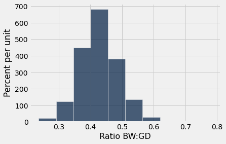
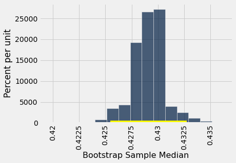
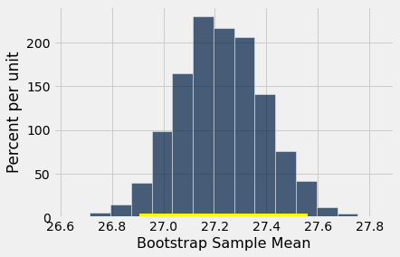
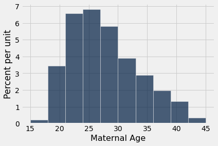
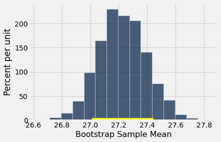
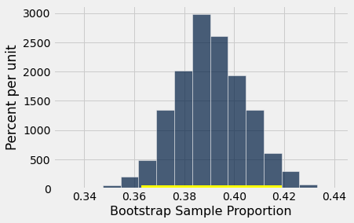

# 신뢰구간(confidence interval)
우리는 무작위 표본추출(random sampling)과 부트스트랩(bootstrap)을 사용하여 모수(parameter)를 추정하는 방법을 발전시켰다. 이 방법은 무작위 표본(random sample)의 우연에 의한 변동(chance variability)을 고려하기 위해 추정값(estimate)의 구간을 산출한다. 추정값 하나 대신 추정값의 구간을 제시함으로써 우리는 어느 정도의 여유를 확보한다.

앞의 예에서 우리의 추정 과정은 약 95%의 경우에 좋은 구간을 산출한다는 것을 보았다. 여기서 "좋은" 구간이란 모수(parameter)를 포함하는 구간이다. 우리는 이 과정이 좋은 구간을 산출한다고 *95% 신뢰한다*(95% confident)고 말한다. 우리의 추정값(estimate) 구간을 모수에 대한 *95% 신뢰구간*(95% confidence interval)이라 하고, 95%를 그 구간의 *신뢰수준*(confidence level)이라 한다.

구간이 부트스트랩(bootstrap) 추정값(estimate)들의 두 백분위수(percentile)를 골라내어 만들어지므로, 이 방법을 *부트스트랩 백분위수 방법*(bootstrap percentile method)이라 한다.

앞의 예의 상황은 조금 특이했다. 우리는 우연히 모수(parameter)의 값을 알고 있었기 때문에 구간이 좋은 구간인지 실패작인지 확인할 수 있었고, 이를 통해 우리의 추정 과정을 100번 사용할 때마다 약 95번은 모수를 포착한다는 것을 알 수 있었다.

그러나 대개 데이터 과학자들은 모수(parameter)의 값을 알지 못한다. 애초에 그것이 모수를 추정하려는 이유이다. 그러한 상황에서 그들은 우리가 발전시킨 것과 같은 방법을 사용하여 알려지지 않은 모수에 대한 추정값(estimate)의 구간을 제시한다. 통계 이론과 우리가 본 것과 같은 시연 덕분에, 데이터 과학자들은 구간을 생성하는 자신의 과정이 알려진 비율만큼의 경우에 좋은 구간을 산출한다고 확신할 수 있다.

```python
from datascience import *
%matplotlib inline
path_data = '../../../assets/data/'
import matplotlib.pyplot as plots
plots.style.use('fivethirtyeight')
import numpy as np
```

## 모집단 중앙값(population median) 추정하기

이제 부트스트랩 방법(bootstrap method)을 사용하여 알려지지 않은 모집단(population) 중앙값(median)을 추정할 것이다. 이 데이터 세트는 이전에 접한 적이 있다. 이는 대규모 병원 시스템의 신생아 표본(sample)에서 나온 것이다. 표본추출(sampling)은 여러 단계에 걸쳐 이루어졌지만, 우리는 이를 단순 무작위 표본(simple random sample)인 것처럼 취급할 것이다. 데버라 놀런(Deborah Nolan)과 테리 스피드(Terry Speed)의 [Stat Labs](https://www.stat.berkeley.edu/~statlabs/)에 이 데이터 세트가 추출된 더 큰 데이터 세트에 대한 자세한 내용이 있다. 

`births` 테이블에는 엄마-아기 쌍에 대한 다음 변수들이 들어 있다. 온스 단위의 아기 출생 체중, 임신 일수(엄마가 임신한 상태였던 날의 수), 만 나이로 나타낸 엄마의 나이, 인치 단위의 엄마의 키, 파운드 단위의 임신 중 체중, 그리고 엄마가 임신 중 흡연했는지 여부이다.

```python
births = Table.read_table(path_data + 'baby.csv')
```

```python
births.show(3)
```

<table border="1" class="dataframe">
    <thead>
        <tr>
            <th>Birth Weight</th> <th>Gestational Days</th> <th>Maternal Age</th> <th>Maternal Height</th> <th>Maternal Pregnancy Weight</th> <th>Maternal Smoker</th>
        </tr>
    </thead>
    <tbody>
        <tr>
            <td>120         </td> <td>284             </td> <td>27          </td> <td>62             </td> <td>100                      </td> <td>False          </td>
        </tr>
        <tr>
            <td>113         </td> <td>282             </td> <td>33          </td> <td>64             </td> <td>135                      </td> <td>False          </td>
        </tr>
        <tr>
            <td>128         </td> <td>279             </td> <td>28          </td> <td>64             </td> <td>115                      </td> <td>True           </td>
        </tr>
    </tbody>
</table>
<p>... (1171 rows omitted)</p>

출생 체중은 신생아의 건강에 중요한 요인이다. 작은 아기는 큰 신생아보다 생후 첫 며칠 동안 더 많은 의료 처리를 필요로 하는 경향이 있다. 따라서 아기가 태어나기 전에 출생 체중의 추정값(estimate)을 가지고 있으면 도움이 된다. 이를 위한 한 가지 방법은 출생 체중과 임신 일수 사이의 관계를 살펴보는 것이다. 

이 관계에 대한 간단한 척도는 임신 일수에 대한 출생 체중의 비율(ratio)이다. `ratios` 테이블에는 `baby`의 처음 두 열과 함께 비율을 담은 열이 들어 있다. 그 열의 첫 번째 항목은 다음과 같이 계산되었다.

$$
\frac{120~\mbox{ounces}}{284~\mbox{days}} ~\approx ~ 0.4225~ \mbox{ounces per day}
$$

```python
ratios = births.select('Birth Weight', 'Gestational Days').with_columns(
    'Ratio BW:GD', births.column('Birth Weight')/births.column('Gestational Days')
)
```

```python
ratios
```

<table border="1" class="dataframe">
    <thead>
        <tr>
            <th>Birth Weight</th> <th>Gestational Days</th> <th>Ratio BW:GD</th>
        </tr>
    </thead>
    <tbody>
        <tr>
            <td>120         </td> <td>284             </td> <td>0.422535   </td>
        </tr>
        <tr>
            <td>113         </td> <td>282             </td> <td>0.400709   </td>
        </tr>
        <tr>
            <td>128         </td> <td>279             </td> <td>0.458781   </td>
        </tr>
        <tr>
            <td>108         </td> <td>282             </td> <td>0.382979   </td>
        </tr>
        <tr>
            <td>136         </td> <td>286             </td> <td>0.475524   </td>
        </tr>
        <tr>
            <td>138         </td> <td>244             </td> <td>0.565574   </td>
        </tr>
        <tr>
            <td>132         </td> <td>245             </td> <td>0.538776   </td>
        </tr>
        <tr>
            <td>120         </td> <td>289             </td> <td>0.415225   </td>
        </tr>
        <tr>
            <td>143         </td> <td>299             </td> <td>0.478261   </td>
        </tr>
        <tr>
            <td>140         </td> <td>351             </td> <td>0.39886    </td>
        </tr>
    </tbody>
</table>
<p>... (1164 rows omitted)</p>

다음은 비율의 히스토그램(histogram)이다.

```python
ratios.select('Ratio BW:GD').hist()
```



언뜻 보기에 히스토그램(histogram)은 상당히 대칭적이며, 하루당 0.4온스에서 하루당 0.45온스 구간에서 밀도가 최대이다. 그러나 자세히 보면 일부 비율은 상대적으로 꽤 컸다는 것을 알 수 있다. 비율의 최댓값은 하루당 0.78온스를 조금 넘었는데, 이는 전형적인 값의 거의 두 배이다.

```python
ratios.sort('Ratio BW:GD', descending=True).take(0)
```

<table border="1" class="dataframe">
    <thead>
        <tr>
            <th>Birth Weight</th> <th>Gestational Days</th> <th>Ratio BW:GD</th>
        </tr>
    </thead>
    <tbody>
        <tr>
            <td>116         </td> <td>148             </td> <td>0.783784   </td>
        </tr>
    </tbody>
</table>

중앙값(median)은 매우 크거나 매우 작은 비율의 영향을 받지 않으므로 전형적인 비율에 대한 감을 준다. 표본(sample)의 비율 중앙값은 하루당 약 0.429온스이다.

```python
percentile(50, ratios.column(2))
```

```
0.42907801418439717
```

그러나 모집단(population)의 중앙값(median)은 얼마였을까? 우리는 그 값을 모르므로 추정할 것이다. 

방법은 앞 절과 정확히 같다. 표본(sample)을 5,000번 부트스트랩(bootstrap)하여 중앙값(median)의 추정값(estimate) 5,000개를 얻을 것이다. 95% 신뢰구간(confidence interval)은 모든 추정값의 "가운데 95%"가 될 것이다.

### 부트스트랩(bootstrap) 신뢰구간(confidence interval) 구성하기 

먼저 `one_bootstrap_median` 함수를 정의하자. 이 함수는 표본(sample)을 부트스트랩(bootstrap)하고 부트스트랩 표본의 비율 중앙값(median) 하나를 반환한다.

```python
def one_bootstrap_median():
    resample = ratios.sample()
    return percentile(50, resample.column('Ratio BW:GD'))
```

아래 셀을 실행하여 부트스트랩(bootstrap) 비율들이 어떻게 달라지는지 살펴보자. 각각이 모집단(population)의 알려지지 않은 비율에 대한 추정값(estimate)이라는 것을 기억하자.

```python
one_bootstrap_median()
```

```
0.43010752688172044
```

이제 `for` 루프를 사용하여 5000개의 부트스트랩(bootstrap) 중앙값(median)을 생성할 수 있다.

```python
# Generate medians from 5000 bootstrap samples
num_repetitions = 5000
bstrap_medians = make_array()
for i in np.arange(num_repetitions):
    bstrap_medians = np.append(bstrap_medians, one_bootstrap_median())
```

```python
# Get the endpoints of the 95% confidence interval
left = percentile(2.5, bstrap_medians)
right = percentile(97.5, bstrap_medians)

make_array(left, right)
```

```
array([0.42545455, 0.43272727])
```

95% 신뢰구간(confidence interval)은 하루당 약 0.425온스에서 하루당 약 0.433온스까지이다. 우리는 모집단(population)의 "임신 일수에 대한 출생 체중" 비율의 중앙값(median)이 하루당 0.425온스에서 하루당 0.433온스 구간 어딘가에 있다고 추정하고 있다.

원래 표본(sample)에 기반한 추정값(estimate) 0.429는 우연히 구간의 양 끝 사이의 정중앙에 있지만, 일반적으로 반드시 그럴 필요는 없다.

결과를 시각화하기 위해 부트스트랩(bootstrap) 중앙값(median)들의 경험적 히스토그램(empirical histogram)을 그리고 가로축 위에 신뢰구간(confidence interval)을 표시하자.

```python
resampled_medians = Table().with_columns(
    'Bootstrap Sample Median', bstrap_medians
)
resampled_medians.hist(bins=15)
plots.plot([left, right], [0, 0], color='yellow', lw=8);
```



이 히스토그램(histogram)과 구간은 앞 절에서 그린 것과 비슷하지만, 한 가지 큰 차이가 있다. 모수(parameter)의 위치를 나타내는 초록색 점이 없다는 것이다. 우리는 그 점이 어디에 있어야 하는지, 심지어 구간 안에 있는지조차 알지 못한다.

우리는 추정값(estimate)의 구간만 가지고 있다. 이를 생성하는 과정이 약 95%의 경우에 좋은 구간을 산출하므로, 이는 추정값의 95% 신뢰구간(confidence interval)이다. 비율을 무작위로 추측하는 것보다는 확실히 낫다!

이 구간은 근사적인 95% 신뢰구간(confidence interval)이라는 점을 명심하자. 계산 과정에는 많은 근사가 포함되어 있다. 근사가 나쁘지는 않지만 정확하지는 않다.

## 모집단 평균(population average) 추정하기
중앙값(median)에 대해 한 작업은 평균(average)에 대해서도 할 수 있다. 모집단(population)에 있는 엄마들의 평균 나이를 추정하고 싶다고 하자. 자연스러운 추정값(estimate)은 표본(sample)에 있는 엄마들의 평균 나이이다. 다음은 그들의 나이 분포(distribution)와 약 27.2세였던 평균 나이이다.

```python
births.select('Maternal Age').hist()
```


```python
np.average(births.column('Maternal Age'))
```

```
27.228279386712096
```

모집단(population)에 있는 엄마들의 평균(average) 나이는 얼마였을까? 우리는 이 모수(parameter)의 값을 알지 못한다.

부트스트랩 방법(bootstrap method)으로 알려지지 않은 모수(parameter)를 추정해 보자. 이를 위해 `bootstrap_median`의 코드를 변형하여 대신 `bootstrap_mean` 함수를 정의할 것이다. 통계량(statistic)이 중앙값(median) 대신 평균(mean, 즉 average)이고, `bstrap_medians` 대신 `bstrap_means`라는 배열에 수집된다는 점을 제외하면 코드는 같다.

```python
def one_bootstrap_mean():
    resample = births.sample()
    return np.average(resample.column('Maternal Age'))
```

```python
# Generate means from 5000 bootstrap samples
num_repetitions = 5000
bstrap_means = make_array()
for i in np.arange(num_repetitions):
    bstrap_means = np.append(bstrap_means, one_bootstrap_mean())
```

```python
# Get the endpoints of the 95% confidence interval
left = percentile(2.5, bstrap_means)
right = percentile(97.5, bstrap_means)

make_array(left, right)
```

```
array([26.90630324, 27.55962521])
```

95% 신뢰구간(confidence interval)은 약 26.9세에서 약 27.6세까지이다. 즉, 우리는 모집단(population)에 있는 엄마들의 평균(average) 나이가 26.9세에서 27.6세 구간 어딘가에 있다고 추정하고 있다. 

양 끝이 원래 표본(sample)의 평균(average)인 약 27.2세에 얼마나 가까운지 주목하자. 표본 크기(sample size)가 1,174명의 엄마로 매우 크므로 표본 평균은 크게 변하지 않는다. 다음 장에서 이 관찰을 더 깊이 탐구할 것이다.

아래에 5,000개의 부트스트랩(bootstrap) 평균(mean) 나이에 대한 경험적 히스토그램(empirical histogram)이 모집단(population) 평균 나이에 대한 95% 신뢰구간(confidence interval)과 함께 나타나 있다.

```python
resampled_means = Table().with_columns(
    'Bootstrap Sample Mean', bstrap_means
)
resampled_means.hist(bins=15)
plots.plot([left, right], [0, 0], color='yellow', lw=8);
```



다시 한번 원래 표본(sample)의 평균(average)인 27.23세는 구간의 중심에 가깝다. 각 부트스트랩(bootstrap) 표본은 바로 그 원래 표본에서 추출되므로 이는 그리 놀랍지 않다. 부트스트랩 표본들의 평균은 그것들이 추출된 표본의 평균을 중심으로 양쪽에 대략 대칭적으로 분포한다.

또한 표본으로 뽑힌 나이의 히스토그램(histogram)은 전혀 대칭적이지 않았음에도, 재표본추출된 평균(mean)들의 경험적 히스토그램은 대략 대칭적인 종 모양이라는 점에 주목하자.

```python
births.select('Maternal Age').hist()
```



이는 확률과 통계의 중심극한정리(Central Limit Theorem)의 결과이다. 이후의 절들에서 이 정리가 무엇을 말하는지 살펴볼 것이다.

## 80% 신뢰구간(confidence interval)
부트스트랩(bootstrap) 표본 평균(mean)들을 사용하여 임의의 신뢰수준(confidence level)의 구간을 구성할 수 있다. 예를 들어, 모집단(population) 평균 나이에 대한 80% 신뢰구간(confidence interval)을 구성하려면 재표본추출된 평균들의 "가운데 80%"를 취하면 된다. 즉, 분포(distribution)의 양쪽 두 꼬리에 각각 10%가 있도록 해야 하므로, 양 끝점은 재표본추출된 평균들의 10번째와 90번째 백분위수(percentile)가 된다.

```python
left_80 = percentile(10, bstrap_means)
right_80 = percentile(90, bstrap_means)
make_array(left_80, right_80)
```

```
array([27.01277683, 27.44293015])
```

```python
resampled_means.hist(bins=15)
plots.plot([left_80, right_80], [0, 0], color='yellow', lw=8);
```



이 80% 신뢰구간(confidence interval)은 95% 신뢰구간보다 훨씬 짧다. 약 27.0세에서 약 27.4세까지일 뿐이다. 이는 촘촘한 추정값(estimate)들의 집합이지만, 이 과정이 약 80%의 경우에만 좋은 구간을 산출한다는 것을 알고 있다. 

앞의 과정은 더 넓은 구간을 산출했지만, 우리는 그 구간을 생성한 과정을 더 신뢰할 수 있었다.

높은 신뢰수준(confidence level)에서 좁은 신뢰구간(confidence interval)을 얻으려면 더 큰 표본(sample)으로 시작해야 한다. 그 이유는 다음 장에서 살펴볼 것이다.

## 모집단 비율(population proportion) 추정하기
표본(sample)에서 엄마들의 39%가 임신 중에 흡연했다.

```python
births.where('Maternal Smoker', are.equal_to(True)).num_rows / births.num_rows
```

```
0.3909710391822828
```

비율(proportion)은 0과 1의 평균(average)이라는 것을 기억하자. 따라서 흡연한 엄마들의 비율은 다음과 같이 배열 연산을 사용하여 계산할 수도 있다.

```python
smoking = births.column('Maternal Smoker')
np.count_nonzero(smoking) / len(smoking)
```

```
0.3909710391822828
```

모집단(population)에서 엄마들 중 몇 퍼센트가 임신 중에 흡연했을까? 이는 부트스트랩(bootstrap) 신뢰구간(confidence interval)으로 추정할 수 있는 알려지지 않은 모수(parameter)이다. 단계는 모집단 중앙값(median)과 평균(mean)을 추정할 때 밟았던 단계와 유사하다.

이제는 익숙해진 과정에 따라, 먼저 표본(sample)을 부트스트랩(bootstrap)하고 부트스트랩 표본에서 흡연자의 비율(proportion)을 반환하는 함수 `one_bootstrap_proportion`을 정의할 것이다. 그런 다음 `for` 루프를 사용하여 이 함수를 여러 번 호출하고, 부트스트랩 비율들의 2.5번째 백분위수(percentile)와 97.5번째 백분위수를 구할 것이다.

```python
def one_bootstrap_proportion():
    resample = births.sample()
    smoking = resample.column('Maternal Smoker')
    return np.count_nonzero(smoking) / len(smoking)
```

```python
# Generate proportions from 5000 bootstrap samples
bstrap_proportions = make_array()
num_repetitions = 5000
for i in np.arange(num_repetitions):
    bstrap_proportions = np.append(bstrap_proportions, one_bootstrap_proportion())
```

```python
# Get the endpoints of the 95% confidence interval
left = percentile(2.5, bstrap_proportions)
right = percentile(97.5, bstrap_proportions)

make_array(left, right)
```

```
array([0.36286201, 0.41908007])
```

신뢰구간(confidence interval)은 약 36%에서 약 42%까지이다.

```python
resampled_proportions = Table().with_columns(
    'Bootstrap Sample Proportion', bstrap_proportions
)
resampled_proportions.hist(bins=15)
plots.plot([left, right], [0, 0], color='yellow', lw=8);
```



## 부트스트랩 백분위수 방법(bootstrap percentile method) 사용 시 주의 사항
부트스트랩(bootstrap)은 우아하고 강력한 방법이다. 이를 사용하기 전에 몇 가지 사항을 명심하는 것이 중요하다.

- 큰 무작위 표본(random sample)으로 시작하라. 그렇지 않으면 이 방법이 작동하지 않을 수 있다. 이 방법의 성공은 큰 무작위 표본(따라서 그 표본에서 추출한 재표본(resample)들도)이 모집단(population)과 닮는다는 데 기반한다. 평균의 법칙(Law of Averages)은 무작위 표본이 크다면 이것이 성립할 가능성이 높다고 말한다.

- 통계량(statistic)의 확률 분포(probability distribution)를 근사하려면 재표본추출(resampling) 절차를 가능한 한 많이 반복하는 것이 좋다. 특히 모집단(population)의 분포가 봉우리가 하나이고 상당히 대칭적이라면, 수천 번의 반복으로 표본 중앙값(median)의 분포에 대한 괜찮은 근사를 얻을 수 있다. 우리의 예에서는 5,000번의 반복을 사용했지만 일반적으로는 10,000번을 권장한다.

- 부트스트랩 백분위수 방법(bootstrap percentile method)은 큰 무작위 표본(random sample)에 기반하여 모집단(population) 중앙값(median)이나 평균(mean)을 추정하는 데 잘 작동한다. 그러나 모든 추정 방법과 마찬가지로 한계가 있다. 예를 들어, 다음 상황에서는 잘 작동하리라고 기대할 수 *없다*.
    - 목표가 모집단의 최솟값이나 최댓값, 매우 낮거나 매우 높은 백분위수, 또는 모집단의 드문 원소에 크게 영향을 받는 모수를 추정하는 것인 경우.
    - 통계량의 확률 분포가 대략적인 종 모양이 아닌 경우.
    - 원래 표본이 매우 작은 경우(예를 들어 10이나 15 미만).
