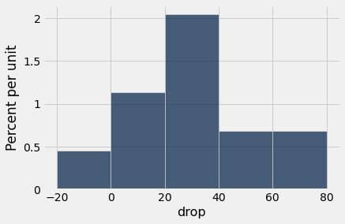
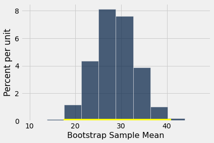

# 신뢰구간(confidence interval) 활용하기
신뢰구간(confidence interval)의 목적은 단 하나, 즉 무작위 표본(random sample)의 데이터에 기반하여 알려지지 않은 모수(parameter)를 추정하는 것이다. 앞 절에서 우리는 구간 (36%, 42%)가 모집단(population)의 엄마들 중 흡연자 비율에 대한 근사적인 95% 신뢰구간이라고 말했다. 이는 우리의 추정에 따르면 모집단의 엄마들 중 흡연자 비율이 36%에서 42% 사이 어딘가에 있으며, 우리의 추정 과정이 약 95%의 경우에 옳다는 것을 형식적으로 표현한 것이다.

신뢰구간(confidence interval)을 다른 목적으로 사용하고 싶은 충동을 억제하는 것이 중요하다. 예를 들어, 우리가 구간 (26.9세, 27.6세)를 모집단(population)에 있는 엄마들의 평균(average) 나이에 대한 근사적인 95% 신뢰구간으로 계산했던 것을 떠올려 보자. 이 구간을 잘못 사용하는 흔한 예로, 여성들의 약 95%가 26.9세에서 27.6세 사이였다고 결론 내리는 경우가 실망스러울 정도로 많다. 이것이 옳을 수 없다는 것을 알기 위해 신뢰구간에 대해 많이 알 필요는 없다. 엄마들의 95%가 모두 나이 차이가 몇 달 이내일 것이라고 기대하지는 않을 것이기 때문이다. 실제로 표본으로 뽑힌 나이의 히스토그램(histogram)은 상당한 변동을 보여 준다.

```python
from datascience import *
%matplotlib inline
path_data = '../../../assets/data/'
import matplotlib.pyplot as plots
plots.style.use('fivethirtyeight')
import numpy as np
```

```python
births = Table.read_table(path_data + 'baby.csv')
```

```python
births.select('Maternal Age').hist()
```


표본으로 뽑힌 나이 중 (26.9, 27.6) 구간에 있는 것은 적은 비율이며, 모집단(population)에서도 비슷하게 적은 비율일 것으로 예상할 수 있다. 이 구간은 단지 하나의 수, 즉 모집단에 있는 모든 나이의 *평균*(average)을 추정할 뿐이다.

그러나 신뢰구간(confidence interval)으로 모수(parameter)를 추정하는 것은 모수가 대략 얼마나 큰지 알려 주는 것 외에도 중요한 용도가 있다.

## 신뢰구간(confidence interval)을 사용한 가설(hypothesis) 검정
모집단(population)의 평균(average) 나이에 대한 우리의 근사적인 95% 신뢰구간(confidence interval)은 26.9세에서 27.6세까지이다. 누군가가 다음 가설(hypothesis)들을 검정하려 한다고 하자.

**귀무가설(null hypothesis):** 모집단의 평균 나이는 30세이다.

**대립가설(alternative hypothesis):** 모집단의 평균 나이는 30세가 아니다.

이때 p-값(p-value)에 대해 5% 기준을 사용한다면 귀무가설(null hypothesis)을 기각하게 된다. 30이 모집단(population) 평균(average)에 대한 95% 신뢰구간(confidence interval)에 속하지 않기 때문이다. 5% 유의수준(level of significance)에서 30은 모집단 평균으로 그럴듯한 값이 아니다.

이러한 신뢰구간(confidence interval)의 활용은 신뢰구간과 검정 사이의 *쌍대성*(duality)의 결과이다. 즉, 모집단(population) 평균(mean)이 특정 값 *x*인지 아닌지를 검정하면서 p-값(p-value)에 대해 5% 기준을 사용한다면, *x*가 평균에 대한 95% 신뢰구간에 속하지 않을 때 귀무가설(null hypothesis)을 기각하게 된다. 

이는 통계 이론으로 확립할 수 있다. 실제로는 귀무가설(null hypothesis)에서 지정한 값이 신뢰구간(confidence interval) 안에 있는지 여부를 확인하는 것으로 귀결된다.

p-값(P-value)에 대해 1% 기준을 사용한다면, 귀무가설(null hypothesis)에서 지정한 값이 모집단(population) 평균(mean)에 대한 99% 신뢰구간(confidence interval) 안에 있는지 확인해야 한다.

대략적인 근사로서, 표본(sample)이 크다면 이러한 설명은 모집단(population) 비율(proportion)에 대해서도 성립한다.

이제 신뢰구간(confidence interval)을 사용하여 특정 종류의 가설(hypothesis)을 검정하는 방법을 알게 되었지만, 모집단(population)의 평균(average) 나이가 30과 같은지 여부를 검정하는 것이 무슨 가치가 있는지 궁금할 수도 있다. 실제로 그 가치는 분명하지 않다. 그러나 이러한 종류의 가설에 대한 검정이 자연스럽고 유용한 상황도 있다.

## 기준선(baseline) 점수와 치료 후(post-treatment) 점수 비교하기

이를 호지킨병(Hodgkin's disease) 치료에 관한 무작위 통제 실험(randomized controlled trial)에서 수집한 정보의 일부인 데이터를 맥락으로 하여 살펴볼 것이다. 호지킨병은 주로 젊은 사람들에게 발병하는 암이다. 이 병은 완치가 가능하지만 치료가 매우 가혹할 수 있다. 이 실험의 목적은 암을 치료하면서도 환자에 대한 부작용을 최소화하는 투여량을 찾는 것이었다. 

이 ``hodgkins`` 테이블에는 22명의 환자의 폐에 치료가 미친 영향에 대한 데이터가 들어 있다. 열은 다음과 같다.

- 키(cm 단위)
- 맨틀 부위(목, 가슴, 겨드랑이 아래)에 대한 방사선량 척도
- 화학요법 척도
- 기준선, 즉 치료 시작 시점의 폐 건강 점수. 점수가 높을수록 폐가 더 건강하다.
- 치료 15개월 후의 같은 폐 건강 점수

```python
hodgkins = Table.read_table(path_data + 'hodgkins.csv')
```

```python
hodgkins.show(3)
```

<table border="1" class="dataframe">
    <thead>
        <tr>
            <th>height</th> <th>rad</th> <th>chemo</th> <th>base</th> <th>month15</th>
        </tr>
    </thead>
    <tbody>
        <tr>
            <td>164   </td> <td>679 </td> <td>180  </td> <td>160.57</td> <td>87.77  </td>
        </tr>
        <tr>
            <td>168   </td> <td>311 </td> <td>180  </td> <td>98.24 </td> <td>67.62  </td>
        </tr>
        <tr>
            <td>173   </td> <td>388 </td> <td>239  </td> <td>129.04</td> <td>133.33 </td>
        </tr>
    </tbody>
</table>
<p>... (19 rows omitted)</p>

기준선 점수와 15개월 점수를 비교할 것이다. 각 행이 한 명의 환자에 대응하므로, 기준선 점수 표본(sample)과 15개월 점수 표본은 *쌍을 이룬다*(paired)고 말한다. 즉, 이들은 단순히 각각 22개의 값으로 이루어진 두 집합이 아니라, 환자마다 하나씩인 22개의 값 쌍이다.

한눈에 보아도 15개월 점수가 기준선 점수보다 낮은 경향이 있음을 알 수 있다. 표본으로 뽑힌 환자들의 폐는 치료 15개월 후에 더 나빠진 것으로 보인다. 이는 기준선에서 15개월까지 점수가 떨어진 양을 나타내는 `drop` 열의 값이 대부분 양수라는 것으로 확인된다.

```python
hodgkins = hodgkins.with_columns(
    'drop', hodgkins.column('base') - hodgkins.column('month15')
)
```

```python
hodgkins
```

<table border="1" class="dataframe">
    <thead>
        <tr>
            <th>height</th> <th>rad</th> <th>chemo</th> <th>base</th> <th>month15</th> <th>drop</th>
        </tr>
    </thead>
    <tbody>
        <tr>
            <td>164   </td> <td>679 </td> <td>180  </td> <td>160.57</td> <td>87.77  </td> <td>72.8  </td>
        </tr>
        <tr>
            <td>168   </td> <td>311 </td> <td>180  </td> <td>98.24 </td> <td>67.62  </td> <td>30.62 </td>
        </tr>
        <tr>
            <td>173   </td> <td>388 </td> <td>239  </td> <td>129.04</td> <td>133.33 </td> <td>-4.29 </td>
        </tr>
        <tr>
            <td>157   </td> <td>370 </td> <td>168  </td> <td>85.41 </td> <td>81.28  </td> <td>4.13  </td>
        </tr>
        <tr>
            <td>160   </td> <td>468 </td> <td>151  </td> <td>67.94 </td> <td>79.26  </td> <td>-11.32</td>
        </tr>
        <tr>
            <td>170   </td> <td>341 </td> <td>96   </td> <td>150.51</td> <td>80.97  </td> <td>69.54 </td>
        </tr>
        <tr>
            <td>163   </td> <td>453 </td> <td>134  </td> <td>129.88</td> <td>69.24  </td> <td>60.64 </td>
        </tr>
        <tr>
            <td>175   </td> <td>529 </td> <td>264  </td> <td>87.45 </td> <td>56.48  </td> <td>30.97 </td>
        </tr>
        <tr>
            <td>185   </td> <td>392 </td> <td>240  </td> <td>149.84</td> <td>106.99 </td> <td>42.85 </td>
        </tr>
        <tr>
            <td>178   </td> <td>479 </td> <td>216  </td> <td>92.24 </td> <td>73.43  </td> <td>18.81 </td>
        </tr>
    </tbody>
</table>
<p>... (12 rows omitted)</p>

```python
hodgkins.select('drop').hist(bins=np.arange(-20, 81, 20))
```



```python
np.average(hodgkins.column('drop'))
```

```
28.615909090909096
```

표본(sample)에서 평균(average) 감소량은 약 28.6이다. 그러나 이것이 우연에 의한 변동(chance variation)의 결과일 수 있을까? 데이터는 무작위 표본(random sample)에서 나온 것이다. 환자 모집단(population) 전체에서는 평균 감소량이 그저 0일 수도 있을까?

이에 답하기 위해 두 가설(hypothesis)을 세울 수 있다.

**귀무가설(null hypothesis):** 모집단에서 평균 감소량은 0이다.

**대립가설(alternative hypothesis):** 모집단에서 평균 감소량은 0이 아니다.

p-값(p-value)에 대해 1% 기준으로 이 가설(hypothesis)을 검정하기 위해, 모집단(population)의 평균(average) 감소량에 대한 근사적인 99% 신뢰구간(confidence interval)을 구성해 보자.

```python
def one_bootstrap_mean():
    resample = hodgkins.sample()
    return np.average(resample.column('drop'))
```

```python
# Generate 10,000 bootstrap means
num_repetitions = 10000
bstrap_means = make_array()
for i in np.arange(num_repetitions):
    bstrap_means = np.append(bstrap_means, one_bootstrap_mean())
```

```python
# Get the endpoints of the 99% confidence interval
left = percentile(0.5, bstrap_means)
right = percentile(99.5, bstrap_means)

make_array(left, right)
```

```
array([17.46863636, 40.97681818])
```

```python
resampled_means = Table().with_columns(
    'Bootstrap Sample Mean', bstrap_means
)
resampled_means.hist()
plots.plot([left, right], [0, 0], color='yellow', lw=8);
```



모집단(population)의 평균(average) 감소량에 대한 99% 신뢰구간(confidence interval)은 약 17에서 약 40까지이다. 이 구간은 0을 포함하지 않는다. 따라서 귀무가설(null hypothesis)을 기각한다.

그러나 우리가 단순히 모집단(population)의 평균(average) 감소량이 0이 아니라고 결론 내리는 것보다 더 나은 일을 했다는 데 주목하자. 우리는 평균 감소량이 얼마나 큰지를 추정했다. 이는 단지 "0이 아니다"라고 말하는 것보다 더 유용한 결과이다.

**정확도에 관한 참고 사항:** 우리의 신뢰구간(confidence interval)은 크게 두 가지 이유로 상당히 넓다.
- 신뢰수준(confidence level)이 높다(99%).
- 표본 크기(sample size)가 앞의 예들에 비해 상대적으로 작다.

다음 장에서는 표본 크기(sample size)가 정확도에 어떤 영향을 미치는지 살펴볼 것이다. 또한 바탕이 되는 데이터의 분포(distribution)가 전혀 종 모양이 아닌데도 표본 평균(mean)들의 경험적 분포(empirical distribution)가 왜 그토록 자주 종 모양으로 나타나는지도 살펴볼 것이다.

## 맺음말 ##
한 분야의 용어는 대개 그 분야의 선도적인 연구자들에게서 나온다. 부트스트랩(bootstrap) 기법을 처음 제안한 [브래드 에프런(Brad Efron)](https://en.wikipedia.org/wiki/Bradley_Efron)은 [미국에서 유래한](https://en.wikipedia.org/wiki/Bootstrapping) 용어를 사용했다. 이에 뒤질세라 중국 통계학자들은 [자신들만의 방법을 제안했다](http://econpapers.repec.org/article/eeestapro/v_3a37_3ay_3a1998_3ai_3a4_3ap_3a321-329.htm).
