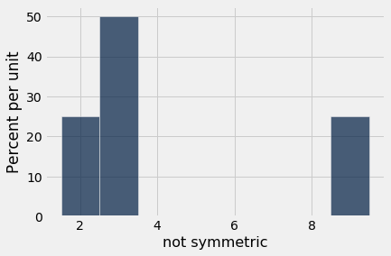
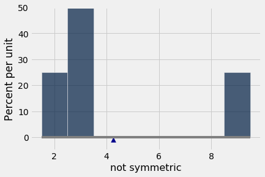
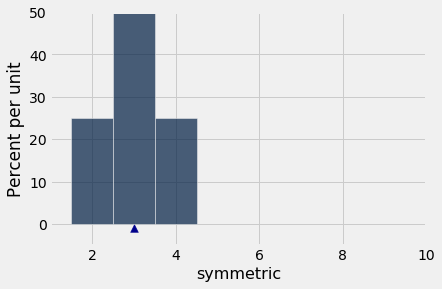
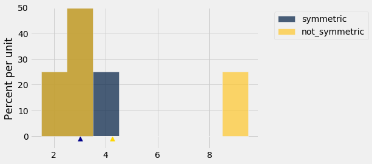
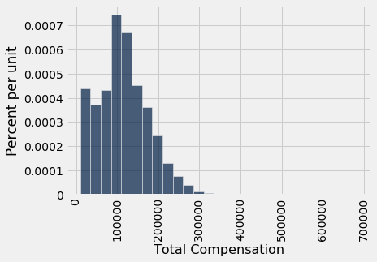

# 평균(mean)의 성질

이 강좌에서 우리는 평균(mean)을 뜻하는 "average"와 "mean"이라는 두 단어를 구별 없이 사용해 왔으며, 앞으로도 그렇게 할 것이다. 평균의 정의는 고등학교 시절이나 그 이전부터 익숙할 것이다.

**정의.** 수들의 모음의 *평균*(average 또는 mean)은 모음에 있는 모든 원소의 합을 모음의 원소 개수로 나눈 값이다.

메서드 `np.average`와 `np.mean`은 배열의 평균(mean)을 반환한다.

```python
from datascience import *
%matplotlib inline
path_data = '../../../assets/data/'
import matplotlib.pyplot as plots
plots.style.use('fivethirtyeight')
import pylab as pl
import numpy as np
```

```python
not_symmetric = make_array(2, 3, 3, 9)
```

```python
np.average(not_symmetric)
```

```
4.25
```

```python
np.mean(not_symmetric)
```

```
4.25
```

## 기본 성질

위의 정의와 예는 평균(mean)의 몇 가지 성질을 보여 준다.

- 평균은 모음의 원소일 필요가 없다.
- 모음의 모든 원소가 정수라 하더라도 평균은 정수일 필요가 없다.
- 평균은 모음의 가장 작은 값과 가장 큰 값 사이 어딘가에 있다.
- 평균이 두 극단값의 정중앙에 있을 필요는 없다. 일반적으로 모음의 원소 중 절반이 평균보다 크다는 것은 사실이 아니다.
- 모음이 특정 단위로 측정된 변수(variable)의 값들로 이루어져 있다면, 평균도 같은 단위를 갖는다.

이제 평균(mean)과 그것이 다른 통계량(statistic)과 맺는 관계를 이해하는 데 도움이 되는 몇 가지 다른 성질을 살펴보자.

## 평균(mean)은 "평활기"이다

평균(mean)을 구하는 것을 "균등화" 또는 "평활화(smoothing)" 연산으로 생각할 수 있다. 예를 들어, 위의 `not_symmetric`의 항목들을 서로 다른 네 사람의 주머니에 든 달러라고 상상해 보자. 평균을 구하려면 먼저 모든 돈을 하나의 큰 통에 넣은 다음 네 사람에게 똑같이 나누어 준다. 그들은 처음에 주머니에 서로 다른 금액(\$2, \$3, \$3, \$9)을 가지고 있었지만, 이제 각자 평균 금액인 \$4.25를 갖게 된다.

## 비율(proportion)은 평균(mean)이다
모음이 1과 0으로만 이루어져 있다면, 모음의 합은 그 안에 있는 1의 개수이고, 모음의 평균(mean)은 1의 비율(proportion)이다.

```python
zero_one = make_array(1, 1, 1, 0)
sum(zero_one)
```

```
3
```

```python
np.mean(zero_one)
```

```
0.75
```

1을 불리언(Boolean) 값 `True`로, 0을 `False`로 바꾸어도 된다.

```python
np.mean(make_array(True, True, True, False))
```

```
0.75
```

비율(proportion)은 평균(mean)의 특수한 경우이므로, 무작위 표본(random sample) 평균에 관한 결과는 무작위 표본 비율에도 그대로 적용된다.

## 평균(mean)과 히스토그램(histogram)
모음 {2, 3, 3, 9}의 평균(mean)은 4.25이며, 이는 데이터의 "중간 지점"이 아니다. 그렇다면 평균은 무엇을 측정하는 것일까?

이를 알아보기 위해, 평균(mean)을 여러 가지 방법으로 계산할 수 있다는 점에 주목하자.

$$\begin{align*}
\mbox{mean} ~ &=~ 4.25 \\ \\
&=~ \frac{2 + 3 + 3 + 9}{4} \\ \\
&=~ 2 \cdot \frac{1}{4} ~~ + ~~ 3 \cdot \frac{1}{4} ~~ + ~~ 3 \cdot \frac{1}{4} ~~ + ~~ 9 \cdot \frac{1}{4} \\ \\
&=~ 2 \cdot \frac{1}{4} ~~ + ~~ 3 \cdot \frac{2}{4} ~~ + ~~ 9 \cdot \frac{1}{4} \\ \\
&=~ 2 \cdot 0.25 ~~ + ~~ 3 \cdot 0.5 ~~ + ~~ 9 \cdot 0.25
\end{align*}$$

마지막 식은 일반적인 사실의 한 예이다. 평균(mean)을 계산할 때, 모음의 각 고유한 값은 그 값이 모음에 나타나는 비율(proportion)만큼 *가중*된다.

이것은 중요한 결과를 낳는다. 모음의 평균(mean)은 고유한 값들과 그 비율(proportion)에만 의존하며, 모음의 원소 개수에는 의존하지 않는다. 다시 말해, 모음의 평균은 모음에 있는 값들의 분포(distribution)에만 의존한다.

따라서 **두 모음이 같은 분포(distribution)를 가지면, 두 모음의 평균(mean)도 같다.**

예를 들어, 다음은 `not_symmetric`과 같은 분포(distribution)를 가지며 따라서 같은 평균(mean)을 갖는 또 다른 모음이다.

```python
not_symmetric
```

```
array([2, 3, 3, 9])
```

```python
same_distribution = make_array(2, 2, 3, 3, 3, 3, 9, 9)
np.mean(same_distribution)
```

```
4.25
```

평균(mean)은 분포(distribution)의 히스토그램(histogram)이 갖는 물리적 속성이다. 다음은 `not_symmetric`의 분포, 또는 이와 동일한 `same_distribution`의 분포를 나타내는 히스토그램이다.

```python
t1 = Table().with_columns('not symmetric', not_symmetric)
t1.hist(bins=np.arange(1.5, 9.6, 1))
```



히스토그램(histogram)을 가로축을 따라 놓인 철사에 붙어 있는 판지로 만든 도형이라고 상상하고, 막대들을 값 2, 3, 9에 매달린 추라고 상상해 보자. 이 도형을 철사 위의 한 점에서 균형을 잡으려 한다고 하자. 그 점이 2 근처에 있으면 도형은 오른쪽으로 기울어 넘어질 것이다. 그 점이 9 근처에 있으면 도형은 왼쪽으로 기울어 넘어질 것이다. 그 사이 어딘가에 도형이 균형을 이루는 점이 있으며, 그 점이 바로 평균(mean)인 4.25이다.

**평균(mean)은 히스토그램(histogram)의 무게중심(center of gravity), 즉 균형점이다.**

왜 그런지 이해하려면 물리학을 조금 알면 도움이 된다. 무게중심(center of gravity)은 우리가 평균(mean)을 계산한 방식과 정확히 같은 방식, 즉 고유한 값들을 그 비율(proportion)로 가중하여 계산한다.

평균(mean)은 균형점이므로, 때때로 히스토그램(histogram) 밑변에 *받침점(fulcrum)* 또는 삼각형으로 표시된다.

```python
mean_ns = np.mean(not_symmetric)
t1.hist(bins=np.arange(1.5, 9.6, 1))
plots.scatter(mean_ns, -0.009, marker='^', color='darkblue', s=60)
plots.plot([1.5, 9.5], [0, 0], color='grey')
plots.ylim(-0.05, 0.5);
```



## 평균(mean)과 중앙값(median)

어떤 학생의 시험 점수가 평균(average)보다 낮다면, 그 학생이 해당 시험에서 반의 하위 절반에 속한다는 뜻일까?

그 학생에게는 다행스럽게도, 답은 "반드시 그렇지는 않다"이다. 그 이유는 히스토그램(histogram)의 균형점인 평균(average)과 데이터의 "중간 지점"인 중앙값(median) 사이의 관계와 관련이 있다.

이 관계는 간단한 예에서 쉽게 볼 수 있다. 다음은 배열 `symmetric`에 들어 있는 모음 {2, 3, 3, 4}의 히스토그램(histogram)이다. 이 분포(distribution)는 3을 중심으로 대칭이다. 평균(mean)과 중앙값(median)은 모두 3이다.

```python
symmetric = make_array(2, 3, 3, 4)
```

```python
t2 = Table().with_columns('symmetric', symmetric)
mean_s = np.mean(symmetric)

t2.hist(bins=np.arange(1.5, 4.6, 1))
plots.scatter(mean_s, -0.009, marker='^', color='darkblue', s=60)
plots.xlim(1, 10)
plots.ylim(-0.05, 0.5);
```



```python
np.mean(symmetric)
```

```
3.0
```

```python
percentile(50, symmetric)
```

```
3
```

일반적으로 **대칭 분포(symmetric distribution)에서는 평균(mean)과 중앙값(median)이 같다.**

분포(distribution)가 대칭이 아니라면 어떨까? `symmetric`과 `not_symmetric`을 비교해 보자.

```python
t3 = t2.with_column(
        'not_symmetric', not_symmetric
)

t3.hist(bins=np.arange(1.5, 9.6, 1))
plots.scatter(mean_s, -0.009, marker='^', color='darkblue', s=60)
plots.scatter(mean_ns, -0.009, marker='^', color='gold', s=60)
plots.ylim(-0.05, 0.5);
```



파란색 히스토그램(histogram)은 원래의 `symmetric` 분포를 나타낸다. `not_symmetric`의 금색 히스토그램은 왼쪽 끝에서는 파란색과 똑같이 시작하지만, 가장 오른쪽 막대가 값 9로 옮겨 가 있다. 갈색 부분은 두 히스토그램이 겹치는 곳이다.

파란색 분포(distribution)의 중앙값(median)과 평균(mean)은 모두 3이다. 금색 분포의 중앙값도 3인데, 오른쪽 절반이 왼쪽 절반과 다르게 분포되어 있음에도 그렇다.

그러나 금색 분포(distribution)의 평균(mean)은 3이 아니다. 금색 히스토그램(histogram)은 3에서 균형을 이루지 않는다. 균형점은 오른쪽으로 이동하여 4.25가 되었다.

금색 분포(distribution)에서는 4개 항목 중 3개(75%)가 평균(average)보다 낮다. 따라서 평균보다 낮은 점수를 받은 학생은 안심해도 된다. 그 학생은 반의 다수에 속할 수도 있다.

일반적으로 **히스토그램(histogram)이 한쪽에 꼬리를 가지고 있으면(정식 용어는 "치우친(skewed)"이다), 평균(mean)은 중앙값(median)으로부터 꼬리 방향으로 끌려간다.**

### 예 ###
표 `sf2015`에는 2015년 샌프란시스코(San Francisco) 시 직원들의 급여 및 복리후생 데이터가 들어 있다. 앞에서와 마찬가지로, 그해에 적어도 반일 근무에 상당하는 만큼 일한 직원들로 분석을 제한한다.

```python
sf2015 = Table.read_table(path_data + 'san_francisco_2015.csv').where('Salaries', are.above(10000))
```

앞에서 보았듯이, 최고 보수는 \$600,000을 넘었지만 대다수 직원의 보수는 \$300,000 미만이었다.

```python
sf2015.select('Total Compensation').hist(bins = np.arange(10000, 700000, 25000))
```



이 히스토그램(histogram)은 오른쪽으로 치우쳐(skewed) 있다. 즉, 오른쪽 꼬리를 가지고 있다. 

평균(mean)은 중앙값(median)으로부터 꼬리 방향으로 끌려간다. 따라서 평균 보수는 중앙값보다 클 것으로 예상되며, 실제로 그렇다.

```python
compensation = sf2015.column('Total Compensation')
percentile(50, compensation)
```

```
110305.79
```

```python
np.mean(compensation)
```

```
114725.98411824222
```

큰 모집단(population)의 소득 분포(distribution)는 오른쪽으로 치우치는(right skewed) 경향이 있다. 모집단의 대부분이 중간 이하의 소득을 가지지만 아주 작은 비율이 매우 높은 소득을 가질 때, 히스토그램(histogram)은 오른쪽으로 길고 가는 꼬리를 갖는다. 

평균(mean) 소득은 이 꼬리의 영향을 받는다. 꼬리가 오른쪽으로 멀리 뻗을수록 평균은 커진다. 그러나 중앙값(median)은 분포(distribution)의 극단에 있는 값들의 영향을 받지 않는다. 이것이 경제학자들이 소득 분포를 평균 대신 중앙값으로 요약하는 경우가 많은 이유이다.
