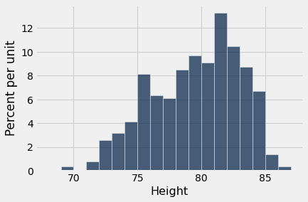
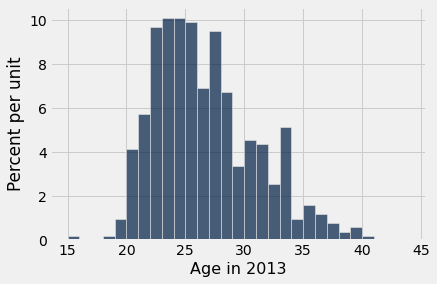
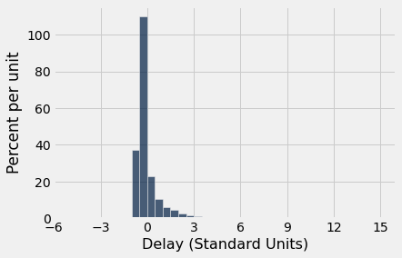

# 변동성(variability)
평균(mean)은 히스토그램(histogram)이 어디에서 균형을 이루는지 알려 준다. 그러나 지금까지 본 거의 모든 히스토그램에서 값들은 평균의 양쪽으로 퍼져 있다. 값들은 평균에서 얼마나 멀리 떨어져 있을 수 있을까? 이 질문에 답하기 위해, 평균을 중심으로 한 변동성(variability)의 척도를 만들어 보자.

먼저 이 척도를 계산하는 방법을 설명하는 것으로 시작한다. 그런 다음 이것이 왜 계산할 가치가 있는 좋은 척도인지 살펴본다.

```python
from datascience import *
%matplotlib inline
path_data = '../../../assets/data/'
import matplotlib.pyplot as plots
plots.style.use('fivethirtyeight')
import numpy as np
```

## 평균(average)으로부터의 편차(deviation)의 대략적인 크기
간단히 하기 위해, 단 네 개의 값으로 이루어진 간단한 배열 `any_numbers`를 가지고 계산을 시작한다. 보게 되겠지만, 우리의 방법은 다른 어떤 값들의 배열에도 쉽게 확장된다.

```python
any_numbers = make_array(1, 2, 2, 10)
```

목표는 수들이 평균(average)에서 대략 얼마나 벗어나 있는지 측정하는 것이다. 이를 위해 먼저 평균이 필요하다.

```python
# Step 1. The average.

mean = np.mean(any_numbers)
mean
```

```
3.75
```

다음으로, 각 값이 평균(mean)에서 얼마나 떨어져 있는지 알아보자. 이를 *평균으로부터의 편차*(deviations from the average)라고 한다. "평균으로부터의 편차"란 단순히 값에서 평균을 뺀 것이다. 표 `calculation_steps`에 그 결과가 나와 있다.

```python
# Step 2. The deviations from average.

deviations = any_numbers - mean
calculation_steps = Table().with_columns(
        'Value', any_numbers,
        'Deviation from Average', deviations
        )
calculation_steps
```

<table border="1" class="dataframe">
    <thead>
        <tr>
            <th>Value</th> <th>Deviation from Average</th>
        </tr>
    </thead>
    <tbody>
        <tr>
            <td>1    </td> <td>-2.75                 </td>
        </tr>
        <tr>
            <td>2    </td> <td>-1.75                 </td>
        </tr>
        <tr>
            <td>2    </td> <td>-1.75                 </td>
        </tr>
        <tr>
            <td>10   </td> <td>6.25                  </td>
        </tr>
    </tbody>
</table>

편차(deviation) 중 일부는 음수인데, 이는 평균(average)보다 작은 값에 해당한다. 양수인 편차는 평균보다 큰 값에 해당한다.

편차(deviation)가 대략 얼마나 큰지 계산하려면, 편차의 평균(mean)을 구하는 것이 자연스럽다. 그런데 모든 편차를 더하면 흥미로운 일이 일어난다.

```python
sum(deviations)
```

```
0.0
```

양수인 편차(deviation)가 음수인 편차를 정확히 상쇄한다. 이는 목록의 히스토그램(histogram)이 어떤 모양이든 관계없이 모든 수의 목록에서 성립한다. **평균으로부터의 편차의 합은 0이다.**

편차(deviation)의 합이 0이므로, 편차의 평균(mean)도 0이 된다.

```python
np.mean(deviations)
```

```
0.0
```

이 때문에 편차(deviation)의 평균(mean)은 편차의 크기를 나타내는 유용한 척도가 아니다. 우리가 정말로 알고 싶은 것은 편차가 양수인지 음수인지와 관계없이 대략 얼마나 큰가이다. 따라서 편차의 부호를 없애는 방법이 필요하다.

부호를 없애는 전통적인 방법은 두 가지가 있다. 절댓값(absolute value)과 제곱(square)이다. 제곱을 취하면 매우 강력한 성질을 가진 척도가 만들어지며, 그중 일부를 이 과정에서 공부할 것이다.

그러니 모든 편차(deviation)를 제곱하여 부호를 없애 보자. 그런 다음 제곱들의 평균(mean)을 구한다.

```python
# Step 3. The squared deviations from average

squared_deviations = deviations ** 2
calculation_steps = calculation_steps.with_column(
   'Squared Deviations from Average', squared_deviations
    )
calculation_steps
```

<table border="1" class="dataframe">
    <thead>
        <tr>
            <th>Value</th> <th>Deviation from Average</th> <th>Squared Deviations from Average</th>
        </tr>
    </thead>
    <tbody>
        <tr>
            <td>1    </td> <td>-2.75                 </td> <td>7.5625                         </td>
        </tr>
        <tr>
            <td>2    </td> <td>-1.75                 </td> <td>3.0625                         </td>
        </tr>
        <tr>
            <td>2    </td> <td>-1.75                 </td> <td>3.0625                         </td>
        </tr>
        <tr>
            <td>10   </td> <td>6.25                  </td> <td>39.0625                        </td>
        </tr>
    </tbody>
</table>

```python
# Step 4. Variance = the mean squared deviation from average

variance = np.mean(squared_deviations)
variance
```

```
13.1875
```

**분산(variance):** 위에서 계산한 제곱 편차의 평균(mean squared deviation)을 그 값들의 *분산*이라고 한다.

분산(variance)은 퍼짐의 정도에 대한 감을 주기는 하지만, 그 단위가 원래 단위의 제곱이므로 원래 변수(variable)와 같은 척도에 있지 않다. 이 때문에 해석하기가 매우 어렵다.

그래서 분산(variance)의 양의 제곱근을 취하여 원래의 척도로 되돌린다.

```python
# Step 5.
# Standard Deviation:    root mean squared deviation from average
# Steps of calculation:   5    4      3       2             1

sd = variance ** 0.5
sd
```

```
3.6314597615834874
```

## 표준편차(standard deviation)

방금 계산한 양을 목록의 *표준편차*(standard deviation)라고 하며, SD로 줄여 쓴다. 이는 목록의 수들이 평균(average)에서 대략 얼마나 떨어져 있는지를 측정한다.

**정의.** 목록의 표준편차(SD)는 *평균으로부터의 편차의 제곱 평균의 제곱근*(root mean square of deviations from average)으로 정의된다. 꽤 긴 말이다. 그러나 영어 표현을 오른쪽에서 왼쪽으로 읽으면 계산 단계의 순서가 된다.

**계산.** 위에서 설명한 다섯 단계를 거치면 표준편차(SD)가 나온다. 함수 ``np.std``를 사용하여 배열에 있는 값들의 표준편차를 계산할 수도 있다.

```python
np.std(any_numbers)
```

```
3.6314597615834874
```

## 표준편차(SD) 활용하기

표준편차(SD)로부터 무엇을 알 수 있는지 보기 위해, `any_numbers`보다 더 흥미로운 데이터셋으로 옮겨 가 보자. 표 `nba13`에는 2013년 미국 프로농구(National Basketball Association, NBA) 선수들에 대한 데이터가 들어 있다. 표에는 각 선수가 주로 뛴 포지션, 인치 단위의 키, 파운드 단위의 몸무게, 그리고 연 단위 나이가 기록되어 있다.

```python
nba13 = Table.read_table(path_data + 'nba2013.csv')
nba13
```

<table border="1" class="dataframe">
    <thead>
        <tr>
            <th>Name</th> <th>Position</th> <th>Height</th> <th>Weight</th> <th>Age in 2013</th>
        </tr>
    </thead>
    <tbody>
        <tr>
            <td>DeQuan Jones   </td> <td>Guard   </td> <td>80    </td> <td>221   </td> <td>23         </td>
        </tr>
        <tr>
            <td>Darius Miller  </td> <td>Guard   </td> <td>80    </td> <td>235   </td> <td>23         </td>
        </tr>
        <tr>
            <td>Trevor Ariza   </td> <td>Guard   </td> <td>80    </td> <td>210   </td> <td>28         </td>
        </tr>
        <tr>
            <td>James Jones    </td> <td>Guard   </td> <td>80    </td> <td>215   </td> <td>32         </td>
        </tr>
        <tr>
            <td>Wesley Johnson </td> <td>Guard   </td> <td>79    </td> <td>215   </td> <td>26         </td>
        </tr>
        <tr>
            <td>Klay Thompson  </td> <td>Guard   </td> <td>79    </td> <td>205   </td> <td>23         </td>
        </tr>
        <tr>
            <td>Thabo Sefolosha</td> <td>Guard   </td> <td>79    </td> <td>215   </td> <td>29         </td>
        </tr>
        <tr>
            <td>Chase Budinger </td> <td>Guard   </td> <td>79    </td> <td>218   </td> <td>25         </td>
        </tr>
        <tr>
            <td>Kevin Martin   </td> <td>Guard   </td> <td>79    </td> <td>185   </td> <td>30         </td>
        </tr>
        <tr>
            <td>Evan Fournier  </td> <td>Guard   </td> <td>79    </td> <td>206   </td> <td>20         </td>
        </tr>
    </tbody>
</table>
<p>... (495 rows omitted)</p>

다음은 선수들의 키에 대한 히스토그램(histogram)이다.

```python
nba13.select('Height').hist(bins=np.arange(68, 88, 1))
```



NBA 선수들의 키가 큰 것은 놀라운 일이 아니다! 그들의 평균(average) 키는 79인치(6피트 7인치)를 조금 넘으며, 이는 미국 남성의 평균 키보다 약 10인치 더 크다.

```python
mean_height = np.mean(nba13.column('Height'))
mean_height
```

```
79.06534653465347
```

선수들의 키는 평균(average)에서 대략 얼마나 벗어나 있을까? 이는 키의 표준편차(SD)로 측정되며, 그 값은 약 3.45인치이다.

```python
sd_height = np.std(nba13.column('Height'))
sd_height
```

```
3.4505971830275546
```

오클라호마시티 선더(Oklahoma City Thunder)의 장신 센터 하심 타비트(Hasheem Thabeet)가 87인치로 가장 키가 큰 선수였다.

```python
nba13.sort('Height', descending=True).show(3)
```

<table border="1" class="dataframe">
    <thead>
        <tr>
            <th>Name</th> <th>Position</th> <th>Height</th> <th>Weight</th> <th>Age in 2013</th>
        </tr>
    </thead>
    <tbody>
        <tr>
            <td>Hasheem Thabeet</td> <td>Center  </td> <td>87    </td> <td>263   </td> <td>26         </td>
        </tr>
        <tr>
            <td>Roy Hibbert    </td> <td>Center  </td> <td>86    </td> <td>278   </td> <td>26         </td>
        </tr>
        <tr>
            <td>Alex Len       </td> <td>Center  </td> <td>85    </td> <td>255   </td> <td>20         </td>
        </tr>
    </tbody>
</table>
<p>... (502 rows omitted)</p>

타비트는 평균(average) 키보다 약 8인치 컸다.

```python
87 - mean_height
```

```
7.934653465346528
```

이것이 평균으로부터의 편차(deviation from average)이며, 표준편차(standard deviation)의 약 2.3배이다.

```python
(87 - mean_height)/sd_height
```

```
2.2995015194397923
```

다시 말해, 가장 키가 큰 선수의 키는 평균(average)보다 약 2.3 표준편차(SD) 위에 있었다.

키 69인치인 아이제이아 토머스(Isaiah Thomas)는 2013년 NBA에서 가장 키가 작은 두 선수 중 한 명이었다. 그의 키는 평균(average)보다 약 2.9 표준편차(SD) 아래였다.

```python
nba13.sort('Height').show(3)
```

<table border="1" class="dataframe">
    <thead>
        <tr>
            <th>Name</th> <th>Position</th> <th>Height</th> <th>Weight</th> <th>Age in 2013</th>
        </tr>
    </thead>
    <tbody>
        <tr>
            <td>Isaiah Thomas </td> <td>Guard   </td> <td>69    </td> <td>185   </td> <td>24         </td>
        </tr>
        <tr>
            <td>Nate Robinson </td> <td>Guard   </td> <td>69    </td> <td>180   </td> <td>29         </td>
        </tr>
        <tr>
            <td>John Lucas III</td> <td>Guard   </td> <td>71    </td> <td>157   </td> <td>30         </td>
        </tr>
    </tbody>
</table>
<p>... (502 rows omitted)</p>

```python
(69 - mean_height)/sd_height
```

```
-2.9169868288775844
```

우리가 관찰한 것은 가장 큰 선수와 가장 작은 선수가 모두 평균(average) 키에서 불과 몇 표준편차(SD) 떨어져 있었다는 사실이다. 이것은 표준편차가 퍼짐(spread)의 유용한 척도인 이유를 보여 주는 한 예이다. 히스토그램(histogram)의 모양이 어떻든, 평균과 표준편차를 함께 보면 히스토그램이 수직선 위 어디에 놓여 있는지에 대해 많은 것을 알 수 있다.

## 표준편차(SD)로 퍼짐(spread)을 측정하는 첫 번째 주요 이유

**비공식적 진술.** 모든 수치 데이터 집합에서, 대부분의 항목은 "평균(average) $\pm$ 몇 표준편차(SD)" 범위 안에 있다.

지금은 "대부분"이나 "몇" 같은 모호한 단어가 정확히 무엇을 뜻하는지 알고 싶은 마음을 잠시 참자. 이 절의 뒷부분에서 이를 정확하게 만들 것이다. 우선 몇 가지 예를 더 들어 이 진술을 살펴보자.

NBA 선수들의 키는 *모두* "평균(average) $\pm$ 3 표준편차(SD)" 범위 안에 있었다는 것을 이미 보았다.

나이는 어떨까? 다음은 나이 분포(distribution)의 히스토그램(histogram)과 나이의 평균(mean) 및 표준편차(SD)이다.

```python
nba13.select('Age in 2013').hist(bins=np.arange(15, 45, 1))
```



```python
ages = nba13.column('Age in 2013')
mean_age = np.mean(ages)
sd_age = np.std(ages)
mean_age, sd_age
```

```
(26.19009900990099, 4.321200441720307)
```

평균(average) 나이는 26세를 조금 넘었고, 표준편차(SD)는 약 4.3년이었다.

나이는 평균(average)에서 얼마나 벗어나 있었을까? 키에서 했던 것처럼, 한 가지 예를 살펴보자.

주완 하워드(Juwan Howard)가 40세로 가장 나이가 많은 선수였다.

```python
nba13.sort('Age in 2013', descending=True).show(3)
```

<table border="1" class="dataframe">
    <thead>
        <tr>
            <th>Name</th> <th>Position</th> <th>Height</th> <th>Weight</th> <th>Age in 2013</th>
        </tr>
    </thead>
    <tbody>
        <tr>
            <td>Juwan Howard</td> <td>Forward </td> <td>81    </td> <td>250   </td> <td>40         </td>
        </tr>
        <tr>
            <td>Steve Nash  </td> <td>Guard   </td> <td>75    </td> <td>178   </td> <td>39         </td>
        </tr>
        <tr>
            <td>Derek Fisher</td> <td>Guard   </td> <td>73    </td> <td>210   </td> <td>39         </td>
        </tr>
    </tbody>
</table>
<p>... (502 rows omitted)</p>

하워드의 나이는 평균(average)보다 약 3.2 표준편차(SD) 위였다.

```python
(40 - mean_age)/sd_age
```

```
3.1958482778922357
```

키와 나이에서 관찰한 것은 매우 일반적으로 성립한다. *모든* 목록에서, 대부분의 항목은 평균(average)에서 2 또는 3 표준편차(SD) 이상 떨어져 있지 않다.

## 체비쇼프 부등식(Chebychev's bounds)
러시아의 수학자 [파프누티 체비쇼프(Pafnuty Chebychev)](https://en.wikipedia.org/wiki/Pafnuty_Chebyshev)(1821-1894)는 우리의 대략적인 진술을 정확하게 만드는 결과를 증명했다.

**모든 목록과 모든 수 $z$에 대해, "평균(average) $\pm z$ 표준편차(SD)" 범위 안에 있는 항목의
비율(proportion)은 적어도 $1 - \frac{1}{z^2}$이다.**

이 결과는 정확한 값이나 근삿값이 아니라 경계(bound)를 제공한다는 점에 유의해야 한다.

이 결과를 강력하게 만드는 것은 그것이 모든 목록, 즉 아무리 불규칙하더라도 모든 분포(distribution)에 대해 성립한다는 점이다.

구체적으로, 이 결과에 따르면 모든 목록에 대해 다음이 성립한다.

- "평균(average) $\pm$ 2 표준편차(SD)" 범위 안에 있는 비율(proportion)은 **적어도 1 - 1/4 = 0.75**이다.

- "평균(average) $\pm$ 3 표준편차(SD)" 범위 안에 있는 비율(proportion)은 **적어도 1 - 1/9 $\approx$ 0.89**이다.

- "평균(average) $\pm$ 4.5 표준편차(SD)" 범위 안에 있는 비율(proportion)은 **적어도 1 - 1/$\boldsymbol{4.5^2}$ $\approx$ 0.95**이다.

앞에서 언급했듯이, 체비쇼프(Chebychev)의 결과는 정확한 답이나 근삿값이 아니라 하한(lower bound)을 제공한다. 예를 들어, "평균(average) $\pm ~2$ 표준편차(SD)" 범위 안에 있는 항목의 백분율은 75%보다 상당히 클 수도 있다. 그러나 그보다 작을 수는 없다.

## 표준 단위(standard units)

위의 계산에서 양 $z$는 *표준 단위(standard units)*, 즉 평균(average)보다 몇 표준편차(standard deviation) 위에 있는지를 측정한다.

표준 단위(standard units)의 값 중 일부는 음수이며, 이는 평균(average)보다 작은 원래 값에 해당한다. 다른 표준 단위 값들은 양수이다. 그러나 목록의 분포(distribution)가 어떤 모양이든, 체비쇼프 부등식(Chebychev's bounds)에 따르면 표준 단위는 대체로 (-5, 5) 범위 안에 있게 된다.

값을 표준 단위(standard units)로 변환하려면, 먼저 그 값이 평균(average)에서 얼마나 떨어져 있는지 구한 다음, 그 편차(deviation)를 표준편차(standard deviation)와 비교한다.

$$
z ~=~ \frac{\mbox{value }-\mbox{ average}}{\mbox{SD}}
$$

앞으로 보겠지만, 표준 단위(standard units)는 데이터 분석에서 자주 사용된다. 따라서 수의 배열을 표준 단위로 변환하는 함수를 정의해 두면 유용하다.

```python
def standard_units(numbers_array):
    "Convert any array of numbers to standard units."
    return (numbers_array - np.mean(numbers_array))/np.std(numbers_array)
```

## 예
앞 절에서 보았듯이, 표 `united`에는 2015년 여름 유나이티드 항공(United Airlines)의 수천 편이 넘는 항공편의 출발 지연 시간(분 단위)으로 이루어진 열 `Delay`가 들어 있다. 지연 시간 열에 함수 `standard_units`를 적용하여 `Delay (Standard Units)`라는 새 열을 만들 것이다. 이렇게 하면 분 단위의 모든 지연 시간과 그에 대응하는 표준 단위(standard units) 값을 함께 볼 수 있다.

```python
united = Table.read_table(path_data + 'united_summer2015.csv')
united = united.with_column(
    'Delay (Standard Units)', standard_units(united.column('Delay'))
)
united
```

<table border="1" class="dataframe">
    <thead>
        <tr>
            <th>Date</th> <th>Flight Number</th> <th>Destination</th> <th>Delay</th> <th>Delay (Standard Units)</th>
        </tr>
    </thead>
    <tbody>
        <tr>
            <td>6/1/15</td> <td>73           </td> <td>HNL        </td> <td>257  </td> <td>6.08766               </td>
        </tr>
        <tr>
            <td>6/1/15</td> <td>217          </td> <td>EWR        </td> <td>28   </td> <td>0.287279              </td>
        </tr>
        <tr>
            <td>6/1/15</td> <td>237          </td> <td>STL        </td> <td>-3   </td> <td>-0.497924             </td>
        </tr>
        <tr>
            <td>6/1/15</td> <td>250          </td> <td>SAN        </td> <td>0    </td> <td>-0.421937             </td>
        </tr>
        <tr>
            <td>6/1/15</td> <td>267          </td> <td>PHL        </td> <td>64   </td> <td>1.19913               </td>
        </tr>
        <tr>
            <td>6/1/15</td> <td>273          </td> <td>SEA        </td> <td>-6   </td> <td>-0.573912             </td>
        </tr>
        <tr>
            <td>6/1/15</td> <td>278          </td> <td>SEA        </td> <td>-8   </td> <td>-0.62457              </td>
        </tr>
        <tr>
            <td>6/1/15</td> <td>292          </td> <td>EWR        </td> <td>12   </td> <td>-0.117987             </td>
        </tr>
        <tr>
            <td>6/1/15</td> <td>300          </td> <td>HNL        </td> <td>20   </td> <td>0.0846461             </td>
        </tr>
        <tr>
            <td>6/1/15</td> <td>317          </td> <td>IND        </td> <td>-10  </td> <td>-0.675228             </td>
        </tr>
    </tbody>
</table>
<p>... (13815 rows omitted)</p>

우리가 볼 수 있는 표준 단위(standard units) 값들은 체비쇼프 부등식(Chebychev's bounds)에 근거하여 기대하는 것과 일치한다. 대부분은 크기가 꽤 작으며, 6을 넘는 것은 하나뿐이다.

그러나 지연 시간을 큰 것부터 작은 것 순으로 정렬하면 꽤 놀라운 일이 일어난다. 보이는 표준 단위(standard units) 값들이 극도로 크다!

```python
united.sort('Delay', descending=True)
```

<table border="1" class="dataframe">
    <thead>
        <tr>
            <th>Date</th> <th>Flight Number</th> <th>Destination</th> <th>Delay</th> <th>Delay (Standard Units)</th>
        </tr>
    </thead>
    <tbody>
        <tr>
            <td>6/21/15</td> <td>1964         </td> <td>SEA        </td> <td>580  </td> <td>14.269                </td>
        </tr>
        <tr>
            <td>6/22/15</td> <td>300          </td> <td>HNL        </td> <td>537  </td> <td>13.1798               </td>
        </tr>
        <tr>
            <td>6/21/15</td> <td>1149         </td> <td>IAD        </td> <td>508  </td> <td>12.4453               </td>
        </tr>
        <tr>
            <td>6/20/15</td> <td>353          </td> <td>ORD        </td> <td>505  </td> <td>12.3693               </td>
        </tr>
        <tr>
            <td>8/23/15</td> <td>1589         </td> <td>ORD        </td> <td>458  </td> <td>11.1788               </td>
        </tr>
        <tr>
            <td>7/23/15</td> <td>1960         </td> <td>LAX        </td> <td>438  </td> <td>10.6722               </td>
        </tr>
        <tr>
            <td>6/23/15</td> <td>1606         </td> <td>ORD        </td> <td>430  </td> <td>10.4696               </td>
        </tr>
        <tr>
            <td>6/4/15 </td> <td>1743         </td> <td>LAX        </td> <td>408  </td> <td>9.91236               </td>
        </tr>
        <tr>
            <td>6/17/15</td> <td>1122         </td> <td>HNL        </td> <td>405  </td> <td>9.83637               </td>
        </tr>
        <tr>
            <td>7/27/15</td> <td>572          </td> <td>ORD        </td> <td>385  </td> <td>9.32979               </td>
        </tr>
    </tbody>
</table>
<p>... (13815 rows omitted)</p>

이것이 보여 주는 것은 데이터가 평균(average)보다 여러 표준편차(SD) 위에 있을 수 있다는 것이다(그리고 항공편이 거의 10시간이나 지연될 수 있다는 것이다). 지연 시간의 최댓값은 표준 단위(standard units)로 14가 넘는다.

그러나 이러한 극단값의 비율(proportion)은 작으며, 체비쇼프 부등식(Chebychev's bounds)은 여전히 성립한다. 예를 들어, "평균(average) $\pm$ 3 표준편차(SD)" 범위 안에 있는 지연 시간의 백분율을 계산해 보자. 이는 표준 단위(standard units)가 (-3, 3) 범위 안에 있는 시간의 백분율과 같다. 아래에서 계산한 것처럼 그 값은 약 98%이며, "적어도 89%"라는 체비쇼프 경계와 일치한다.

```python
within_3_sd = united.where('Delay (Standard Units)', are.between(-3, 3))
within_3_sd.num_rows/united.num_rows
```

```
0.9790235081374322
```

아래에 지연 시간의 히스토그램(histogram)을 가로축을 표준 단위(standard units)로 하여 나타냈다. 위의 표에 따르면, 오른쪽 꼬리는 $z=14.27$ 표준 단위(580분)까지 계속 이어진다. $z=-3$부터 $z=3$까지의 범위 밖에 있는 히스토그램의 넓이는 약 2%이며, 이는 히스토그램에서 대부분 보이지 않는 아주 작은 조각들로 흩어져 있다.

```python
united.hist('Delay (Standard Units)', bins=np.arange(-5, 15.5, 0.5))
plots.xticks(np.arange(-6, 17, 3));
```


