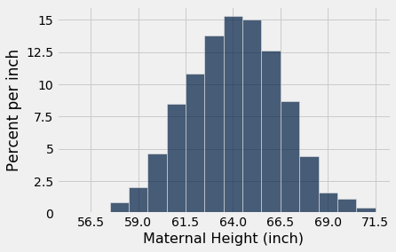
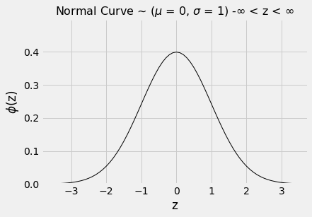
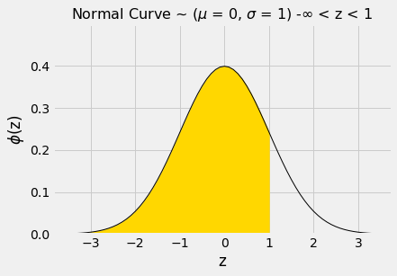
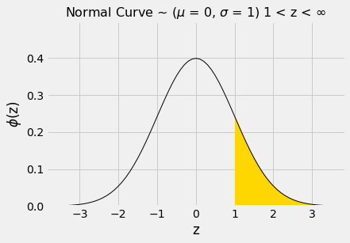
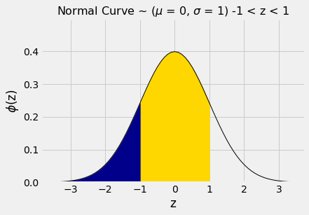
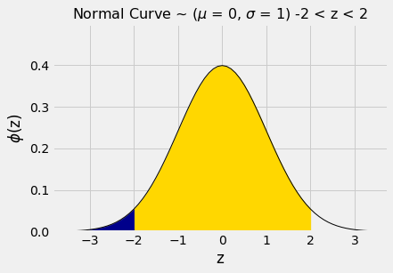

# 표준편차(SD)와 정규 곡선(normal curve)

평균(mean)이 히스토그램(histogram)의 균형점이라는 것은 알고 있다. 평균과 달리, 표준편차(SD)는 보통 히스토그램을 보는 것만으로는 쉽게 파악하기 어렵다. 

그러나 표준편차(SD)를 평균(mean)만큼이나 분명하게 파악할 수 있는 분포(distribution) 모양이 하나 있다. 바로 종 모양 분포이다. 이 절에서는 그 모양을 살펴본다. 이 모양은 확률 히스토그램(probability histogram)에서 자주 나타나며, 일부 데이터 히스토그램에서도 나타난다.

```python
from datascience import *
%matplotlib inline
path_data = '../../../assets/data/'
import matplotlib.pyplot as plots
plots.style.use('fivethirtyeight')
import math
import numpy as np
```

## 대략 종 모양인 데이터 히스토그램(histogram)
익숙한 표본(sample)인 산모-신생아 1,174쌍에서 산모 키의 분포(distribution)를 살펴보자. 산모 키의 평균(mean)은 64인치이고 표준편차(SD)는 2.5인치이다. 농구 선수들의 키와 달리, 산모의 키는 평균을 중심으로 꽤 대칭적인 종 모양 곡선으로 분포한다.

```python
baby = Table.read_table(path_data + 'baby.csv')
```

```python
heights = baby.column('Maternal Height')
mean_height = np.round(np.mean(heights), 1)
mean_height
```

```
64.0
```

```python
sd_height = np.round(np.std(heights), 1)
sd_height
```

```
2.5
```

```python
baby.hist('Maternal Height', bins=np.arange(55.5, 72.5, 1), unit='inch')
positions = np.arange(-3, 3.1, 1)*sd_height + mean_height
plots.xticks(positions);
```



위 셀의 마지막 두 줄의 코드는 가로축의 눈금 표시를 바꾼다. 이제 눈금은 $z = 0, \pm 1, \pm 2$, $\pm 3$에 대해 "평균(average) $\pm$ $z$ 표준편차(SD)"에 해당한다. 분포(distribution)의 모양 때문에 "중심"은 모호하지 않은 의미를 가지며 64에서 분명하게 보인다.

## 종 모양 곡선에서 표준편차(SD)를 찾는 방법

표준편차(SD)가 곡선과 어떤 관계가 있는지 보려면, 곡선의 꼭대기에서 시작하여 오른쪽을 바라보자. 곡선이 "뒤집힌 컵" 모양에서 "똑바로 놓인 컵" 모양으로 바뀌는 지점이 있다는 것을 알 수 있다. 정식으로 말하면, 곡선에 변곡점(point of inflection)이 있다. 그 점은 평균(average)보다 1 표준편차 위에 있다. 그것은 점 $z=1$이며, "평균 더하기 1 표준편차" = 66.5인치이다.

대칭적으로, 평균(mean)의 왼쪽에 있는 변곡점(point of inflection)은 $z=-1$, 즉 "평균 빼기 1 표준편차(SD)" = 61.5인치에 있다. 

일반적으로, **종 모양 분포(distribution)에서 표준편차(SD)는 평균(mean)과 양쪽 변곡점(point of inflection) 사이의 거리이다.**

## 표준 정규 곡선(standard normal curve)

지금까지 본 모든 종 모양 히스토그램(histogram)은 축의 눈금 표시를 제외하면 본질적으로 똑같아 보인다. 실제로, 축의 눈금만 적절히 바꾸면 이 모든 곡선을 그려 낼 수 있는 기본 곡선이 사실상 단 하나 있다. 

그 기본 곡선을 그리기 위해, 모든 목록을 변환할 수 있는 단위인 표준 단위(standard units)를 사용한다. 그렇게 얻은 곡선을 *표준 정규 곡선*(standard normal curve)이라고 한다.

표준 정규 곡선(standard normal curve)은 인상적인 방정식을 가지고 있다. 그러나 지금은 표준 단위(standard units)로 측정되었고 종 모양 분포(distribution)를 갖는 변수(variable)의 히스토그램(histogram)을 매끄럽게 그린 윤곽선으로 생각하는 것이 가장 좋다.

$$
\phi(z) = {\frac{1}{\sqrt{2 \pi}}} e^{-\frac{1}{2}z^2}, ~~ -\infty < z < \infty
$$

```python
# The standard normal curve

plot_normal_cdf()
```



새로운 히스토그램(histogram)을 살펴볼 때 늘 그렇듯이, 가로축을 보는 것으로 시작하자. 표준 정규 곡선(standard normal curve)의 가로축에서 값들은 표준 단위(standard units)이다. 

다음은 이 곡선의 몇 가지 성질이다. 일부는 관찰로 분명히 알 수 있고, 다른 일부는 이를 입증하는 데 상당한 수학이 필요하다.

- 곡선 아래의 전체 넓이는 1이다. 따라서 이 곡선을 밀도 척도(density scale)로 그린 히스토그램(histogram)으로 생각할 수 있다.

- 곡선은 0을 중심으로 대칭이다. 따라서 어떤 변수(variable)가 이 분포(distribution)를 가지면, 그 평균(mean)과 중앙값(median)은 모두 0이다.

- 곡선의 변곡점(point of inflection)은 -1과 +1에 있다. 

- 어떤 변수(variable)가 이 분포(distribution)를 가지면, 그 표준편차(SD)는 1이다. 정규 곡선(normal curve)은 히스토그램(histogram)에서 표준편차를 이렇게 분명하게 파악할 수 있는 극소수의 분포 중 하나이다.

이 곡선을 매끄럽게 만든 히스토그램(histogram)으로 생각하고 있으므로, 전체 데이터 양에 대한 비율(proportion)을 곡선 아래의 넓이로 나타내고자 한다. 

매끄러운 곡선 아래의 넓이는 흔히 미적분학에서 적분(integration)이라는 방법을 사용하여 구한다. 그러나 표준 정규 곡선(standard normal curve)은 미적분학의 통상적인 방법으로는 적분할 수 없다는 것이 수학적 사실이다. 

따라서 곡선 아래의 넓이는 근사해야 한다. 그래서 거의 모든 통계학 교과서에는 정규 곡선(normal curve) 아래 넓이의 표가 실려 있다. 또한 그래서 파이썬(Python)의 한 모듈을 포함한 모든 통계 시스템에는 그 넓이에 대한 훌륭한 근삿값을 제공하는 메서드가 들어 있다.

```python
from scipy import stats
```

## 표준 정규 "cdf"

정규 곡선(normal curve) 아래의 넓이를 구하는 기본 함수는 `stats.norm.cdf`이다. 이 함수는 수치 인수 하나를 받아 그 수의 왼쪽에 있는 곡선 아래의 넓이 전체를 반환한다. 정식으로는 이를 표준 정규 곡선의 "누적 분포 함수(cumulative distribution function)"라고 한다. 이 다소 길고 거추장스러운 이름을 줄여서 cdf라고 쓴다.

이 함수를 사용하여 표준 정규 곡선(standard normal curve) 아래에서 $z=1$의 왼쪽 넓이를 구해 보자.

```python
# Area under the standard normal curve, below 1

plot_normal_cdf(1)
```



음영 처리된 넓이의 수치 값은 `stats.norm.cdf`를 호출하여 구할 수 있다.

```python
stats.norm.cdf(1)
```

```
0.8413447460685429
```

약 84%이다. 이제 곡선의 대칭성과 곡선 아래의 전체 넓이가 1이라는 사실을 이용하여 다른 넓이들을 구할 수 있다. 

$z=1$의 오른쪽 넓이는 약 100% - 84% = 16%이다.

```python
# Area under the standard normal curve, above 1

plot_normal_cdf(lbound=1)
```



```python
1 - stats.norm.cdf(1)
```

```
0.15865525393145707
```

$z=-1$과 $z=1$ 사이의 넓이는 여러 가지 방법으로 계산할 수 있다.  아래 곡선에서 금색으로 표시된 넓이가 그것이다.

```python
# Area under the standard normal curve, between -1 and 1

plot_normal_cdf(1, lbound=-1)
```



예를 들어, 넓이를 "100% - 크기가 같은 두 꼬리"로 계산할 수 있으며, 이는 대략 100% - 2x16% = 68%가 된다.

또는 $z=1$과 $z=-1$ 사이의 넓이가 $z=1$의 왼쪽 넓이 전체에서 $z=-1$의 왼쪽 넓이 전체를 뺀 것과 같다는 점에 주목할 수도 있다.

```python
stats.norm.cdf(1) - stats.norm.cdf(-1)
```

```
0.6826894921370859
```

비슷한 계산으로, $-2$와 2 사이의 넓이가 약 95%임을 알 수 있다.

```python
# Area under the standard normal curve, between -2 and 2

plot_normal_cdf(2, lbound=-2)
```



```python
stats.norm.cdf(2) - stats.norm.cdf(-2)
```

```
0.9544997361036416
```

다시 말해, 히스토그램(histogram)이 대략 종 모양이면 "평균(average) $\pm$ 2 표준편차(SD)" 범위 안에 있는 데이터의 비율(proportion)은 약 95%이다. 

이는 체비쇼프(Chebychev)의 하한(lower bound)인 75%보다 상당히 크다. 체비쇼프 경계가 더 약한 이유는 그것이 모든 분포(distribution)에 대해 성립해야 하기 때문이다. 분포가 정규분포(normal distribution)라는 것을 안다면, 단지 경계가 아니라 비율(proportion)에 대한 좋은 근삿값을 얻을 수 있다.

아래 표는 모든 분포(distribution)에 대해 알고 있는 것과 정규분포(normal distribution)에 대해 알고 있는 것을 비교한다. $z=1$일 때 체비쇼프 경계(Chebychev's bound)는 맞기는 하지만 유익한 정보를 주지 못한다는 점에 주목하자.

| 범위 안의 백분율    | 모든 분포: 경계   | 정규분포: 근삿값 |
| :---------------    | :------------------------  | :--------------------------------- |
| 평균 $\pm$ 1 SD  | 적어도 0%                | 약 68%                          |
| 평균 $\pm$ 2 SD | 적어도 75%               | 약 95%                          |
| 평균 $\pm$ 3 SD | 적어도 88.888...%        | 약 99.73%                       |
