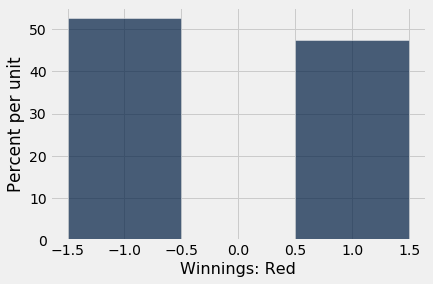
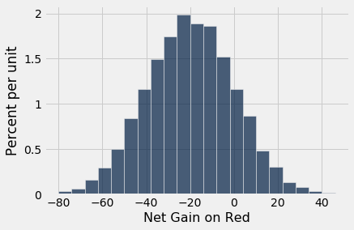
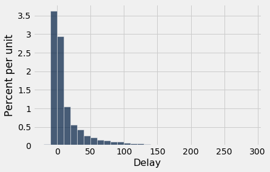
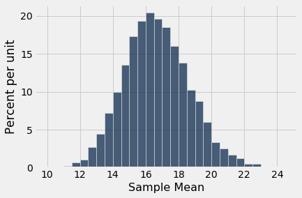
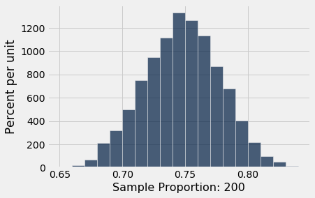
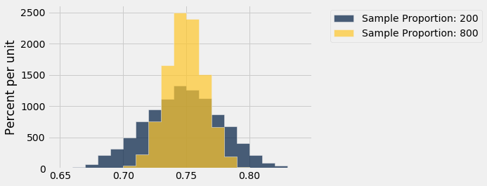

# 중심극한정리(Central Limit Theorem)
이 강좌에서 지금까지 본 데이터 히스토그램(histogram) 중 종 모양인 것은 거의 없었다. 종 모양 분포(distribution)를 만났을 때, 그것은 거의 예외 없이 무작위 표본(random sample)에 근거한 통계량(statistic)의 경험적 히스토그램(empirical histogram)이었다.

아래의 예들은 그러한 히스토그램(histogram)에서 대략적인 종 모양이 나타나는 매우 다른 두 가지 상황을 보여 준다.

```python
from datascience import *
%matplotlib inline
path_data = '../../../assets/data/'
import matplotlib.pyplot as plots
plots.style.use('fivethirtyeight')
import math
import numpy as np
from scipy import stats
```

```python
colors = Table.read_table(path_data + 'roulette_wheel.csv').column('Color')
pockets = make_array('0','00')
for i in np.arange(1, 37):
    pockets = np.append(pockets, str(i)) 

wheel = Table().with_columns(
    'Pocket', pockets,
    'Color', colors
)
```

## 룰렛(roulette)에서의 순이득
앞 절에서, 룰렛(roulette) 회전판의 여러 번의 회전에 같은 내기를 반복해서 걸었을 때 얻게 될 총금액의 대략적인 모양으로 종 모양이 나타났다.

```python
wheel
```

<table border="1" class="dataframe">
    <thead>
        <tr>
            <th>Pocket</th> <th>Color</th>
        </tr>
    </thead>
    <tbody>
        <tr>
            <td>0     </td> <td>green</td>
        </tr>
        <tr>
            <td>00    </td> <td>green</td>
        </tr>
        <tr>
            <td>1     </td> <td>red  </td>
        </tr>
        <tr>
            <td>2     </td> <td>black</td>
        </tr>
        <tr>
            <td>3     </td> <td>red  </td>
        </tr>
        <tr>
            <td>4     </td> <td>black</td>
        </tr>
        <tr>
            <td>5     </td> <td>red  </td>
        </tr>
        <tr>
            <td>6     </td> <td>black</td>
        </tr>
        <tr>
            <td>7     </td> <td>red  </td>
        </tr>
        <tr>
            <td>8     </td> <td>black</td>
        </tr>
    </tbody>
</table>
<p>... (28 rows omitted)</p>

빨간색에 거는 내기는 1 대 1의 같은 금액을 배당한다는 것을 떠올리자. 우리는 빨간색에 \$1를 한 번 걸었을 때의 순상금을 반환하는 함수 `red_winnings`를 정의했다. 구체적으로, 이 함수는 색을 인수로 받아 그 색이 빨간색이면 1을 반환한다. 다른 모든 색에 대해서는 -1을 반환한다.

```python
def red_winnings(color):
    if color == 'red':
        return 1
    else:
        return -1
```

표 `red`는 빨간색에 걸었을 때 각 칸의 상금을 보여 준다.

```python
red = wheel.with_column(
    'Winnings: Red', wheel.apply(red_winnings, 'Color')
    )
red
```

<table border="1" class="dataframe">
    <thead>
        <tr>
            <th>Pocket</th> <th>Color</th> <th>Winnings: Red</th>
        </tr>
    </thead>
    <tbody>
        <tr>
            <td>0     </td> <td>green</td> <td>-1           </td>
        </tr>
        <tr>
            <td>00    </td> <td>green</td> <td>-1           </td>
        </tr>
        <tr>
            <td>1     </td> <td>red  </td> <td>1            </td>
        </tr>
        <tr>
            <td>2     </td> <td>black</td> <td>-1           </td>
        </tr>
        <tr>
            <td>3     </td> <td>red  </td> <td>1            </td>
        </tr>
        <tr>
            <td>4     </td> <td>black</td> <td>-1           </td>
        </tr>
        <tr>
            <td>5     </td> <td>red  </td> <td>1            </td>
        </tr>
        <tr>
            <td>6     </td> <td>black</td> <td>-1           </td>
        </tr>
        <tr>
            <td>7     </td> <td>red  </td> <td>1            </td>
        </tr>
        <tr>
            <td>8     </td> <td>black</td> <td>-1           </td>
        </tr>
    </tbody>
</table>
<p>... (28 rows omitted)</p>

한 번의 내기에서 얻는 순이득은 `Winnings: Red` 열에서 무작위로 한 번 뽑은 값이다. \$1를 얻을 확률은 18/38이고, -\$1를 얻을 확률은 20/38이다. 이 확률 분포(probability distribution)가 아래 히스토그램(histogram)에 나타나 있다.

```python
red.select('Winnings: Red').hist(bins=np.arange(-1.5, 1.6, 1))
```



이제 빨간색에 여러 번 건다고 하자. 순상금은 위의 분포(distribution)에서 복원 무작위 추출(drawn at random with replacement)한 많은 값들의 합이 될 것이다.

순상금의 모든 가능한 값과 각각의 확률을 나열하려면 수학이 조금 필요하다. 그렇게 하지는 않을 것이다. 대신, 이 강좌 내내 해 왔던 것처럼 시뮬레이션(simulation)으로 확률 분포(probability distribution)를 근사할 것이다.

아래 코드는 룰렛(roulette) 회전판의 서로 다른 400번의 회전에서 빨간색에 \$1씩 걸었을 때의 순이득을 시뮬레이션(simulation)한다.

```python
num_bets = 400
repetitions = 10000

net_gain_red = make_array()

for i in np.arange(repetitions):
    spins = red.sample(num_bets)
    new_net_gain_red = spins.column('Winnings: Red').sum()
    net_gain_red = np.append(net_gain_red, new_net_gain_red)


results = Table().with_column(
    'Net Gain on Red', net_gain_red
    )
```

```python
results.hist(bins=np.arange(-80, 50, 6))
```



우리가 뽑고 있는 분포(distribution)는 종 모양과는 거리가 멀지만, 이것은 대략 종 모양인 히스토그램(histogram)이다.

**중심.** 이 분포(distribution)는 대략 -20달러 근처를 중심으로 한다. 그 이유를 알아보기 위해, 내기의 약 18/38에서는 상금이 \$1이고 나머지 20/38에서는 -$1라는 점에 주목하자. 따라서 1달러 내기당 평균(average) 상금은 대략 -5.26센트가 된다.

```python
average_per_bet = 1*(18/38) + (-1)*(20/38)
average_per_bet
```

```
-0.05263157894736842
```

따라서 400번의 내기에서 순이득은 약 -\$21로 기대된다.

```python
400 * average_per_bet
```

```
-21.052631578947366
```

확인을 위해, 시뮬레이션(simulation)한 10,000개의 순이득의 평균(mean)을 계산할 수 있다.

```python
np.mean(results.column(0))
```

```
-20.9586
```

**퍼짐.** 중심에서 시작하여 곡선을 따라 눈을 옮겨 보면 변곡점(point of inflection)이 0 근처에 있음을 알 수 있다. 종 모양 곡선에서 표준편차(SD)는 중심에서 변곡점까지의 거리이다. 중심은 대략 -\$20이므로, 이 분포(distribution)의 표준편차는 약 \$20이다.

다음 절에서는 이 \$20이 어디에서 나오는지 살펴볼 것이다. 지금은 시뮬레이션(simulation)한 10,000개의 순이득의 표준편차(SD)를 계산하여 우리의 관찰을 간단히 확인해 보자.

```python
np.std(results.column(0))
```

```
20.029115957525438
```

**요약.** 400번의 내기에서의 순이득은 각각의 내기에서 얻은 400개의 금액의 합이다. 그 합의 확률 분포(probability distribution)는 근사적으로 정규분포(normal distribution)를 따르며, 그 평균(average)과 표준편차(SD)는 근사적으로 구할 수 있다.

## 평균(average) 항공편 지연
표 `united`에는 2015년 여름 샌프란시스코(San Francisco) 공항에서 출발한 유나이티드 항공(United Airlines) 국내선 항공편 13,825편의 출발 지연에 관한 데이터가 들어 있다. 앞에서 보았듯이, 지연 시간의 분포(distribution)는 긴 오른쪽 꼬리를 가지고 있다.

```python
united = Table.read_table(path_data + 'united_summer2015.csv')
```

```python
united.select('Delay').hist(bins=np.arange(-20, 300, 10))
```



평균(mean) 지연 시간은 약 16.6분이었고 표준편차(SD)는 약 39.5분이었다. 평균에 비해 표준편차가 얼마나 큰지 주목하자. 오른쪽에 있는 큰 편차(deviation)들은 데이터에서 아주 작은 비율(proportion)을 차지하지만 영향을 미친다.

```python
mean_delay = np.mean(united.column('Delay'))
sd_delay = np.std(united.column('Delay'))

mean_delay, sd_delay
```

```
(16.658155515370705, 39.480199851609314)
```

이제 400개의 지연 시간을 복원 무작위 표본추출(sampled at random with replacement)한다고 하자. 원한다면 비복원 표본추출(sampling without replacement)을 해도 되지만, 결과는 복원 표본추출과 매우 비슷할 것이다. 13,825개 중에서 수백 개를 비복원으로 추출하면, 값을 하나 뽑을 때마다 모집단(population)이 거의 변하지 않는다.

표본(sample)에서 평균(average) 지연 시간은 얼마가 될 수 있을까? 모집단 평균이 16 또는 17 정도이므로 그 근처일 것으로 기대한다. 그러나 어느 정도 벗어날 가능성이 크다. 표본추출(sampling)을 해서 무엇이 나오는지 보자. 지연 시간 열만 들어 있는 표 `delay`를 사용할 것이다.

```python
delay = united.select('Delay')
```

```python
np.mean(delay.sample(400).column('Delay'))
```

```
15.59
```

표본 평균(sample average)은 표본(sample)이 어떻게 나오느냐에 따라 달라지므로, 표본추출(sampling) 과정을 반복해서 시뮬레이션(simulation)하고 표본 평균의 경험적 히스토그램(empirical histogram)을 그려 볼 것이다. 이것은 표본 평균의 확률 히스토그램(probability histogram)에 대한 근사가 된다.

```python
sample_size = 400
repetitions = 10000

means = make_array()

for i in np.arange(repetitions):
    sample = delay.sample(sample_size)
    new_mean = np.mean(sample.column('Delay'))
    means = np.append(means, new_mean)

results = Table().with_column(
    'Sample Mean', means
)
```

```python
results.hist(bins=np.arange(10, 25, 0.5))
```



매우 치우친(skewed) 분포(distribution)에서 뽑고 있음에도, 이번에도 대략적인 종 모양을 볼 수 있다. 예상대로 종 모양의 중심은 16과 17 사이 어딘가에 있다.

## 중심극한정리(Central Limit Theorem)

이러한 상황에서 종 모양이 나타나는 이유는 **중심극한정리**(Central Limit Theorem)라고 불리는 확률론(probability theory)의 놀라운 결과 때문이다.

**중심극한정리(Central Limit Theorem)에 따르면, 복원추출(drawn with replacement)한 큰 무작위 표본(random sample)의 합 또는 평균(average)의 확률 분포(probability distribution)는 *표본을 추출한 모집단(population)의 분포가 무엇이든 관계없이* 대략 정규분포(normal distribution)를 따른다.**

체비쇼프 부등식(Chebychev's bounds)을 공부할 때 언급했듯이, *모집단(population)의 분포(distribution)와 관계없이* 무작위 표본(random sample)에 적용할 수 있는 결과는 매우 강력하다. 데이터 과학에서는 모집단의 분포를 아는 경우가 드물기 때문이다.

중심극한정리(Central Limit Theorem)는 큰 무작위 표본(random sample)만 있다면 모집단(population)에 대해 아는 것이 거의 없어도 추론(inference)을 할 수 있게 해 준다. 그래서 이 정리는 통계적 추론(statistical inference) 분야의 중심에 있다.

## 보라색 꽃의 비율(proportion)
완두 식물의 한 종에서 꽃 색에 대한 멘델(Mendel)의 확률 모형(probability model)을 떠올려 보자. 이 모형에 따르면, 식물들의 꽃 색은 {보라, 보라, 보라, 흰색}에서 복원 무작위 추출(drawn at random with replacement)한 것과 같다.

식물의 큰 표본(sample)에서 대략 어느 정도의 비율(proportion)이 보라색 꽃을 가질까? 답은 모형(model)에서의 보라색 비율인 약 0.75일 것으로 기대한다. 그리고 비율은 평균(mean)이므로, 중심극한정리(Central Limit Theorem)에 따르면 보라색 식물의 표본 비율(sample proportion)의 분포(distribution)는 대략 정규분포(normal distribution)를 따른다.

시뮬레이션(simulation)으로 이를 확인할 수 있다. 200개의 식물로 이루어진 표본(sample)에서 보라색 꽃을 가진 식물의 비율(proportion)을 시뮬레이션해 보자.

```python
colors = make_array('Purple', 'Purple', 'Purple', 'White')

model = Table().with_column('Color', colors)

model
```

<table border="1" class="dataframe">
    <thead>
        <tr>
            <th>Color</th>
        </tr>
    </thead>
    <tbody>
        <tr>
            <td>Purple</td>
        </tr>
        <tr>
            <td>Purple</td>
        </tr>
        <tr>
            <td>Purple</td>
        </tr>
        <tr>
            <td>White </td>
        </tr>
    </tbody>
</table>

```python
props = make_array()

num_plants = 200
repetitions = 10000

for i in np.arange(repetitions):
    sample = model.sample(num_plants)
    new_prop = np.count_nonzero(sample.column('Color') == 'Purple')/num_plants
    props = np.append(props, new_prop)
    
results = Table().with_column('Sample Proportion: 200', props)
```

```python
results.hist(bins=np.arange(0.65, 0.85, 0.01))
```



중심극한정리(Central Limit Theorem)가 예측한 대로 다시 정규 곡선(normal curve)이 나타나며, 예상대로 약 0.75를 중심으로 한다.

표본 크기(sample size)를 늘리면 이 분포(distribution)는 어떻게 달라질까? 표본 크기 800으로 코드를 다시 실행하고, 시뮬레이션(simulation) 결과를 표본 크기 200에 근거한 시뮬레이션 결과를 모아 둔 것과 같은 표에 모아 보자. 두 열의 길이가 같도록 `repetitions` 횟수는 이전과 같게 유지할 것이다.

```python
props2 = make_array()

num_plants = 800

for i in np.arange(repetitions):
    sample = model.sample(num_plants)
    new_prop = np.count_nonzero(sample.column('Color') == 'Purple')/num_plants
    props2 = np.append(props2, new_prop)
    
results = results.with_column('Sample Proportion: 800', props2)
```

```python
results.hist(bins=np.arange(0.65, 0.85, 0.01))
```



두 분포(distribution) 모두 근사적으로 정규분포(normal distribution)를 따르지만, 하나가 다른 하나보다 더 좁다. 표본 크기(sample size) 800에 근거한 비율(proportion)들은 표본 크기 200에서 나온 비율들보다 0.75 주위에 더 촘촘하게 모여 있다. 표본 크기를 늘리자 표본 비율의 변동성(variability)이 줄어들었다.

이는 놀라운 일이 아니다.  우리는 표본 크기(sample size)가 클수록 대체로 통계량(statistic)의 변동성(variability)이 줄어든다는 직관에 여러 번 의지해 왔다.  그러나 표본 평균(sample average)의 경우에는 표본 크기와 변동성 사이의 관계를 *정량화*할 수 있다.

표본 크기(sample size)는 표본 평균(sample average)이나 표본 비율(sample proportion)의 변동성(variability)에 정확히 어떤 영향을 미칠까? 이것이 다음 절에서 살펴볼 질문이다.
