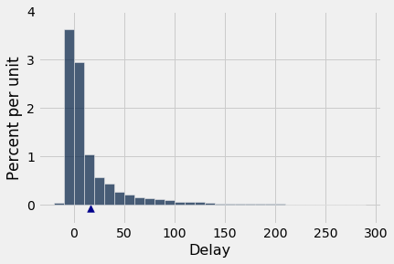
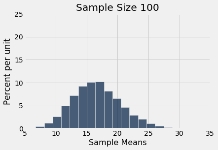
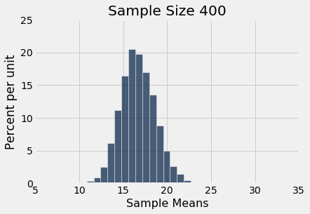
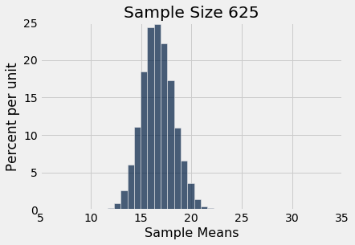
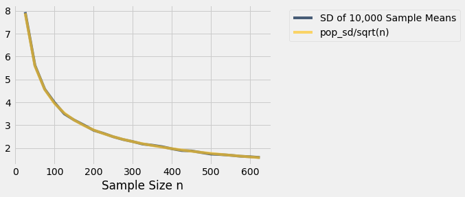

# 표본 평균(sample mean)의 변동성(variability)
중심극한정리(Central Limit Theorem)에 따르면, 큰 무작위 표본(random sample)의 평균(mean)의 확률 분포(probability distribution)는 대략 정규분포(normal distribution)를 따른다. 종 모양 곡선은 모평균(population mean)을 중심으로 한다. 어떤 표본 평균은 더 크고 어떤 표본 평균은 더 작지만, 여러 번 보았듯이 모평균으로부터의 편차(deviation)는 양쪽으로 대략 대칭이다. 정식으로, 확률론(probability theory)은 표본 평균이 모평균의 *비편향(unbiased)* 추정값(estimate)임을 보여 준다.

시뮬레이션(simulation)에서 우리는 또한 큰 표본(sample)의 평균(mean)이 작은 표본의 평균보다 모평균(population mean) 주위에 더 촘촘하게 모이는 경향이 있다는 것을 알아차렸다. 이 절에서는 표본 평균(sample mean)의 변동성(variability)을 정량화하고, 변동성과 표본 크기(sample size) 사이의 관계를 도출할 것이다.

```python
from datascience import *
import numpy as np
path_data = '../../../assets/data/'
%matplotlib inline
import matplotlib.pyplot as plots
plots.style.use('fivethirtyeight')
```

항공편 지연 표에서 시작하자. 평균(mean) 지연 시간은 약 16.7분이며, 지연 시간의 분포(distribution)는 오른쪽으로 치우쳐(skewed) 있다.

```python
united = Table.read_table(path_data + 'united_summer2015.csv')
delay = united.select('Delay')
```

```python
pop_mean = np.mean(delay.column('Delay'))
pop_mean
```

```
16.658155515370705
```

```python
delay.hist(bins=np.arange(-20, 300, 10))
plots.scatter(pop_mean, -0.0008, marker='^', color='darkblue', s=60)
plots.ylim(-0.004, 0.04);
```



이제 무작위 표본(random sample)을 추출하여 표본 평균(sample mean)의 확률 분포(probability distribution)를 살펴보자. 늘 그렇듯이, 시뮬레이션(simulation)을 사용하여 이 분포에 대한 경험적 근사를 얻을 것이다.

나중에 표본 크기(sample size)를 바꿀 것이므로, 이를 위해 함수 `simulate_sample_mean`을 정의한다. 인수는 표의 이름, 변수(variable)가 들어 있는 열의 레이블, 표본 크기, 그리고 시뮬레이션(simulation) 횟수이다.

```python
"""Empirical distribution of random sample means"""

def simulate_sample_mean(table, label, sample_size, repetitions):
    
    means = make_array()

    for i in range(repetitions):
        new_sample = table.sample(sample_size)
        new_sample_mean = np.mean(new_sample.column(label))
        means = np.append(means, new_sample_mean)

    sample_means = Table().with_column('Sample Means', means)
    
    # Display empirical histogram and print all relevant quantities
    sample_means.hist(bins=20)
    plots.xlabel('Sample Means')
    plots.title('Sample Size ' + str(sample_size))
    print("Sample size: ", sample_size)
    print("Population mean:", np.mean(table.column(label)))
    print("Average of sample means: ", np.mean(means))
    print("Population SD:", np.std(table.column(label)))
    print("SD of sample means:", np.std(means))
```

100개의 지연 시간으로 이루어진 무작위 표본(random sample)의 평균(mean)을 시뮬레이션(simulation)하고, 이어서 400개, 마지막으로 625개의 지연 시간에 대해서도 시뮬레이션해 보자. 각 과정을 10,000번씩 반복할 것이다. `xlim`과 `ylim` 줄은 비교하기 쉽도록 모든 그래프의 축을 일관되게 설정한다. 각 셀에서 이 두 줄의 코드는 무시해도 된다.

```python
simulate_sample_mean(delay, 'Delay', 100, 10000)
plots.xlim(5, 35)
plots.ylim(0, 0.25);
```

```
Sample size:  100
Population mean: 16.658155515370705
Average of sample means:  16.672836
Population SD: 39.480199851609314
SD of sample means: 3.92467202924066
```



```python
simulate_sample_mean(delay, 'Delay', 400, 10000)
plots.xlim(5, 35)
plots.ylim(0, 0.25);
```

```
Sample size:  400
Population mean: 16.658155515370705
Average of sample means:  16.678091499999997
Population SD: 39.480199851609314
SD of sample means: 1.9474592014668113
```



```python
simulate_sample_mean(delay, 'Delay', 625, 10000)
plots.xlim(5, 35)
plots.ylim(0, 0.25);
```

```
Sample size:  625
Population mean: 16.658155515370705
Average of sample means:  16.649224
Population SD: 39.480199851609314
SD of sample means: 1.5883338034053167
```



중심극한정리(Central Limit Theorem)가 작동하는 모습을 볼 수 있다. 지연 시간 자체의 히스토그램(histogram)은 정규분포(normal distribution)와 거리가 멀지만, 표본 평균(sample mean)의 히스토그램은 대략 정규분포 모양이다.

또한 표본 평균(sample mean)의 세 히스토그램(histogram) 각각이 모평균(population mean)에 매우 가까운 곳을 중심으로 한다는 것도 볼 수 있다. 각 경우에 "표본 평균들의 평균(average of sample means)"은 모평균인 16.66분에 매우 가깝다. 두 값 모두 각 히스토그램 위의 출력에 나와 있다. 예상대로, 표본 평균은 모평균의 비편향(unbiased) 추정값(estimate)이다.

## 모든 표본 평균(sample mean)의 표준편차(SD)

표본 크기(sample size)가 커짐에 따라 히스토그램(histogram)이 더 좁아지고, 따라서 더 높아진다는 것도 볼 수 있다. 이는 앞에서도 본 적이 있지만, 이제는 퍼짐(spread)의 척도에 더 주의를 기울여 보자.

모든 지연 시간으로 이루어진 모집단(population)의 표준편차(SD)는 약 40분이다.

```python
pop_sd = np.std(delay.column('Delay'))
pop_sd
```

```
39.480199851609314
```

위의 표본 평균(sample mean) 히스토그램(histogram)들에 나온 표준편차(SD)들을 살펴보자. 세 경우 모두 지연 시간 모집단(population)의 표준편차는 약 40분인데, 모든 표본(sample)이 같은 모집단에서 추출되었기 때문이다.

이제 표본 크기(sample size)가 100일 때 10,000개의 모든 표본 평균(sample mean)의 표준편차(SD)를 보자. 그 표준편차는 모집단(population) 표준편차의 약 10분의 1이다. 표본 크기가 400일 때, 모든 표본 평균의 표준편차는 모집단 표준편차의 약 20분의 1이다. 표본 크기가 625일 때, 표본 평균의 표준편차는 모집단 표준편차의 약 25분의 1이다.

표본 평균(sample mean)의 경험적 분포(empirical distribution)의 표준편차(SD)를 "모집단(population) 표준편차를 표본 크기(sample size)의 제곱근으로 나눈 값"과 비교해 보는 것이 좋을 것 같다.

다음은 수치 값들이다. 첫 번째 열의 각 표본 크기(sample size)에 대해, 그 크기의 무작위 표본(random sample) 10,000개를 추출하고 10,000개의 표본 평균(sample mean)을 계산했다. 두 번째 열에는 그 10,000개 표본 평균의 표준편차(SD)가 들어 있다. 세 번째 열에는 "모집단(population) 표준편차를 표본 크기의 제곱근으로 나눈 값"을 계산한 결과가 들어 있다.

이 셀은 규모가 큰 시뮬레이션(simulation)이므로 실행하는 데 시간이 좀 걸린다. 그러나 곧 기다린 보람이 있다는 것을 알게 될 것이다.

```python
repetitions = 10000
sample_sizes = np.arange(25, 626, 25)

sd_means = make_array()

for n in sample_sizes:
    means = make_array()
    for i in np.arange(repetitions):
        means = np.append(means, np.mean(delay.sample(n).column('Delay')))
    sd_means = np.append(sd_means, np.std(means))

sd_comparison = Table().with_columns(
    'Sample Size n', sample_sizes,
    'SD of 10,000 Sample Means', sd_means,
    'pop_sd/sqrt(n)', pop_sd/np.sqrt(sample_sizes)
)
```

```python
sd_comparison
```

<table border="1" class="dataframe">
    <thead>
        <tr>
            <th>Sample Size n</th> <th>SD of 10,000 Sample Means</th> <th>pop_sd/sqrt(n)</th>
        </tr>
    </thead>
    <tbody>
        <tr>
            <td>25           </td> <td>7.94482                  </td> <td>7.89604       </td>
        </tr>
        <tr>
            <td>50           </td> <td>5.6131                   </td> <td>5.58334       </td>
        </tr>
        <tr>
            <td>75           </td> <td>4.57417                  </td> <td>4.55878       </td>
        </tr>
        <tr>
            <td>100          </td> <td>3.98687                  </td> <td>3.94802       </td>
        </tr>
        <tr>
            <td>125          </td> <td>3.49769                  </td> <td>3.53122       </td>
        </tr>
        <tr>
            <td>150          </td> <td>3.22776                  </td> <td>3.22354       </td>
        </tr>
        <tr>
            <td>175          </td> <td>3.00675                  </td> <td>2.98442       </td>
        </tr>
        <tr>
            <td>200          </td> <td>2.77764                  </td> <td>2.79167       </td>
        </tr>
        <tr>
            <td>225          </td> <td>2.64268                  </td> <td>2.63201       </td>
        </tr>
        <tr>
            <td>250          </td> <td>2.49447                  </td> <td>2.49695       </td>
        </tr>
    </tbody>
</table>
<p>... (15 rows omitted)</p>

두 번째 열과 세 번째 열의 값은 매우 가깝다. 가로축을 표본 크기(sample size)로 하여 각 열을 그래프로 그리면, 두 그래프는 사실상 구별할 수 없다.

```python
sd_comparison.plot('Sample Size n')
```



그 그래프에는 실제로 두 개의 곡선이 있다. 그러나 서로 너무 가까워서 하나만 있는 것처럼 보인다.

우리가 보고 있는 것은 일반적인 결과의 한 사례이다. 위의 그래프는 각 표본 크기(sample size)마다 10,000번의 반복에 근거한 것임을 기억하자. 그러나 각 크기의 표본(sample)은 10,000개보다 훨씬 많다. 표본 평균(sample mean)의 확률 분포(probability distribution)는 고정된 크기의 *가능한 모든 표본*의 평균에 근거한다.

**표본 크기(sample size)를 고정하자.** 표본(sample)이 모집단(population)에서 복원 무작위 추출(drawn at random with replacement)된다면, 다음이 성립한다.

$$
{\mbox{SD of all possible sample means}} ~=~
\frac{\mbox{Population SD}}{\sqrt{\mbox{sample size}}}
$$

이것은 추출될 수 있는 가능한 모든 표본(sample)의 평균(average)들의 표준편차(standard deviation)이다. **이것은 표본 평균(sample mean)이 모평균(population mean)에서 대략 얼마나 벗어나 있는지를 측정한다.**

## 표본 평균(sample mean)에 대한 중심극한정리(Central Limit Theorem)
모집단(population)에서 큰 무작위 표본(random sample)을 복원추출(draw with replacement)하면, 모집단의 분포(distribution)와 관계없이 표본 평균(sample mean)의 확률 분포(probability distribution)는 대략 정규분포(normal distribution)를 따르며, 모평균(population mean)을 중심으로 하고, 그 표준편차(SD)는 모집단 표준편차를 표본 크기(sample size)의 제곱근으로 나눈 값과 같다.

## 표본 평균(sample mean)의 정확도(accuracy)
가능한 모든 표본 평균(sample mean)의 표준편차(SD)는 표본 평균이 얼마나 변할 수 있는지를 측정한다. 따라서 이것은 모평균(population mean)의 추정값(estimate)으로서 표본 평균이 갖는 정확도(accuracy)의 척도로 간주된다. 표준편차가 작을수록 추정이 더 정확하다.

이 공식은 다음을 보여 준다.
- 모집단 크기(population size)는 표본 평균(sample mean)의 정확도(accuracy)에 영향을 미치지 않는다. 모집단 크기는 공식의 어디에도 나타나지 않는다.
- 모집단(population) 표준편차(SD)는 상수이다. 즉, 모집단에서 추출한 모든 표본(sample)에 대해 같다. 표본 크기(sample size)는 바꿀 수 있다. 표본 크기가 분모에 나타나므로, 표본 크기가 커질수록 표본 평균(sample mean)의 변동성(variability)은 *감소*하고, 따라서 정확도(accuracy)는 높아진다.

## 제곱근 법칙(square root law)
표준편차(SD) 비교 표에서, 25개의 항공편 지연 시간으로 이루어진 무작위 표본(random sample)들의 평균(mean)의 표준편차는 약 8분임을 알 수 있다. 표본 크기(sample size)에 4를 곱하면 크기 100인 표본을 얻게 된다. 그 모든 표본의 평균의 표준편차는 약 4분이다. 이는 8분보다 작지만, 4분의 1로 작아진 것이 아니라 2분의 1로 작아졌을 뿐이다. 분모에 있는 표본 크기에 제곱근이 씌워져 있기 때문이다. 표본 크기는 4배가 되었지만, 표준편차는 $2 = \sqrt{4}$분의 1로 줄었다. 다시 말해, 정확도(accuracy)는 $2 = \sqrt{4}$배 높아졌다.

일반적으로, 표본 크기(sample size)에 어떤 배수를 곱하면 표본 평균(sample mean)의 정확도(accuracy)는 그 배수의 제곱근 배만큼 높아진다.

따라서 정확도(accuracy)를 10배 높이려면 표본 크기(sample size)를 100배로 늘려야 한다. 정확도는 공짜로 얻어지지 않는다!
