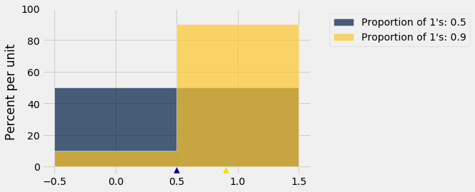
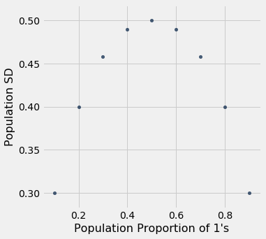

# 표본 크기(sample size) 정하기
후보 A가 선거에 출마했다. 한 여론조사 기관이 그녀에게 투표할 유권자의 비율(proportion)을 추정하려고 한다. 실제로는 표본추출(sampling) 방법이 더 복잡하겠지만, 이 기관이 유권자의 단순 무작위 표본(simple random sample)을 추출할 계획이라고 가정하자. 원하는 수준의 정확도(accuracy)를 얻으려면 표본(sample)이 얼마나 커야 하는지 어떻게 정할 수 있을까?

몇 가지 가정을 하고 나면, 이제 우리는 이 질문에 답할 수 있다.
- 유권자 모집단(population)은 매우 크므로, 무작위 표본(random sample)이 복원추출(drawn with replacement)된다고 가정해도 무방하다.
- 여론조사 기관은 후보 A에게 투표할 유권자의 백분율에 대한 근사적인 95% 신뢰구간(confidence interval)을 구성하여 추정값(estimate)을 낼 것이다.
- 원하는 정확도(accuracy) 수준은 구간의 폭이 1%를 넘지 않는 것이다. 꽤 정확한 수준이다! 예를 들어, 신뢰구간(confidence interval) (33.2%, 34%)는 괜찮지만 (33.2%, 35%)는 그렇지 않다.

후보 A에게 투표하는 유권자의 표본 비율(sample proportion)을 다룰 것이다. 모집단(population)의 값이 0(세지 않는 유형의 개체)이나 1(세는 유형의 개체)뿐일 때, 비율은 평균(mean)이라는 것을 기억하자.

```python
from datascience import *
import numpy as np
path_data = '../../../../data/'
%matplotlib inline
import matplotlib.pyplot as plots
plots.style.use('fivethirtyeight')
```

## 신뢰구간(confidence interval)의 폭
무작위 표본(random sample)이 있다면, 부트스트랩(bootstrap)을 사용하여 후보 A에게 투표하는 유권자의 백분율에 대한 신뢰구간(confidence interval)을 구성할 수 있을 것이다. 그러나 아직 표본은 없다. 우리는 신뢰구간이 원하는 만큼 좁아지려면 표본이 얼마나 커야 하는지 알아내려 하고 있다.

이런 상황에서는 이론이 무엇을 예측하는지 보는 것이 도움이 된다.

중심극한정리(Central Limit Theorem)에 따르면, 표본 비율(sample proportion)의 확률은 대략 정규분포(normal distribution)를 따르며, 모집단(population)에서 1의 비율을 중심으로 하고, 그 표준편차(SD)는 0과 1로 이루어진 모집단의 표준편차를 표본 크기(sample size)의 제곱근으로 나눈 값과 같다.

따라서 부트스트랩(bootstrap)으로 얻은 비율(proportion)들의 2.5번째 백분위수(percentile)와 97.5번째 백분위수로 양 끝을 골라낼 수는 없지만, 신뢰구간(confidence interval)은 여전히 정규분포(normal distribution)의 "가운데 95%"가 될 것이다.

구간의 폭이 얼마나 될지 알아내는 다른 방법이 있을까? 있다. 정규분포(normal distribution)를 따르는 변수(variable)의 경우, "중심 $\pm$ 2 표준편차(SD)" 구간에 데이터의 95%가 들어간다는 것을 알고 있기 때문이다.

신뢰구간(confidence interval)은 중심의 양쪽으로 표본 비율(sample proportion)의 표준편차(SD) 2개만큼씩 뻗어 있을 것이다. 따라서 구간의 폭은 표본 비율의 표준편차 4개만큼이 된다.

우리는 1% = 0.01의 폭까지 허용할 수 있다. 따라서 앞 절에서 도출한 공식을 사용하면 다음과 같다.

$$
4 \times \frac{\mbox{SD of the 0-1 population}}{\sqrt{\mbox{sample size}}}
~ \le ~ 0.01
$$

그러므로

$$
\sqrt{\mbox{sample size}} ~ \ge ~ 4 \times \frac{\mbox{SD of the 0-1 population}}{0.01}
$$

## 0과 1로 이루어진 모음의 표준편차(SD)
모집단(population)의 표준편차(SD)를 안다면 문제는 끝난다. 표본 크기(sample size)의 제곱근을 계산한 다음 제곱하여 표본 크기를 구하면 된다. 그러나 우리는 모집단의 표준편차를 모른다. 모집단은 후보 A에게 투표하는 유권자 각각에 대해 1, 다른 모든 유권자에 대해 0으로 이루어져 있는데, *각 유형이 어느 정도의 비율(proportion)로 있는지 모른다.* 그것이 바로 우리가 추정하려는 것이다.

그렇다면 막다른 길에 몰린 것일까? 그렇지 않다. 모집단(population)의 표준편차(SD)에 *경계*(bound)를 정할 수 있기 때문이다. 다음은 그러한 두 분포(distribution)의 히스토그램(histogram)이다. 하나는 1과 0의 비율(proportion)이 같은 분포이고, 다른 하나는 1이 90%, 0이 10%인 분포이다. 어느 쪽의 표준편차가 더 클까?

```python
pop_50 = make_array(1, 1, 1, 1, 1, 0, 0, 0, 0, 0)
pop_90 = make_array(1, 1, 1, 1, 1, 1, 1, 1, 1, 0)

coins = Table().with_columns(
   "Proportion of 1's: 0.5", pop_50,
   "Proportion of 1's: 0.9", pop_90,
)
coins.hist(bins=np.arange(-0.5, 1.6, 1))
plots.scatter(0.5, -0.02, marker='^', color='darkblue', s=60)
plots.scatter(0.9, -0.02, marker='^', color='gold', s=60)
plots.ylim(-0.05, 1);
```



모집단(population)에서 가능한 값은 0과 1뿐이라는 것을 기억하자.

1이 50%, 0이 50%인 파란색 히스토그램(histogram)은 금색 히스토그램보다 더 많이 퍼져 있다. 평균(mean)은 0.5이다. 평균으로부터의 편차(deviation) 중 절반은 0.5이고 나머지 절반은 -0.5이므로, 표준편차(SD)는 0.5이다.

금색 히스토그램(histogram)에서는 모든 넓이가 1 주위로 몰려 있어 퍼짐(spread)이 더 작다. 편차(deviation)의 90%는 0.1로 작다. 나머지 10%는 -0.9로 크지만, 전체적으로 퍼짐은 파란색 히스토그램보다 작다.

1의 비율(proportion)을 바꾸거나 0의 비율이 1의 비율보다 크도록 해도 같은 관찰이 성립할 것이다. 0과 1로만 이루어지고 그 비율이 다양한 10개 원소의 모집단(population)들의 표준편차(SD)를 계산하여 이를 확인해 보자. 이를 위해 함수 `np.ones`가 유용하다. 이 함수는 양의 정수를 인수로 받아 그 개수만큼의 1로 이루어진 배열을 반환한다.

```python
sd = make_array()
for i in np.arange(1, 10, 1):
    # Create an array of i 1's and (10-i) 0's
    population = np.append(np.ones(i), 1-np.ones(10-i))
    sd = np.append(sd, np.std(population))
    
zero_one_sds = Table().with_columns(
    "Population Proportion of 1's", np.arange(0.1, 1, 0.1),
    "Population SD", sd
)

zero_one_sds
```

<table border="1" class="dataframe">
    <thead>
        <tr>
            <th>Population Proportion of 1's</th> <th>Population SD</th>
        </tr>
    </thead>
    <tbody>
        <tr>
            <td>0.1                         </td> <td>0.3          </td>
        </tr>
        <tr>
            <td>0.2                         </td> <td>0.4          </td>
        </tr>
        <tr>
            <td>0.3                         </td> <td>0.458258     </td>
        </tr>
        <tr>
            <td>0.4                         </td> <td>0.489898     </td>
        </tr>
        <tr>
            <td>0.5                         </td> <td>0.5          </td>
        </tr>
        <tr>
            <td>0.6                         </td> <td>0.489898     </td>
        </tr>
        <tr>
            <td>0.7                         </td> <td>0.458258     </td>
        </tr>
        <tr>
            <td>0.8                         </td> <td>0.4          </td>
        </tr>
        <tr>
            <td>0.9                         </td> <td>0.3          </td>
        </tr>
    </tbody>
</table>

놀랍지 않게도, 1이 10%이고 0이 90%인 모집단(population)의 표준편차(SD)는 1이 90%이고 0이 10%인 모집단의 표준편차와 같다. 한 히스토그램(histogram)의 막대들을 서로 바꾸면 다른 히스토그램이 되기 때문이다. 퍼짐(spread)에는 변화가 없다.

우리의 목적에 더 중요한 것은, 1의 비율(proportion)이 0.5가 될 때까지는 1의 비율이 커짐에 따라 표준편차(SD)가 증가하고, 그 이후에는 대칭적으로 감소하기 시작한다는 점이다.

```python
zero_one_sds.scatter("Population Proportion of 1's")
```



**요약:** 1과 0으로 이루어진 모집단(population)의 표준편차(SD)는 최대 0.5이다. 이것은 모집단의 50%가 1로, 나머지 50%가 0으로 코딩되었을 때의 표준편차 값이다.

## 표본 크기(sample size)
다음을 알고 있다.

$$
\sqrt{\mbox{sample size}} ~ \ge ~ 4 \times \frac{\mbox{SD of the 0-1 population}}{0.01}
$$

또한 0-1 모집단(population)의 표준편차(SD)는 모집단에서 1의 비율(proportion)과 관계없이 최대 0.5라는 것도 알고 있다. 따라서 다음과 같이 잡는 것이 안전하다.

$$
\sqrt{\mbox{sample size}} ~ \ge ~ 4 \times \frac{0.5}{0.01} ~=~ 200
$$

따라서 표본 크기(sample size)는 적어도 $200^2 = 40,000$이어야 한다. 엄청나게 큰 표본(sample)이다! 그러나 모집단(population)이 어떤 모습이든 높은 신뢰도로 높은 정확도(accuracy)를 보장하고 싶다면 그만큼이 필요하다.
